# Samudrik Shastra - Illustrations & Diagram Catalog

This catalog maps all palm, mount, line, and foot diagrams extracted from the book.

---

## Page 82: Heart Line (हृदय रेखा) - 6 Hand Variations

### Individual Hand Figures:

  
  
  
  
  
  

---

## Page 85: Fate Line / Saturn Line (भाग्य रेखा) - 8 Hand Variations

### Individual Hand Figures:

  
  
  
  
  
  
  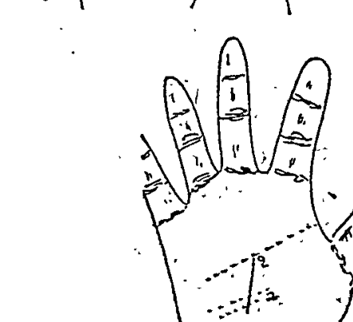
  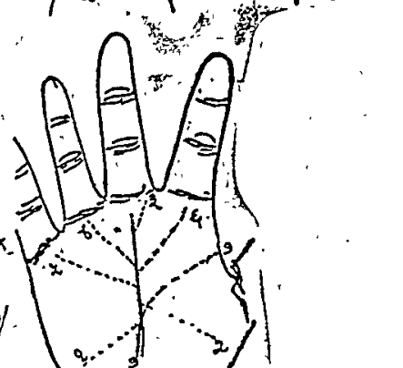

---

## Page 89: Head Line / Mental Line (मस्तक रेखा) - 12 Hand Variations

### Individual Hand Figures:

  
  
  
  
  
  
  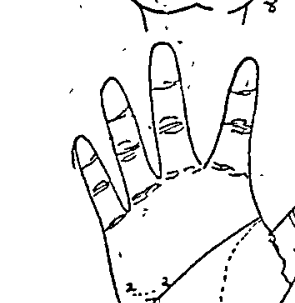
  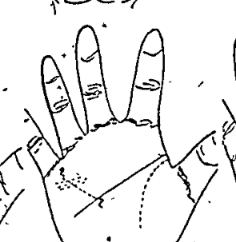
  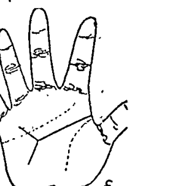
  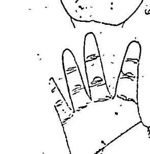
  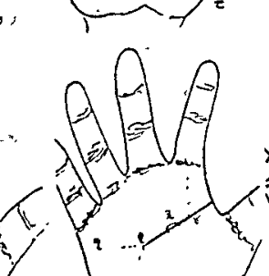
  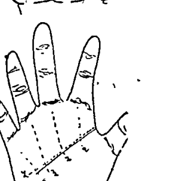

---

## Page 93: Life Line (जीवन रेखा) - 6 Hand Variations

### Individual Hand Figures:

  
  
  
  
  
  

---

## Page 97: Sun Line / Apollo Line (सूर्य रेखा) - 6 Hand Variations

### Individual Hand Figures:

  
  
  
  
  
  

---

## Page 108: Health / Mercury Line (स्वास्थ्य रेखा) - 5 Hand Variations

### Individual Hand Figures:

  
  
  
  
  

---

## Page 110: Marriage Line (विवाह रेखा) - 7 Hand Variations

### Individual Hand Figures:

  
  
  
  
  
  
  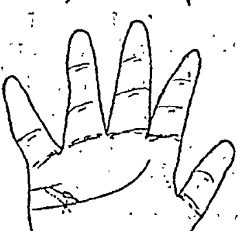

---

## Page 162: Foot Lines: Figure 2 (पैर की रेखायें चित्र २)

---

## Page 168: Foot Lines: Figure 3 (पैर की रेखायें चित्र ३)

---

## Page 171: Foot Lines: Figure 4 (पैर की रेखायें चित्र ४)

---

## Page 174: Foot Lines: Figure 5 (पैर की रेखायें चित्र ५)

---

## Page 180: Foot Lines: Figure 6 (पैर की रेखायें चित्र ६)

---

## Page 184: Foot Lines: Figure 7 - Chains & Islands

---

## Page 185: Foot Lines: Figure 8 - Straight Lines

---

## Page 189: Foot Lines: Figure 9 - Islands in Feet

---

## Page 193: Foot Lines: Figure 10 - Circles & Crosses

---

## Page 209: Hand Figure 1: Master Overview of Palm Lines (विभिन्न रेखाओं का सही स्थान)

---

## Page 210: Hand Figure 2: Line Trajectories across Mounts

---

## Page 211: Hand Figure 3: Intersecting Line Junctions

---

## Page 212: Hand Figure 4: Planetary Mount Emergence

---

## Page 213: Hand Figures 5 & 6: Triangles, Circles, Squares on Palm

---

## Page 214: Hand Figures 7 & 8: Junction of Life, Head and Heart Lines

---

## Page 215: Hand Figures 9 & 10: Serpent-Tongue Forked Lines

---

## Page 216: Hand Figures 11 & 12: Branching and Conjoined Lines

---

## Page 218: Hand Figures 15 & 16: Heart and Marriage Line Interactions

---

## Page 219: Hand Figure 17: Bracelet Lines (Manibandh / Rascettes)

---

## Page 220: Life Line Additional Variations (चित्र 317)

### Individual Hand Figures:

  
  
  
  
  
  

---

## Page 221: Head Line Additional Variations (चित्र 318)

### Individual Hand Figures:

  
  
  
  
  

---

## Page 223: Pustak Rekha / Special Lines (चित्र 320)

### Individual Hand Figures:

  
  
  
  
  
  
  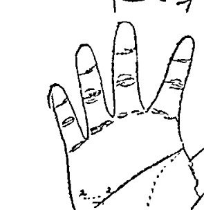
  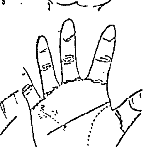
  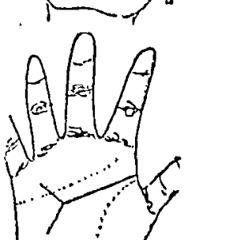
  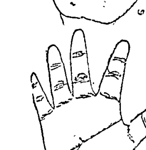
  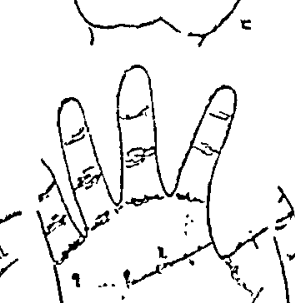
  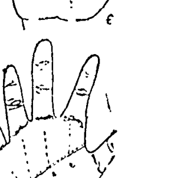

---

## Page 280: Sacred Palm Signs: Triangles, Crescents, Cones, Stars (चित्र ६)

---

