# Samudrik Shastra (The Science of Indian Palmistry & Physiognomy)
### English Translation

---

## Page 1

Samudrik Shastra
(The Science of Astrology and Physiognomy)

Author
Jyotishacharya Bhriguraj

Pustak Mandir
Mathura

---

## Page 2

Publisher:
Pustak Mandir,
Mathura.

All rights reserved.
Price:
₹4/-
Four Rupees

Printed by Darshanlal Sharma at the
Harihar Machine Press, Mathura,
owned by Pandit Purushottamdass Sharma.

---

## Page 3

In sacred memory of
Lakshmi Behin,

---

## Page 4

Editorial

In the field of astrology, India has always surpassed all the countries of the world. Today, although India is counted among the developing nations in other fields, it has nevertheless been leading all the countries of the world in astrology for hundreds of years. It is an undeniable truth that no other astrological knowledge in the world holds any significance compared to the astrological wisdom of India. Alongside this, it is our misfortune that this science is gradually declining within our own country. 

There are two primary reasons for this decline. The first reason is that there is no proper institution where comprehensive instruction in this subject is available. The rise of any science remains impossible until the government provides full resources for its dissemination and planning. Since it holds no importance in the country's curriculum, individuals are deprived of the means to attain its knowledge. Consequently, their understanding remains incomplete, and due to such half-baked learning, their knowledge loses all practical significance. State apathy, which has persisted for centuries toward this specific science, has become the principal cause of its downfall.

The second reason is the general public's indifference toward this science. The masses regard this discipline merely as the domain of horoscope makers and mendicants who beg for oil on Saturdays. It is also true that individuals from these two classes have inflicted considerable harm upon the public through their distorted practices. As a result, people no longer retain any faith in this science, perceiving it merely as...

---

## Page 5

Editorial

In the field of astrology, India has always surpassed all the nations of the world. Today, although India is counted among the developing countries of the world in other domains, it has consistently led all nations in astrological wisdom for centuries. It is an undeniable truth that the astrological knowledge of all other countries in the world holds no comparison before the astrological knowledge of India. Concurrently, it is our misfortune that this science is gradually declining in our country.

There are two fundamental reasons for this decline. The first reason is that there is no institution in the country where proper arrangements exist for its formal instruction. The upliftment of any science remains impossible until the state provides adequate resources for its propagation and research. Since it holds no significance in the nation's educational curriculum, even enthusiastic seekers are deprived of the means to acquire this knowledge. Their understanding remains incomplete, and lacking a systematic structure, their knowledge loses all significance. The governmental neglect that has persisted toward this specific science for centuries has become the primary cause of its downfall.

The second reason is the public's indifference toward this discipline. The general populace perceives it merely as the craft of astrologers who cast birth charts and the mendicants who beg for oil on Saturdays. It is also true that these two classes of people, through their limited and superficial knowledge, have often caused harm to the public. Consequently, people no longer retain any faith in it, reducing their perception of it merely to—

---

## Page 6

(6)

People respect it as an ancient science and are constantly in search of an opportunity to meet a genuine expert in this discipline. Calculating the past and future to deliver astrological predictions holds a special significance. However, illiterate practitioners who have become the torchbearers of this science and made it a mere means of livelihood are perpetually unable to present such an example before the public through which they could earn general reverence for themselves and respect for this science.

Today, India is advancing on the path of progress. Therefore, it has become our collective duty to bring about appropriate reforms in this field as well. Reform in this sphere is possible only when this science is propagated in the proper manner. Thus, upon assuming the responsibility of its dissemination, it becomes our duty to discard the flawed traditions of this science and present it before the public backed by sound logic.

Astrology is an extremely profound subject. Its scope is vast, and it is impossible to cram an ocean into a pot. Therefore, its various branches can be uplifted only by separating them into distinct domains. In the present book, we have analyzed the science of lines (palmistry and physiognomy).

There are three primary parts of the human body where lines are abundantly found, and their evaluation has been practiced since immemorial times. The human hand, foot, and head fall into this category. These three organs hold special significance in the human body and are also referred to as the governing organs of the physique.

---

## Page 7

( 7 )

It is a hard truth that change is inevitable in every sphere of life. Consequently, these changes invariably leave their impression on a human being's brain, hands, and feet. Ancient explorers established the fact that the lines on our limbs also increase, decrease, or modify in accordance with the changes in a person's life. Based on this very principle, our astrological sages laid the foundation of this science, which has continued to this day.

Just as the pioneers of medical science tested various medicines upon themselves to describe their merits and demerits, the explorers of this science likewise conducted exhaustive research through practical observation of the shifting patterns of the lines. The unanimous consensus is that a person's actions and life transformations undeniably impact the lines. Adepts in this science have, on numerous occasions, accurately revealed a person's past and future solely by examining these lines, leaving the world astonished.

This science came into existence alongside the birth of human society. Historical facts clearly substantiate that Indian civilization is immensely ancient. Alongside India's other branches of knowledge and science, this discipline also continued to flourish. Indian sages and ascetics, who renounced the world to spend their lives in forests, dedicated themselves deeply to these investigations. They contemplated the movements of the planets in the solar system, alongside the lines on the human palm and forehead. The essence gathered from their experiences and experiments exists today in the form of the science of Jyotish.

---

## Page 8

( 5 )

The Sun, Earth, Moon, and other celestial bodies are in constant motion. Our ancestors proved this fact thousands of years ago. It is also an established truth that every particle of nature is dynamic. Predictions for every entity unfold in accordance with this evolution. The foundation of the science of astrology, resting upon this fundamental principle, remains steadfast even today. Astrology holds its own distinct significance, and in alignment with it, the knowledge of palmistry also occupies a specialized domain.

In the present book, an earnest endeavor has been made to shed comprehensive light on every facet of palmistry. Wherever excerpts in English have been cited, they reflect foreign perspectives.

Admirers of Western civilization tend to give greater credence to Western doctrines than to authoritative Indian scriptures. The truth is that Western nations possess virtually nothing of their own in the domain of this science. Whatever they do hold is merely a distorted echo of Indian astrological science. As we have already stated, India alone holds the distinction of having systematically structured this knowledge. It originated here, and having taken birth on this great subcontinent, it spread to other foreign lands.

When Indian civilization was at the pinnacle of its prosperity, most other countries of the world were still uncivilized. If any other nations of the world can be considered contemporary from the perspective of civilization, they are China, Greece, and Egypt. European countries such as Britain, Germany, and Russia have not experienced development for more than five hundred years.

The science of astrology was prevalent in Greece approximately five thousand years ago. Renowned Greek astrologers such as Pauligan, Yalan...

---

## Page 9

6)

Even today, they are viewed with a sense of respect. It is said that when Alexander the Great set out from his kingdom for world conquest, an astrologer accompanied him, who would advise him on the auspicious timing for attacks, the deployment of the army, and even the direction to advance along the route. Be that as it may, it is a hard truth that the science of astrology existed in Greece and that it had spread there from India itself.

The inhabitants of the great continent of China have held a firm belief in the science of astrology since ancient times. Even today, this science enjoys widespread popularity in their country, and its people have great faith in it. Historians opine that this science has been prevalent there since approximately 2500 to 3000 years before Christ.

In other parts of Europe, astrology was propagated by the Gypsies. The Gypsies are akin to the nomadic banjaras of India. They do not prefer to stay in one place. Loading their entire household on carts drawn by horses and other cattle, they constantly wander from place to place. Manufacturing and selling items such as knives and scissors is their primary occupation, while their womenfolk adorn themselves and go among the public to sell knives and razors. They also sing songs, beg for alms, and earn their livelihood by reading the lines of people's hands. It was the Gypsies who propagated this science in other European countries.

The country whose attention was first drawn to this science of palmistry pursued by the Gypsies was Germany. Germany embraced this science and was the first in Europe to publish books on the subject. For many past years, the German people have been engaged in astrology.

---

## Page 10

( 10 )

People have continued to place their faith in the shastras. During the last World War, it was widely known that Hitler kept an astrologer by his side who advised him on opening new fronts and consulted on the selection of gems. It is also the belief of many that Germany achieved its unexpected victories in the war based on astrology.

Gradually, this science spread to other European countries as well, gaining popularity in nations like France and Russia. In England, this science was disrespected for several centuries; laws were enacted against it, and it was viewed with great contempt. However, ever since Britain came into contact with India, they understood its significance and accepted it as a complete body of knowledge. In modern times, the works of authors such as Craig and Cheiro hold great prominence in the English-speaking world and are considered authoritative.

It is certainly true that compared to other sciences, the science of astrology has had to endure severe hardships, yet it remains alive today and is progressing daily on the path of advancement. Therefore, it is undeniable that this science possesses truth, and it is upon that very truth that it survives. We all know that within the realm of nature, only that knowledge or entity which contains truth can endure permanently. Untruth has no place in nature. Just as gold remains when subjected to fire while the impurities are burned away, so too, having been tempered in the fire of nature, only the truth endures, leaving not even a trace of the false.

Whether one calls it a weakness of the human heart or an inherent curiosity, every

---

## Page 11

( 11 )

Humanity has always sought to know its future. Astrology is the sole science through which future events can be discerned. Even today, we observe that our revered sages and astrologers of yore have left behind written records of the future spanning thousands of years. The almanac (*Panchang*), which we consult daily, stands as a living testament to this truth. It is by the grace of Jyotish that our astrologers, through precise planetary calculations made ages in advance, can accurately determine the exact dates and times of solar and lunar eclipses down to the very hour and moment.

The advancement of knowledge is possible only when a discipline is presented in such a manner that the general public may derive its rightful benefit. Keeping this precise objective in mind, the publication of this book has been arranged. Most other treatises on this subject are overly abstruse and profound, rendering them inaccessible to the common person.

It is hoped that this book will fulfill this long-standing void in the realm of this sacred science. With its aid, even an ordinary individual will be empowered to understand the tapestry of their life through the study of their palm lines. It is indeed necessary to exercise great patience in acquiring proficiency in this science, for the formation, alteration, and subtle shifting of lines require a considerable span of time. Therefore, I urge my readers to gain knowledge of the lines through this book, to closely monitor their development and diminution, and to venture predictions only after mature deliberation and complete comprehension.

Every living being is eager to know the future. As the proverb goes...

---

## Page 12

( 12 )

It is also said that "Prevention is better than cure," meaning that prevention is more important than treatment. Along with this, I would request you that rather than receiving an incorrect prediction, it is far more beneficial not to know it at all. Therefore, I urge you to read this book with due attention and, before reaching a conclusion on any matter, to certainly take into account all the essential points. If you show even the slightest haste and fail to pay attention to the necessary details, your knowledge will remain incomplete, and consequently, you will also experience distress.

It is hoped that the learned reader will never act with haste in acquiring the knowledge of this science.

Editor

---

## Page 13

❀ Table of Contents ❀

Part One

Chapter - 1
Fundamental Principles
Page 17

,, 2
Examination of the Hand
,, 22

,, 3
The Palm
,, 35

,, 4
Introduction to Palmistry
,, 43

,, 5
Fingers of the Hand
,, 51

,, 6
Nails
,, 67

,, 7
Knowledge of Planetary Mounts
,, 73

,, 8
Knowledge of Signs and Marks
,, 83

Part Two

Chapter - 1
Study of Lines
Page 112

,, 2
Life Line
,, 116

,, 3
Health Line
,, 134

,, 4
Heart Line
,, 140

,, 5
Head Line
,, 151

,, 6
Fate Line
,, 162

,, 7
Sun Line
,, 162

,, 8
Marriage Line
,, 205

---

## Page 14

(14)

"6. Children Line" 213
"10. Bracelet Lines (Manibandha)" 217
"11. Miscellaneous Lines" 220
"12. Significance of the Lines" 223

Part Three
Chapter 1: Physical Characteristics, Page 152
"2. Right Foot" 256
"3. Right Foot" 271

---

## Page 15

Part First

---

## Page 16

( 56 )

If all the fingers are bent forward, that man possesses a fickle heart; his mind does not remain steadfast in any endeavor. If the base is straight, but the middle portion is inclined towards the palm, he is fickle in nature and stubborn. Whatever comes to his mind, he is unable to remain firm upon it, and if something contrary to his thoughts is said to him, he becomes obstinate. Remaining steadfast in his obstinacy and getting his own way brings him special gratification. The bearer of fingers that bend forward may be described as:

Fickle-hearted and stubborn.
Slow-witted and lacking in intellect.
Destitute of courage, turning away from formidable tasks.
Fond of solitude and ever desiring to remain silent.
Entangled within his own thoughts.

However, before arriving at any conclusion, it is necessary to know a few more things. To reach a specific characteristic merely by observing the bending of the fingers is not wise.

If all the fingers bend backward, it is a sign of being cunning and profound. The person whose fingers have a backward inclination is implied to be cunning. The fingers may be straight and uniform at the base, while tapering towards the tip and bending backward at the upper end. By observing them, the following astrological results may be declared:

He may prove to be cunning and a profound thinker.

---

## Page 17

( 61 )

His heart is vast and tender. He constantly strives to extract the essence of every matter.

He is gentle in disposition and respectful towards others. He is humble, thoughtful, and charitable.

If he is a writer, he will write specifically on literary subjects.

If he is a painter, he will be an expert in sculpting or painting the image of his chosen deity (Ishta-deva).

3. Thin yet curved—often, there are fingers that appear slender from the base up to the upper phalanges, yet they distinctly possess a curvature. It is possible that their inclination is either forward or backward. Those whose fingers are curved forward—such a person is:

1. A manual laborer, one who earns through hard work to sustain himself and his family. He possesses the capability to support his livelihood by enduring the most arduous toil.

2. Humble, but lacking in deep contemplation. His capacity for deliberation is limited. He cannot ponder deeply upon any subject. He hastily arrives at a conclusion and begins acting upon it.

3. He is sensible, yet his sense is only limited to the extent that if a matter of counsel is explained to him, he grasps it promptly.

4. He is prone to chasing mirages. He is perpetually caught up in the pursuit of worldly wealth (the trap of ninety-nine). He remains constantly preoccupied with the anxiety of...

---

## Page 18

( 60 )

If advised gently, he can be easily persuaded. He is clever as well as self-reliant, carving out his own path. He tends to wander in search of something better, abandoning what he already possesses. He bears the absolute traits of chasing a mirage.

If all the fingers are inclined towards one side—that is, if all the fingers lean towards the little finger (Kanishtha)—it is evident that they absorb and reflect the qualities of that side. The consequence of the fingers leaning towards the little finger is that the individual may be:
Cruel by nature and ill-behaved.
Arrogant, possessing a stubborn trait of clinging rigidly to his own stance.
Physically weak yet prone to excessive anger. He misjudges his own physical strength, considers himself the mightiest of all, and remains perpetually ready to fight to the death with anyone.

If all the fingers are inclined towards the index finger (Tarjani), the person is thoughtful and polite. His heart is magnanimous and tender. He contemplates every matter thoroughly, reflects upon it deeply, and acts accordingly. He is gentle by nature and virtuous. A person all of whose fingers lean towards the index finger is:
Reflective and virtuous.

---

## Page 19

(61)

His heart is expansive and tender. He strives to extract the essence of every matter.

He is gentle in temperament and respectful towards others. He is modest, thoughtful, and charitable.

If he is a writer, he will write specifically on literary subjects.

If he is a painter, he will be an expert in sculpting or painting the image of his chosen deity (Ishta-deva).

3. Thin yet curved fingers: Frequently, certain fingers appear slender from the base all the way up to the upper phalanges, yet they distinctly possess a curved contour. It is possible that they lean either forward or backward. A person whose fingers are curved forward is:

1. A manual laborer, one who earns his livelihood through hard work to support himself and his family. He possesses the capacity to sustain himself even through the most arduous physical exertion.

2. Gentle, but lacking in depth of thought. His faculty for contemplation is limited. He is incapable of pondering any subject with complete seriousness. He arrives at a decision hastily and immediately begins to act upon it.

3. Sensible, though his understanding is of a specific kind—limited to grasping advice quickly when someone offers counsel.

4. One who wanders in the mirage of illusions (Mriga-trishna). He is perpetually caught up in the obsession of worldly accumulation (the pursuit of endless wealth), constantly consumed by the anxiety of...

---

## Page 20

(62)
Driven by the intense craving to attain the fruits of his desired wishes, he wanders restlessly hither and thither.

It would not be an exaggeration to state that the individual whose fingers bend forward belongs to the middle class, and he is ever inspired to act in accordance with his own thoughts.

Those individuals whose fingers bend backward possess a temperament that corresponds to the movement of their fingers. By observing backward-bent fingers, one can easily ascertain the following:

1. Such a person is dull-witted. He possesses a low capacity for reasoning and is utterly foolish. The power of reflection is almost entirely absent in him; he is entirely incapable of thinking before undertaking any task, and whatever contemplation he manages to do occurs only after the deed has been done.

2. He is devoid of courage. His spirit fails him even before he initiates any endeavor. His fortitude is weak, the dam of his inner strength breaks, and losing heart prior to action, he withdraws his hand from the enterprise.

3. He is timid and cowardly. He lacks even an iota of faith in his own abilities; therefore, he prefers to remain silent. Through silence, he seeks to conceal the depletion of his own vigor.

4. Being devoid of the courage to act, he merely lies about and indulges in idle contemplation. His capacity for labor forsakes him, yet he endlessly builds castles in the air.

---

## Page 21

(63)

The inclination of these fingers provides significant assistance in revealing a person's temperament and future.

4. Thick at the base yet tapering at the tips — Fingers of this type produce various effects. While the base is thick, the tip is narrow. Regarding individuals with this kind of fingers, the following attributes may be ascertained:

1. Such a person is highly promising and dedicated to some clever scholarly or technical pursuit. They possess a good command over a particular skill. They are engaged in painting or some other artistic endeavor.

2. Along with being cunning, deceitful, or a pickpocket, they may also be prone to violence or even commit murder.

3. They think very little of themselves. Even if their task is extremely arduous and difficult, they will undertake it solely out of greed for wealth.

5. Completely straight yet thick fingers — These fingers are entirely straight and thick. Their bases are thick, and their tips are equally thick. From beginning to end, they appear heavy and robust.

An individual with this type of fingers is impoverished.

The tips of the fingers are of four types: first, flat; second, round; third, square; and fourth, pointed.

Phalanges of the Fingers

Astrologers state regarding the phalanges that the thumb has two phalanges, while the other fingers possess three phalanges. These phalanges

---

## Page 22

( 64 )

Vertical lines rising above indicate auspicious results. If gaps are visible when the fingers are brought together, it indicates poverty. 

The fingers of fortunate and intelligent men remain continuously joined, while those of long-lived men have fingers that are straight and long. 

Destitute individuals have thick fingers, those associated with weaponry have fingers that curve outward, and servants have short and flat fingers. 

If an extra finger emerges from the thumb—meaning a sixth finger alongside the standard five—such a person lacks wealth and food grains, and possesses a short lifespan. 

Fingers are of two types: smooth and knotted. A person with knotted fingers is intelligent, clever, far-sighted, prudent, and keeps a detailed account of whatever enterprise they undertake. They remain dedicated and focused on social endeavors. 

Those with smooth fingers are whimsical and act on impulse. Individuals with such fingers leave tasks unfinished in the middle; they rush into undertakings without forethought and abandon them due to a lack of self-confidence. 

1. The first finger [Index / Tarjani] is ruled by Jupiter.
2. The second finger [Middle / Madhyama] is ruled by Saturn.
3. The third finger [Ring / Anamika] is ruled by the Sun.
4. The fourth finger [Little / Kanishtika] is ruled by Mercury.

If the first finger, namely the index finger, is long, it endows the individual with administrative power, a desire for sensual pleasures, and the attainment of a high position.

---

## Page 23

( 65 )

fosters a desire for authority. When it is equal to two units near the middle finger (index), it indicates cruelty, turbulence, self-praise, and an excessive desire for power. If this finger is short, the individual possesses a calm disposition and is afraid of responsibilities. If it is crooked, the person is unfit for governance, lacking in purpose, and enjoys little prestige.

If it leans toward the finger of Saturn, the person is arrogant. If that finger is thin, flat, and pointed, the person is dull-witted.

If the second finger, namely the middle finger (Saturn), is long, it grants a love for solitude, strong study habits, and an interest in occult sciences. If it is overly long, the person has a gloomy disposition, a weak willpower, and relies entirely on fate. If it is short or pointed, the nature is superficial and thoughtless. If it is crooked, it generates base thoughts and chronic illness.

If the first phalanx is long, the person soon desires death. If the second phalanx is long, there is an affection for occult sciences such as astrology, Vedanta, and mesmerism. If the third phalanx is long, the person is popular and frugal.

If the third finger, the ring finger (Apollo), is long, the individual possesses a desire for fame, along with an interest in arts, craftsmanship, literature, and similar fields. If it is overly long, there is business acumen, a propensity for gambling, and a strong greed for wealth.

If it is short, it generates indifference and a lack of interest in arts and craftsmanship; if crooked, it brings infamy.

If its length is equal to the middle finger and the second phalanx is somewhat

---

## Page 24

( 66 )

If the hand is well-fleshed and the Mount of Mars is prominent, the individual possesses strong logical reasoning, an interest in gambling, and an affinity for lotteries and other games of chance. If, along with the aforementioned signs, the Mount of Mercury is elevated, the person engages in speculative business.

If the fourth finger, the little finger (Kanistha), is long, it confers the power of intellect, the ability to accumulate wealth, and the aptitude for acquiring languages. If excessively long, it bestows cunning, cleverness, and a sharp intellect. If short, it produces traits such as dull-mindedness, failure in endeavors, and difficulty in grasping matters easily. If crooked, it leads to habits of silence, easily falling under the influence of others, and weakness of thought. There is a lack of noble virtues and moral knowledge, alongside a tendency for profitable opportunities to slip away from one's grasp. The individual fails to pay attention to those who would offer assistance. If the tip of the finger is square, the person makes an excellent teacher.

The fingers should be proportional in length to the palm. When this is the case, the individual is endowed with exceptional intellect and mental power, which is a sign of good fortune. If the fingers are overly long, the person is often tormented by the agony of separation (viraha), absorbed in their own contemplations, and generally suspicious or imaginative. Such a person does not find rest until they have deeply investigated every matter spiritually and intellectually. They tend to be sluggish in speech and action, and slow to make decisions.

A person with short fingers is clever, narrow-minded, quick to dive into action, and eager for rapid gains. Their writing style is concise, profound, and captures the essence of matters.

---

## Page 25

( 67 )
is present. It can be easily developed. A hand with long, thick fingers is firm and decisive. He grasps the essence of a matter briefly and cares little for outward appearances. If the fingers are short yet firm, they indicate cruelty.

Chapter Six
Nails
In Samudrik Shastra, the nails hold an importance equal to, if not greater than, that of the fingers. In truth, through the nails, one can easily comprehend the mental faculties and psychological processes of an individual. Inherited weaknesses and mental afflictions present from birth can also be discerned through the nails. It is frequently observed that these very weaknesses later manifest as severe diseases, ultimately taking the life of the individual.

Figure No. 3

---

## Page 26

( 68 )

The formation of the nails reveals a person's past circumstances as well as their state of health. To understand all these details, special attention must be paid to the nails.

Nails are of four types: long, narrow, small, and wide.

Those with long nails have a weak chest and lungs, especially when lines are present on the nails. Even in the absence of any disease, the body remains weak and delicate.

Those with narrow nails have a weak spine, which is curved and very thin. This indicates a curvature of the spine and bodily fragility, and is a sign of cowardice.

Small nails indicate a weakness of the heart, particularly when the half-moons (lunulae) on the nails are very small and barely visible.

If the half-moons are large in size, the heartbeat is rapid and the circulation of blood is swift.

If wide nails curve upward or flare outward, there is a fear of paralysis, especially when they resemble the shape of a seashell.

If white-colored nails are shaped like an areca nut, anger does not arise instantly, but once aroused, it is not easily forgotten. If a woman's nails are white, she will be arrogant and stubborn.

Those with wide nails greatly enjoy mockery, sarcasm, harsh speech, and teasing. Individuals of this nature

---

## Page 27

(66)

Anger persists for a long time and does not subside easily. Those with short and wide nails are exceptionally skilled at debating. If the nails are excessively short and wide, they indicate asthma, cold-related ailments, and other throat diseases.

If the nails are very flat and sunken, they are indicative of nervous disorders. A man whose nails resemble bran (long and short) is impotent, while those with flat or split nails lack wealth. Individuals with repulsive-looking nails possess a malicious gaze, whereas those with coppery-red nails are wealthy.

Those with small, yellowish nails are deceitful by nature. Their physical and spiritual strength is weak.

Individuals with small, red nails possess a fiery temperament. Those with small, rectangular, and bluish nails are afflicted with heart disease.

A long, thin, and curved nail is a sign of throat ailments and injuries; if lines are present upon it, it indicates tuberculosis.

Disposition

If the nails are long in width, it signifies independence and a decisive intellect. The temperament is gentle, civilized, and easily comprehensible.

A person with small, round, and very white nails is of an angry disposition.

One with very lustrous nails possesses a sharp capacity for mental imagination.

Having clear white and dark nails renders a person wicked and stubborn.

---

## Page 28

( 70 )

Such a person is treacherous and skilled in deceitful undertakings. 
One with small and pale nails is cunning and dissolute. 
One with long, white nails is righteous and principled. 
Having round nails indicates a nature inclined toward enjoyment and worldly pleasures. 
Hard nails indicate the fear of paralysis, hemiplegia, and other diseases. 
White spots on the nails signify a defect in the digestive system. 
Raised and curved nails raise the suspicion of tuberculosis (Rajyakshma). 
White spots resembling small half-moons indicate a disorder in blood circulation. 
Those with yellow nails are merciless and harsh by nature. 
If the base of the nails is pointed, the person is quick to anger and easily offended. 
Having long and white nails makes an individual knowledgeable in ethics and morality. 
White marks on the nails are a symptom of nervous weakness.

In the opinion of some scholars, white spots are auspicious omens, while black spots on the nails are inauspicious. The characteristics of nail blemishes should be understood through the chart given below. Carefully examine this chart to comprehend the signs and implications of various types of nails.

---

## Page 29

( 71 )

Results of Spots on the Nails

Nails | White Spot | Black Spot
Index Finger | Honor, fame | Disgrace, base tendencies
Middle Finger | Travel in homeland and abroad | Death, fear
Ring Finger | Profit, glory, devotion | Defeat, infamy
Little Finger | Profit, trust | Loss, false hope
Thumb | Love, profit | Loss, crime

If the spots are located on the upper part of the nail, they are indicative of the past. When situated in the middle, they represent the present. Being at the very lowest part, that is, at the root, they provide information regarding future outcomes.

Western View

Through the nails of the fingers, information regarding health and commerce is ascertained; therefore, their examination is essential. Nails should be smooth, well-proportioned, and pink in color. Vertical ridges running from top to bottom clearly indicate physical suffering, and as the disease progresses, the nails begin to lift upward from the fingers accordingly.

White spots on the nails indicate that illness is near, and as the disease advances, these white spots grow larger, becoming dense and spreading over the nail. Following this, the nail begins to lift upward from the flesh of the finger, appearing distinctly raised. In this manner, raising

---

## Page 30

( 72 )

It appears to turn backward and abandons its natural form. At this juncture, it indicates a peril, and the severity of an illness is surmised; simultaneously, there may also be the fear of paralysis.

Figure No. 4

An individual with narrow nails, although not possessing a robust physique, is endowed with agility and an unflagging capacity for work. In reality, this is indicative of psychological depth and clearly denotes a humble disposition. A broad नाखून (nail) signifies a healthy and well-developed body. Narrow nails are either white, yellow, blue, or pink in color. They are never observed to be red, although

---

## Page 31

( 73 )

Bluish discolorations observed at the base [of the nails] indicate a sluggish circulation of blood.

Small nails signify mental complications. However, if the nails are not excessively small, they indicate a nature inclined toward research and investigation. Extremely small, flat nails over which the flesh has grown indicate disease. If, alongside small nails, the thumb is upright, the hand is stiff, and the joints of the fingers are prominent, the individual is predominantly antagonistic in temperament.

An individual with open and clean nails whose upper tips are broad, resting upon rounded fingers while being square at the base and pink in color, demonstrates that a person with such nails is clear in thought and outspoken in speech. Honesty is a natural attribute within them. The width and rounded shape of the nails reveal their generous heart and broad-mindedness, while the pink color signifies a healthy body.

Square nails are frequently observed on long fingers, and this type of nail is indicative of heart disease. Such nails are often found across all types of fingers. Frequently, nails of this description appear deep blue at the base, and their formation serves as a token of cardiac weakness.

Chapter Seven

The Knowledge of Planets
In the calculations of Samudrik Shastra, special [consideration is given to the planets...]

---

## Page 32

( 72 )

The line appears to curve backward and departs from its natural form. At this juncture, it signals a peril, the severity of a disease is anticipated, and concurrently, the fear of paralysis may arise.

Figure No. 4

An individual with narrow nails, although not possessing a robust physique, is endowed with agility and an inexhaustible capacity for work. In reality, this is indicative of psychological depth and clearly denotes a humble disposition. A broad nail signifies a healthy and well-developed body. Narrow nails are either white, yellow, blue, or pink in color. They are never observed to be red, although

---

## Page 33

( 73 )

Bluish discolorations observed at the base [of the nails] indicate a sluggish rate of blood circulation.

Small nails are indicative of mental complexities. However, if the nails are not excessively small, they denote a nature inclined toward scientific and empirical research. Extremely small, flat nails over which the flesh has grown signify disease. When exceptionally small nails are accompanied by a large thumb, stiff hands, and knotted joints in the fingers, the individual is predominantly characterized by antagonistic and oppositional tendencies.

An individual possessing open, clean nails with broad tips, set upon rounded fingers that are squared off at the base and pink in color, demonstrates that such a person is clear in thought and outspoken in speech. The quality of honesty is natural to them. The breadth and rounded formation of the nails reveal a magnanimous heart and broad-minded views, while their pink coloration signifies a healthy, disease-free body.

Square nails are frequently observed upon long fingers, and this specific type of nail is indicative of heart disease. Such nails are commonly found across various types of fingers. Often, these nails exhibit a deep blue hue at the base, and their physical formation serves as an indicator of cardiac weakness.

Chapter Seven
Knowledge of the Planets
When making calculations in Samudrik Shastra, special [attention is given to the planets...]

---

## Page 34

( 134 )

Chapter Three
Health Line

The fulfillment of life depends significantly on health. An ancient proverb states:
The first happiness is a disease-free body; the second is wealth in hand.
The third happiness is an obedient son; the final happiness is a virtuous wife.

Therefore, according to this proverb—which is based on the harsh realities of life—if we contemplate deeply, we will easily realize how essential it is for the body to be free from disease. For only when a living being is healthy can they lead their life smoothly; if they are afflicted with illness, they will remain constantly irritable and distressed.

Man shapes his own life, and for this reason, he must perform noble actions. Without performing good deeds, he will achieve nothing and will forever remain troubled and impoverished.
"Action is paramount in this world; as one sows, so shall one reap."
In accordance with this popular maxim as well, human action is considered supreme. Therefore, it is the primary duty of every living being to pay special attention to their health and, as far as possible, maintain it properly.

Western scholars have also said: "A healthy soul lives in a healthy body." This truth is an absolute reality, and all these...

---

## Page 35

( 135 )

Keeping these thoughts in mind, it is essential for every individual to remain vigilant regarding their health.

Through the Health Line, a person gains insight into the state of their future health. If there is a threat to one's health in the times ahead, wisdom dictates that the individual prepare accordingly and endeavor to protect themselves from impending adversities.

There are numerous differences of opinion regarding the origin and course of the Health Line. First and foremost, in the hands of many individuals, the Health Line is entirely absent. In the hands of many others, it appears vague and indistinct, while in some, it is deep, long, and clear (refer to number 2 in Figure No. 1).

Generally speaking, the Health Line serves as a measure of the Life Line and is prone to frequent changes. When a person falls ill, this line becomes deep and ominous, and as the individual gradually recovers their health, the line tends to fade away.

According to Indian astrology, the Health Line originates from above the Wrist Band (Maniabandha) and extends towards the Mount of Mercury. Its most auspicious placement is when it is clear at the lower end and does not touch the Life Line at all (refer to lines marked 1-1 in Figure No. 1).

Individuals in whose hands the Health Line is completely absent are generally healthy and robust. Those who possess a distinct Health Line experience its influence in the form of ailments gradually taking root in their bodies, and therefore, they must remain cautious. Those whose

---

## Page 36

( 136 )

When the Health Line is deep in the hand, the individual falls prey to severe illnesses. For those whose Health Line intersects the Life Line, when the corresponding age is reached at that precise point, the person attains death.

A distinctive characteristic of the Health Line is that it remains straight from beginning to end. It does not waver, nor does it contain twists or breaks.

If a person has a Health Line that originates from the bracelets (Rascette lines) or just above them, and proceeding towards the little finger, merges with the Heart Line, the resulting effect is that an individual with such a line in their hand inevitably becomes a victim of heart diseases.

They suffer from palpitations, and the simple remedy to avoid this is that they must cease exercise, worry, and the consumption of intoxicants; only then can their life be preserved. (Observe line number 1 in Figure No. 2)

If a person's Health Line originates from the termination point of the Life Line and extends upward, such an individual suffers from kidney disease. If this line is broken at position 2, the individual's digestive power becomes weak, and due to disorders developing in the lungs, they fall prey to tuberculosis or asthma. (Observe the line originating from number 2 in Figure No. 2)

If the Health Line is chained, its effect is that the individual is continually afflicted by numerous stomach ailments, flatulence—

---

## Page 37

( 137 )
He is constantly afflicted by ailments such as roundworms, liver disorders, and dropsy. If a person with such a line has wide fingernails bearing red hues intermingled with white spots, he suffers from severe diseases. His health can never remain good. (Refer to lines marked 1-1 in Figure No. 3)

Those individuals whose fingernails are broad and whose Health Line contains island marks at various places are invariably plagued by throat ailments and remain constantly surrounded by diseases of the throat. Furthermore, those people who have long fingernails and possess island marks on their Health Line will be distressed by chest diseases. They will be continually troubled by kidney pain, palpitations of the heart, and similar afflictions. (Refer to lines marked 2-2 in Figure No. 3)

The Health Line remains visible in a person's hand only during childhood and youth; as one advances toward maturity, this line tends to disappear from the hand. The sole reason for this is that when a person steps into maturity, he becomes conscious of his body, and by paying attention to his health, falls ill very infrequently.

The individual in whose hand the Health Line is entirely absent remains perfectly healthy. Those who possess a Health Line that is unblemished are endowed with an extraordinary memory and are also well-versed in worldly conduct. Individuals whose Health Line is long and clear are cheerful in disposition. He will possess good conduct, sharp intellect, and will be a skilled artisan, and should he develop a penchant for commerce,

---

## Page 38

( 138 )

He will also be a highly skilled merchant. He will progress through his own valor and will also be liberal toward matters of righteousness and religion. The length of his Health Line is clear proof that his lifespan will also be long.

It is frequently observed that in the hands of some individuals, another line runs parallel to the Health Line in a similar manner. We refer to this line as the Subsidiary Health Line. Such a Subsidiary Health Line is not commonly seen; it appears in only one out of every few thousand hands. The greatest beneficial effect of this Subsidiary Health Line is that if there are any defects or flaws within the Health Line itself, this auxiliary line nullifies those blemishes and yields auspicious results. (Refer to the lines marked 1-1 and 1-2 in Figure No. 4.)

If an individual's Health Line is straight, long, and clear, its results are auspicious. However, it must also be kept in mind that neither this line nor any of its subsidiary lines should touch or intersect the Life Line. By misfortune, if an individual's Life Line is broken at some point and the Health Line crosses directly through that broken area, then death is certain for that individual under such conditions. (Refer to the dotted line marked 1-3 at location No. 3 in Figure No. 4.)

If an individual's Health Line touches the Life Line at any point, the exact age should be calculated, because at that very age the individual will fall victim to a severe disease, and that illness may potentially claim their life.

---

## Page 39

( 136 )

Conversely, if the Health Line runs parallel to the Life Line, but upon approaching the *Manibandha* (wrist bracelet) takes the shape of a bow without touching the Life Line, then in such a case, although the individual falls victim to severe illnesses, they ultimately attain complete recovery and enjoy a long lifespan. (See line 1-1 in Figure No. 5)

For those individuals whose nails are both rounded and elongated, and whose Health Line forms an island mark near the Head Line of the hand, there is a strong astrological combination for contracting *Rajayakshma*, that is, tuberculosis. (See island mark No. 7 in Figure No. 5)

When the Health Line is properly situated in its appropriate place, touches both the Heart Line and the Head Line, and inscribes some mark within the space between these lines, in such a case it signifies throat ailments. (See the star mark No. 3 in Figure No. 5)

Upon examining the hands of individuals who remain sickly throughout their lives, it has invariably been observed that their Life Line is chained, while their Health Line is deep and broad. Individuals possessing lines of this nature remain constantly afflicted by disease and endure perpetual suffering.

In the hands of many individuals, the Health Line is deep and simultaneously red in color. Persons possessing lines of this type frequently fall prey to illnesses. Colds, coughs, and fevers never leave them, and they succumb to sickness in every season.

---

## Page 40

( 140 )

Chapter Four
The Heart Line

"To truly know the secrets of the heart is no child's play"—this is a fact known to all. Yet, we wish to assure everyone that astrology possesses this very virtue: by sitting before a master of the science, "it takes no time at all to discover the secrets of affection."

We have stated previously that astrology possesses the remarkable capacity to illuminate all three dimensions of time: the past, the present, and the future. The lines of the palm clearly narrate the story of the time that has passed and foreshadow the events of the time to come. As for the present, man experiences it himself.

The lines of the palm constantly form and fade according to the flow of time, which is to say, in accordance with one's actions (karma). The lines on a person's hand bear witness to the deeds they have performed in the past.

It is said that once, a beggar extended his hand before a learned astrologer. Casting a brief glance at the palm, the astrologer placed a gold coin (asharfi) into his hand. The beggar took the coin and departed.

The onlookers seated nearby were filled with great astonishment and asked the revered astrologer, "Maharaj, why did you bestow a gold coin upon an ordinary beggar without him even asking?"

Thereupon, the learned astrologer replied, "Brethren, that beggar was no ordinary man. He is, in truth, a wealthy merchant, and due to some..."

---

## Page 41

( 141 )

Having fallen in love, he has been reduced to a beggar on the path. Thinking thus, I gave him a gold coin. When people inquired, the learned astrologer revealed that the lines on the palm clearly indicated he belonged to an affluent family, and I discerned his love story from his Heart Line. Indeed, the Heart Line portrays a romance exactly as it is.

All authorities on the science of astrology are unanimous in their view that the mental disposition of a person and his romantic affairs can be known through the Heart Line. This is the very line through which a living being's love relations and the fundamental elements pertaining to love are directed. How an individual's conduct and attitude will be toward friends, relatives, wife, mother, father, son, grandson, and others is made clear solely by this line.

The formation of this line is observed in three distinct ways:

1. Originating from the index finger, that is, the Mount of Jupiter, and running parallel to the Head Line to terminate at the Mount of Mars at the base of the little finger. (Line number 1 in Figure No. 1)

2. Originating from the base of the middle finger on the Mount of Saturn, running in a semi-circular fashion parallel to the Head Line, and terminating at the Mount of Mars. [Line number 2 in Figure No. 1]

3. Originating from between the planetary mounts of Saturn and Jupiter, running semi-parallel to the Head Line, and terminating at the Mount of Mars. [Line number 3 in Figure No. 1]

---

## Page 42

( 142 )

Generally, the Heart Line is present in the hand of every human being. Those individuals who lack a Heart Line suffer from heart ailments, and their lives are characterized by sensual indulgence. Such creatures are specifically wicked, vagrants, hard-hearted, and deceitful. Although individuals lacking this line are rarely seen, those in whose hands this line is absent have invariably been found to possess such conduct.

Astrological authorities explicitly state that if this line originates from the Mount of Jupiter and terminates between the Mount of Mars and the Mount of Mercury, such individuals are mostly observed to be unsuccessful in their romantic lives and aspirations. They are eager in pursuit of love, yet their love is not devoid of deceit. This is precisely why they have never succeeded in their love affairs. [Refer to the line formed by the combination of numbers 1 and 4 in Figure No. 1].

Although individuals with this type of line are highly emotional and infatuated with love, whenever they tie the knot of love with someone, they become almost mad about them, constantly contemplating their beloved. Yet, despite all this, they are never seen as successful lovers; their love and emotionality prove to be short-lived. When they bind themselves in the bond of love, they yearn for their beloved moment by moment, but as time passes, the thirst of their heart diminishes, and they grow weary of their beloved.

If a person's Heart Line originates from the Mount of Saturn and terminates in the space between Mercury and Mars,

---

## Page 43

(143)

If such a formation exists, the individual will prioritize self-interest even in their romantic relationships. Whenever they fall in love, they will look to their own advantage first. If the person is a male, he will desire a wealthy female companion who can shower him with riches. He will look at the wealth of his partner rather than her heart. (Line no. 1 in Figure no. 2)

If he happens to encounter an exceedingly beautiful woman, he will merely enact a facade of love until he has indulged in her physical beauty and satisfied his carnal desires. As soon as his lust is quenched, he will sever all ties with her, bringing his romantic escapades to an immediate end.

Individuals with this type of line are not true lovers; in the truest sense of the word, they are hedonists. They value physical form, wealth, youth, and the satiation of their carnal desires above all else. To satisfy their lust, they have not the slightest regard for their own dignity or even the honor of their partner.

The clear and definitive consequence of this type of Heart Line is that individuals bearing it prefer to spend their lives entirely in pursuit of sensory pleasures and merrymaking. Consequently, they fall in social esteem, yet they remain indifferent to it. The sole reason for this is that, driven by unchecked lust, they lose all sense of self-respect and descend into the deepest abyss. Along with this, one must also keep in mind...

---

## Page 44

( 142 )

Generally, the Heart Line is present in the hand of every living being. Those individuals who lack a Heart Line suffer from heart ailments and lead a life of indulgence. Such persons are specifically sinful, vagrants, hard-hearted, and deceitful. Although individuals without this line are very rarely encountered, those in whose hands this line is absent have invariably been found to possess such conduct.

Astrological authorities explicitly state that if this line originates from the Mount of Jupiter and terminates between the Mount of Mars and the Mount of Mercury, such individuals are mostly observed to be unsuccessful in their romantic lives and aspirations. They are eager in pursuit of love, yet their love is not devoid of deceit, and this is the reason why they never succeed in their affection. [Refer to the line formed by the combination of number 1 and number 4 in Figure No. 1].

Although individuals with this type of line are highly emotional and infatuated with love, whenever they tie the knot of love with someone, they become almost obsessed, constantly contemplating only their beloved. Yet, despite all this, they are never seen as successful lovers. Their love and emotionality prove to be short-lived. When they bind themselves in the cords of love, they yearn for their partner every single moment; however, as time passes, the thirst in their hearts diminishes and they grow weary of their lover.

If a person's Heart Line originates from the Mount of Saturn and terminates in the region between Mercury and Mars,

---

## Page 45

(143)

If this occurs, such an individual looks out for his own self-interest even in his romantic relationships. Whenever he loves someone, he puts his own self-interest first. If such a person is a male, he will desire a wealthy female partner who can provide him with financial support. He looks not at the heart of his beloved, but at her wealth. (Refer to line number 1 in Figure No. 2)

If he happens to lay eyes upon an extremely beautiful woman, he will merely play the part of a lover until he has enjoyed her physical beauty and satisfied his lustful desires. As soon as his carnal thirst is quenched, he will sever all ties with her, and his romance will come to an end right there.

Individuals with this type of line are not true lovers, but rather libertines in the truest sense of the word. They value physical form, wealth, youth, and the gratification of their carnal desires above all else. To satisfy their lust, they care not the least bit about their own social standing and reputation, nor even that of their partner.

The clear and definitive consequence of such a Heart Line is that individuals possessing it prefer to spend their lives indulging in sensual pleasures and merrymaking. Consequently, they fall in the estimation of society, yet even then, they remain indifferent to it. The sole reason for this is that, consumed by carnal appetite, they lose all sense of self-respect and are plunged into the deepest abyss. Along with this, one must also keep in mind...

---

## Page 46

( 144 )

It is of utmost importance to examine the condition of the Mount of Saturn on the hand.

If the Mount of Saturn is depressed, the individual will be fond of romance. Conversely, if the Mount of Saturn is elevated, they will be idiosyncratic or desirous of solitude, showing little interest in social life. Along with being reclusive, they will also be timid; their heart will lack vigor, and their mind will perpetually harbor false hopes and vain schemes. However, their attention will never turn toward noble or virtuous pursuits.

There are certain individuals whose Heart Line originates from the space between the Mount of Saturn and the Mount of Jupiter, and terminates between the Mount of Mercury and the Mount of Mars. Individuals with this type of line possess profound understanding regarding the matters of love. For them, love is a matter of substance; they do not view it merely as pretense or show. They dislike artificiality and do not wish to bring their romantic affairs into the public eye. They never want their love affairs to become even slightly apparent to anyone else (as illustrated by Line No. 2 in Figure No. 2).

Once these individuals love someone, their love is genuine, and they always strive to honor and sustain that love to the end. Their love is idealistic; they remain oblivious to the faults and virtues of their beloved. They simply love and know how to fulfill the vows of love. They do not even care to know what sentiments their partner harbors toward them or how their partner behaves.

They hold steadfast to their own convictions and remain resolute in them, while the other person fulfills their duties from their own end properly.

---

## Page 47

( 144 )

...whether it exists or not? They feel no necessity to know all this, nor do they care to understand or ponder over this subject. Their disposition is gentle, renunciatory, tender, ambitious, courageous, fearless, and philanthropic. They look at their own virtues while remaining oblivious to the virtues of others; and even if they happen to notice any flaws in others, they never even mention them. They do not wish any such words to escape their lips that might, in any way, wound the heart of their beloved.

They are emotional. If their feelings are even slightly hurt, they become deeply distressed. They are not sensuous. They possess no desire for worldly indulgence. They do not view their partner merely as a medium for physical gratification; rather, they desire them as their true, ultimate lover and well-wisher.

They remain constantly mindful of social prestige and honor. They do not wish to take any step that might cause them or their beloved to face any kind of humiliation. Seeing the hardships on the path of love, they do not lose courage, nor are they ever unnerved by adversity.

The Heart Line runs parallel to the Head Line in a semi-circular shape. Therefore, the influence of both these lines is invariably exerted upon the breath of life. In individuals whose Head Line is deeply etched, clear, and reddish in color, while the Heart Line is faint, indistinct, and whitish, the influence of the Head Line predominates in their life. In matters of love, such a person does not lose their own identity; they prioritize their duties first, and...

---

## Page 48

(146)

Later, he assigns to his romantic life the very place that is fitting for it. Mostly, such individuals are observed to remain detached from married life. (Figure No. 3)

In the hands of numerous individuals, two parallel Head Lines are also observed to run. If an individual possesses two such Heart Lines alongside a long and downward-curving Head Line, a person with hands bearing such lines rises far above ordinary humanity. They derive the greatest joy from benevolence and public service. They are perpetually engaged in the upliftment and advancement of society, community, and nation. Witnessing anyone even slightly distressed causes their heart to melt spontaneously. To the extent possible, they feel compelled to sacrifice their all in acts of charity. (Figure No. 4)

In the hands of certain individuals, if the Heart Line is deep and clear, the point of its origin on the Mount of Jupiter is quite elevated, and numerous minor lines merge into it, then such a person excels in the art of loving. Their love is sublime. They are madly devoted to love and remain so eager in their romantic lives that discussions of love alone occupy their minds. Lines of this nature are generally found in the hands of those who are deeply engrossed in love. This line is most frequently observed in the hands of poets who compose verses of aesthetic and romantic beauty (Shringara Rasa), musicians, and women devoted to the love of their husbands. In short, of this nature

---

## Page 49

( 147 )

A person with a lined [hand] is more emotional and a lover of the arts. (Figure No. 4)

If the Heart Line on a person's hand is thin, bright, and clear, such a person is exceptionally emotional in matters of love. Their love is more enduring and extraordinary. This is an auspicious sign.

When the Heart Line on a person's hand is short, dull, and faint, a person with this type of line is indifferent by nature. Their demeanor is harsh. All those who come into contact with such a person think that this individual is devoid of warmth at heart, but in reality, this is not the case. Even though they may appear cold in their conduct, love exists within them; however, they are unable to express it clearly.

It is often observed that in the hands of many individuals, the Heart Line is broken at various places. In such a condition, its results are as follows:

If it is broken beneath the middle finger (Saturn finger), such a person faces failure in love due to the workings of destiny. When they love and do not achieve success, the fault does not lie with the individual, but rather with their fate. By the very will of Providence, numerous obstacles arise in their path of love. (Figure No. 5)

If the Heart Line is broken beneath the ring finger (Sun/Apollo finger), a person with such a line meets with failure in love precisely because of their own pride. It is also a practical rule that ego has no place in love, and the person who in love [acts with pride or arrogance...]

---

## Page 50

( 148 )

Western scholars hold the view that anyone who does so can never be successful. Classical Indian astrologers are also in complete agreement with this opinion. Therefore, it has been established as truth that an individual whose Heart Line breaks beneath the Ring Finger can never be successful in love. (Figure No. 5)

If the Heart Line breaks beneath the fourth finger, an individual bearing such a sign creates obstacles in their own romantic pursuits solely through their own foolishness. It is precisely due to their follies that their love life becomes despondent and fraught with numerous impediments. (Figure No. 5)

For all these reasons, it is appropriate to examine the Heart Line closely and, keeping the point of fracture in mind, declare its prognostications. It is frequently observed that the Heart Line breaks in one or even multiple places within the same hand.

In such a condition, when the Heart Line breaks at several points instead of just one, wherever it fractures, the Lord of the planet toward which the break is directed inevitably casts its influence. Such a line often bends toward the Head Line and breaks beneath the finger of Saturn, with that severed branch crossing the Head Line and extending toward the Life Line. The second location of its fracture occurs beneath the Ring Finger, near the Mount of Sun, from where it breaks and extends toward the thumb. This branch likewise advances toward the Head Line, crosses it, and moves further toward the Mount of Mars.

---

## Page 51

( 146 )

For those individuals whose Heart Line breaks in two places according to the characteristics described above, the respective astrological results are as follows:

1. When the line breaks beneath the Mount of Saturn, the outcome is that the two individuals experience profound love for one another, and are ready to sacrifice everything to be bound in the sacred bond of marriage. However, inadvertently, some such circumstance arises that forces them apart, and despite a myriad of efforts and endeavors, they can never truly belong to each other. It has been observed in almost a hundred percent of such cases that they end up marrying different partners. The deity Saturn plays the governing role in separating the lover from the beloved, or the beloved from the lover. It is solely due to the malefic influence of Saturn that such individuals fail to unite in marriage. (Figure No. 5, Location 4)

2. When the Heart Line breaks at a second place as well, the clear indication is that the individual does not hold the same genuine and unbreakable love for this second partner as they did for the first. This clearly implies that they happen to meet this woman purely by chance, and this encounter eventually blossoms into a romantic affair. Gradually, their loving relationship deepens, and the attraction between the two lovers becomes heavily driven by carnal desires. It has been observed that a person possessing such palmistic markers soon grows disenchanted with their lover's affections. They begin to consider their family lineage and social honor, and slowly start to distance themselves from the beloved. Mindful of their dignity and social standing, their emotional inclination begins to wane, and swiftly...

---

## Page 52

(150)

There comes a time when he contemptuously abandons and separates from her. The Sun plays a dominant role in this psychological condition. The Sun planet desires fame and glory, and for this very reason, it steers the individual away from actions that bring dishonor.

Small, clear lines rising upward near the Heart Line indicate how many times an individual with such lines has plunged into and emerged from romantic liaisons and affairs of the heart. Those lines that intersect the Heart Line clearly indicate that the subject's love affairs were felicitous and joyful, whereas those that do not intersect the Heart Line reveal that the individual's romantic endeavors were fraught with sorrow. Some people possess certain dots upon their Heart Line. These dots are symbols indicating that the individual's heart is of a fickle and easily unsettled nature. An individual with such dotted marks should never engage in any activity that accelerates their heartbeat, namely palpitations of the heart. Running, strenuous exertion, and excessive worry are strictly prohibited for them. (Refer to sites 1, 2, and 3 respectively in Figure No. 6.)

It has been observed that in the hands of certain individuals, there are red dots, parallel line marks (=), or moles. If all these signs are present together or separately in a person's hand, an individual bearing such marks is forever destined to face disappointment in the path of love.

---

## Page 53

( 151 )

Chapter Five
The Head Line

After the Life Line, the line of greatest significance in a person's life is the Head Line. This line serves as the harbinger of all matters pertaining to human intellect and knowledge. Through this line, all aspects concerning an individual's mental power, wisdom, and intellectual development can be ascertained. "A healthy soul resides in a healthy body"—this is an absolute truth. Similarly, it is an absolute truth that healthy thoughts flourish in a healthy mind. Only an individual who maintains a balance of healthy thoughts and mental strength can forge a brilliant future across various spheres of the world. Indeed, only the wise are worthy of ultimate auspiciousness and liberation in this world. For all these reasons, it is imperative to understand the significance of this line correctly, and it is entirely appropriate to deliberate fully upon all its predictive implications.

The position of the Head Line must be comprehended thoroughly. This line originates from various locations and reaches its destination.

Beginning at the base of the thumb, below the Life Line where the Mount of Mars is situated, if it starts from that very place and traverses across the Life Line toward the opposite edge of the palm—an individual with a line of this nature possesses an irritable temperament and is prone to sudden fits of anger. Such a person fails to foresee the consequences of their actions and flies into a rage over the most trivial matters.

---

## Page 54

(( 0152. ))

Driven by impulsive passion, such a person is capable of doing almost anything. Owing to this volatile habit, they are naturally quarrelsome by nature, rushing into fights without forethought or consideration of consequences, and frequently turning their own friends into enemies. Because of this trait, they fail to gain popularity and are never regarded as a person of good conduct [refer to the emergence of the line below the designated area in Figure No. 1].

An individual bearing a line of this nature can never become anyone's darling; due to their fierce temperament, they create numerous enemies in the course of life. They have no friends, and even the few friends they manage to have eventually turn into enemies because of their disposition. In short, it suffices to say that a line of this kind is inauspicious.

Frequently, the Head Line originates from the exact starting point of the Life Line, running concurrently while touching it for a certain distance, before eventually diverging towards its destination. A Head Line of this type, which runs alongside touching the Life Line and separates further ahead, is known to yield auspicious results. According to the opinion of astrologers, the clearer, more distinct, and deeper a Head Line possessing these features is, the more favorable results it will confer [refer to Figure No. 2, location No. 1].

Individuals possessing a line of this kind remain perpetually vigilant and alert regarding their self-interests. Wherever the question of their personal gain arises, they act with utmost caution and never let an opportunity slip from their hands. On account of their sharp memory and vigilance,

---

## Page 55

(( 153 ))

They are never subjected to loss and never let an opportunity for profit slip through their hands. 

Individuals who possess lines of this nature on their palms exhibit a high degree of modesty. Young men or women with such lines are inherently bashful. They lack eloquence in open speech and exercise exceptional caution in their demeanor, constantly harboring a fear lest their actions draw any displeasure from their elders. Reticence pervades every sphere of their lives to such an extent that they can neither perform any task nor express themselves wholeheartedly. Even after prolonged interaction, they are unable to shed their diffidence, prompting an astute observer to readily deduce that, despite an outwardly uninhibited display, the sentiments of shyness and hesitation have not waned from their hearts. While examining the palm of an individual, upon finding the Head Line configured in this manner, I was astonished and subsequently communicated the aforementioned astrological prediction to him. Initially, the man remained silent, but gradually, as he grew more comfortable with me over a few days, he explicitly confessed that owing to his extreme diffidence, he could not even speak freely before his relatives, friends, or even his own lawfully wedded wife. 

According to Western authorities, individuals with this type of line perpetually suffer from an inferiority complex. Although their vigilance enables them to weigh their profits and losses, their persistent tendency to consider themselves inferior to others renders them tongue-tied and constrained by diffidence in the presence of others. Their

---

## Page 56

( 154 )

Modesty places such a seal upon their lips that, despite desiring it immensely, they remain unable to express their inner feelings.

Individuals possessing a line of this nature comprehend every matter with great promptness. Their mental awareness and faculties are so extraordinary that they possess the capability to grasp any task instantly upon observing it. However, coupled with this, their heart is so feeble that even after understanding everything, they harbor not the slightest confidence in their own strength. One who is ignorant and, owing to that ignorance, comprehends nothing is forgivable; but one who grasps things swiftly and, despite attaining knowledge through a sharp intellect, fails to believe in his own power is unforgivable. Lacking a steadfast mind, they are unable to progress. According to Western authorities, such individuals certainly fall under the category of lacking self-confidence.

It is frequently observed in the hands of many people that these two lines—the Life Line and the Head Line—touch one another and extend towards the middle portion of the palm. The consequence of them touching and remaining excessively long in this manner is that the individual wanders aimlessly. Despite possessing a sharp intellect, he easily fails to stabilize his work; consequently, he gets lost wandering amidst his own thoughts. At times he wishes to accomplish something, but simply by casting his glance upon another matter, he desires to pursue that instead. Being quick to comprehend, he easily understands every matter. For this reason, he remains plagued by indecision and achieves limited progress in his life. His mind can never attain stability. As a renowned English author has also stated—"It is

---

## Page 57

( 155 )

"It is always dangerous to be wise enough" [See position no. 2 in Figure No. 2]

It is frequently observed that in the hands of certain individuals, the origin of the Head Line is separate from the Life Line, and originating from its starting point, it proceeds upward toward the Mount of Jupiter. A line of this nature possesses special significance. However, before describing its attributes, it is essential to understand a few important points. The Head Line can detach from the Life Line and travel toward the Mount of Jupiter in several ways. [See the line marked no. 1 in Figure No. 3]

If the Head Line is completely detached from the Life Line, it signifies that a person with such a line is inclined toward carelessness. Such an individual remains unconcerned even about the most crucial of tasks. Their life passes in nonchalance; they feel no anxiety regarding any undertaking, regardless of how important it may be to them. This kind of negligence induces a certain lethargy in their life, causing the greatest harm to the individual themselves. [See the line marked no. 2 in Figure No. 3]

If the Head Line is clear, distinct, and deep, and simultaneously the region of the First Mount of Mars is also more prominent on the palm compared to the positions of other planets, then under such circumstances, the individual possesses boundless enthusiasm. They maintain zeal in their work and exhibit an extreme eagerness to perform every task. However, coupled with this, another flaw develops in them: due to their enthusiastic habit—that is, becoming so immersed in the surge of their enthusiasm...

---

## Page 58

( 156 )

It is observed that such an individual remains entirely oblivious to whether a specific action will bring them harm or profit. It is frequently seen that over-enthusiastic persons possessing this type of line undertake tasks even more difficult than their capacity allows, initiating them without any prior thought of the consequences. The outcome of such endeavors is rarely beneficial and largely detrimental; for it is a self-evident truth that in any undertaking beyond one's strength, the possibilities of loss far outweigh those of gain.

Conversely, if the Head Line is separated from the Life Line and is successively deep, blurred, and unclean, such a person is generally careless, while their disposition also incorporates anger and bitterness. Cunningness becomes an intrinsic part of their nature, and consequently, individuals with such a line are often fickle-minded, quick-tempered, and prone to jealousy and malice. Impetuosity also permeates their temperament, and due to these vices, they fail to achieve success easily in any venture. They ruin their own work through their sheer wrath and haste.

It is also frequently observed that the gap between the Head Line and the Life Line becomes quite wide in many hands. The smaller this gap is, the lesser these negative traits affect a person's life; however, as this distance increases, the greater is the influence of these vices upon the individual. When this gap is excessively wide, the resulting consequence is that irritability also creeps into the person's temperament, and acting thoughtlessly invariably brings sorrow.

---

## Page 59

[ 157 ]

Along with this, when carelessness, haste, and irritability become ingrained in a person's nature, they fail to achieve success in any of their endeavors and, due to incurring losses as a result, are also deemed foolish. Frequently, when such a line is found in the hands of women, it is often observed that a woman possessing this type of line is ready to undertake every task without forethought, and consequently suffers losses in the end. As this gap progressively increases, the individual becomes increasingly fickle-minded and heedless. Yielding to the impulse of their fiery temperament without any thought or comprehension, they execute their tasks, caring not the least for profit or loss. The outcome of work done in haste has always been detrimental.

Western authorities term such an individual a "headless creature." It is also a well-known adage among them: "One who plunges without caring to know the depth always sinks." This proverb holds true in every literal sense.

Conversely, if the Head Line originates at a distance from the Life Line, leans toward the Mount of Jupiter, and simultaneously touches the Life Line, an individual with such a line is exceedingly wise. Before taking any task in hand, they contemplate it thoroughly and commence the work only after considering the consequences. They take a deep interest in the task and engage in it with utmost care and diligence. It is possible that in doing so,

---

## Page 60

( 148 )

Though limited in intellect, such a person applies whatever faculty they possess to the utmost, striving to execute their tasks with meticulous care. Individuals bearing such characteristic signs are observed to be highly capable and proficient in their endeavors. They possess administrative aptitude and prove to be successful officers. Their defining trait is that they are incapable of abusing their authority. It is never their desire that their actions should cause pain to anyone, nor do they inflict suffering upon others by virtue of their position.

According to Western authorities, such individuals are termed "Born Rulers in the true sense." This implies that they are born rulers by nature—and rulers who place the highest value on justice. Owing to their virtuous qualities, such persons are universally beloved and become recipients of exceptional honor and reverence within their sphere. (Location No. 1 in Figure No. 4)

If the Head Line, from its very inception, remains separated from the Life Line while curving upward toward the upper portion of the Life Line right up to its termination, an individual with such a line is a lover of the fine arts. This type of curved line is found in the hands of artists such as musicians, votaries of literature, poets, writers, painters, and sculptors. It is noteworthy that the curvature of the line is not excessive; it merely appears crescent-shaped. (Lines numbered 1-2 in Figure No. 5)

It is frequently observed that the Head Lines of many individuals are separate from the Life Line, not even touching it, while the gap between them remains small, and the line itself is clear, unblemished, and ordinary.

---

## Page 61

( 156 )

The line is deep in appearance. From the point where it originates to the place where it terminates, it remains uniform throughout; it is not circular, but rather straight from the beginning to the end. An individual possessing such a line is an ardent lover of nature. He is fond of a tranquil environment and dislikes commotion. He always remains focused and, distancing himself from clamor, becomes deeply absorbed in beholding natural beauty. Consequently, he prefers to spend his time in places such as gardens, riverbanks, seashores, and mountains. (Refer to line 1-3 in Figure No. 5)

However, if alongside this, the line bends downward at its termination, it produces an entirely different effect upon the individual’s life. An individual with a downward-curved line at the end is contemplative. He is visionary, and introspection becomes his inherent nature. Even over trivial matters, his mind becomes engrossed in thought, and he begins to deliberate thoroughly upon their causes and consequences. (Refer to line 1-1 in Figure No. 6)

Western astrologers and palmists refer to individuals of this type as "deep thinkers." They are of the opinion that lines of this nature are found exclusively in the hands of philosophers and statesmen. There is also a well-known adage among them: "One who thinks deep always meditates for the good of others," which means that one who contemplates profoundly usually meditates for the welfare of others. This is also true, for the experiences of humankind are termed knowledge, and the essence of thought is likewise knowledge. The quintessential outcome derived from excessive contemplation ultimately fosters the growth of wisdom.

---

## Page 62

(( 160 ))

It is frequently observed that the Head Line, originating from a distinct point separate and at a distance from the Life Line, curves in a circular fashion toward the Mount of Moon without ever touching the Life Line. An individual bearing such a line is fickle in their resolutions and lives purely in the realm of imagination. Building castles in the air is their second nature. They lack the capability to fulfill their aspirations. They continually construct palaces of fantasy and remain lost within them. While their imaginative power is undoubtedly heightened, an individual can never be deemed successful in this world until their plans are translated into action. In reality, thorough investigations reveal that a person with such a line simply lacks the capacity to actualize their ambitions. (Refer to line number 192 in the accompanying figure.)

According to Western authorities, such an individual is termed "An Idle Dreamer," implying that a person who weaves hollow schemes lives solely by imagination yet accomplishes nothing. The truth is that even if such a person attempts to translate their designs into reality, they fail to achieve success in doing so.

One of the primary reasons for this is that every individual possesses a fixed reserve of vital energy within their physical frame. A person who expends the major portion of this finite energy upon mere imagining is left with virtually no residual power to execute tasks. Consequently, they remain incapable of completion. Energy, too, has its limits, and the journey of life...

---

## Page 63

( 161 )

Energy is required in every sphere of life. A living being can apply this inherent energy wherever they choose—whether they exhaust it entirely in mere imagination, or translate it into action and put it to good use.

It has already been stated that there are six types of hands. The specific formation of this line produces a different effect on each type of hand. In brief, the outcomes are as follows:

1. If this line is found on a Philosophic hand, the result of this formation is that the individual, through continuous imagining, arrives at a concept that is in itself an enigma. Furthermore, they strive to realize this fantasy. The consequence is that when they fail to accomplish it, they become distressed, and ultimately grow so despondent that they lose all attachment to life itself; overwhelmed by the agony of despair, they contemplate ending their life by committing suicide.

2. If an individual possesses a hand of the Conic or Psychic category, and the Head Line curves downward attempting to reach the Mount of Moon, such a person becomes purely a creature of imagination. Although they soar to great heights in thought, nothing is ever practically achieved. They contemplate excessively, yet they are neither able to execute those thoughts nor can they even conceive of a practical way to fulfill them. They waste their entire energy in rumination. Moreover, if the Head Line of such an individual curves downward all the way to touch the Rascette (Manibandha or wrist lines), the person becomes 'insane'. Their mind collapses due to over-imagination and excessive brooding—

---

## Page 64

(162)
...becomes immature, and distressed by life, he even commits suicide.

3—If a person has a hand of the uneven (abnormal) type and the Head Line on his hand also possesses a similar formation, then in such a condition, the individual's fate becomes identical to the one described above. He spends a vast amount of time merely in overthinking and hesitation, and a day eventually arrives when despair becomes a permanent and core part of his life. Distressed by this hopelessness, he renounces his life.

4—The life of a person who possesses a hand of the useless (impractical) category remains full of despair. Hopelessness becomes their constant companion, and due to this despondency, the greatest treasures of life—tact, cleverness, and vitality—depart from their lives forever. Despair gives birth to laziness, and the gift of laziness is indifference. Deeming life to be devoid of essence, and perpetually pondering questions such as, "What will happen now?", "The world is hollow," and "What is there left in life after all?", become their grave problems.

5—If these lines are found in a base or inferior type of hand, it should be clearly understood that an unnatural or tragic death for such a person is inevitable. He will certainly meet an untimely death, not through natural causes, but through suicide, madness, epilepsy, or similar afflictions.

6—If a person belonging to the rectangular (square) category has this type of line on the hand, it is not as distressing as it is in other types of hands. The simple reason for this is that the nature bestowed upon the rectangular hand...

---

## Page 65

( 163 )

The individual possessing such a formation is profound, tranquil, and intelligent. Consequently, they maintain balance over their thoughts and are capable of controlling their cognitive faculties through their intellect. For this reason, they remain protected from the negative traits associated with this particular formation of the Head Line. Or rather, it should be said that this configuration of the Head Line exerts no influence whatsoever upon an individual with a square hand.

Learned astrologers and palmists always emphasize that before declaring the result of a Head Line with this specific structure, one must carefully examine the formation of the hand, and predictions should only be pronounced after fully determining the category of the hand.

Western authorities do not agree with this view. They assert that a line whose portends are malefic will yield the exact same result regardless of the type of hand in which it appears. Whether its impact on human life is equal or lesser is not for the astrologer to determine. Those individuals who are courageous and exercise control over their heart and mind experience a lesser impact; whereas for those who are weak in courage and lack mastery over their heart and mind, it holds profound significance. "Those who have greater sense so for their each thought care much and there others who take things lightly saves themselves from mental perturbation for this count" — meaning that those who contemplate every matter with seriousness experience a deep impact on their lives, whereas those who do not pay close attention...

---

## Page 66

[ 164 ]

Even upon hearing such an explanation, they do not become overly distressed.

If the Head Line of an individual originates from its standard position, touches the Life Line, extends straight towards the Mount of Moon, and ultimately assumes a forked shape resembling a serpent's tongue near the Mount of Moon, such a line proves to be beneficial for the person. The individual's mental faculty will be balanced; whatever they contemplate, they will also devise the means to accomplish it and strive to fulfill it promptly. Furthermore, if by chance there is a blemish or mole upon this line, the person will be exceptionally intelligent and contemplative. (Location No. 1 in Figure No. 7)

It is frequently observed that numerous minor lines originate from the region of the Moon and touch the Head Line. If these minor lines are clear and make complete contact with the Head Line, an individual endowed with such traits invariably becomes a successful poet, painter, writer, literary figure, thinker, religious preceptor, or orator. Such a person possesses a special affinity towards nature and, sustained by their calm disposition, remains a profound lover of form, beauty, charm, and the sweetness of nature. (Lines marked 2-2 in Figure No. 7)

Regarding this, Western scholars state that an individual with such a line is an artist from birth. Music is his voice and Beauty remains his theme of life. However, such fortunate individuals are extremely rare who

---

## Page 67

(165)

Do they take birth in this world bearing lines of this very kind? All those who have been born as congenital poets, musicians, painters, artists, and lovers possess such a combination in their hands.

A Western astrologer has written: "There are few who are born as poets, prophets, and masters, yet there are many who die as poets, prophets, and kings. Whatever they thought proper, they achieved after their birth; therefore, there can be no hard and fast rule to determine the factor or the line of fate by seeing their past or present."

That is to say, very few creatures in this world are born as poets, incarnations, or kings, but there are many who die as poets, incarnations, and kings. Whatever they deemed right, they chose during their lifetime itself; therefore, no such rule or line is available that can definitively reveal the essence of their lives without observing their past or present. According to this scholar's opinion, it must be said that such a line develops concurrently with the inclination of the individual—this is the consensus of Western scholars. Some Greek astrologers state that this line was present congenitally in the hand of Socrates, whereas in the hand of Plato, this line appeared after his youth. However, no concrete evidence for this is available.

The serpent-tongued Head Line is auspicious, as we have seen above. However, it is now necessary to understand those conditions as well in which it becomes inauspicious—

---

## Page 68

( 166 )

1. When the Head Line divides into two branches, one of which proceeds toward the Mount of Mercury, and is intersected by other minor lines originating from the Mount of Mercury: the lines that emerge from Mercury and cut across the Head Line inevitably exert a detrimental influence. The consequence of this formation is that an individual possessing such characteristics remains lacking in moral purity. He becomes corrupt, his gaze is perpetually fixed upon the wealth of others, and he misses no opportunity to act dishonestly. Cunning becomes a principal component of his life. Tendencies toward deception, betrayal, dishonesty, and the like are found within him. (Line marked 1-1 in Figure No. 8)

2. If, among the fork-tongued branches of a person's Head Line, one branch extends downward toward the Mount of Moon while the other extends upward toward the Mount of Mercury, such an individual is a deep thinker. His faculty of thought is formidable. Owing to his exceptional genius and elevated intellectual power, whatever he conceives transcends even the imagination of an ordinary human being. The flight of his thoughts holds a distinct and unique place. This sign is indicative of political leaders, successful businessmen, artists, and clever artisans. (Figure No. 9)

However, the entire potency of this auspicious line is neutralized if, unfortunately, the Heart Line merges with the Head Line at any point. Upon being intersected or joined by the Heart Line, all the virtues of this line are annulled, and its effect becomes such that the individual turns treacherous and arrogant. In worldly interactions, he exhibits an excess of cunning.

---

## Page 69

( 167 )

starts doing so, his associates understand him well and also cease to trust him. (Figure No. 6)
The opinion of a renowned Western palmist is—".........such a man having such line develops himself to a mean, cruel and unreliable creature," meaning that a person with this type of line becomes ignoble, cruel, and untrustworthy. Such is the terrifying impact of this line upon an individual.

3. If, upon curving excessively, the Head Line reaches the Mount of Moon and, combining with other lines, transforms into a wavy formation, its impact on the mind is profound. Individuals with a chained Head Line are frequently observed to be victims of madness, eccentricity, and epilepsy. Due to the derangement of the mental state, paralysis has also been observed in their bodies. The consequence of paralysis is that a limb of the individual's body becomes dysfunctional, and control over the body is lost. Generally, this is a type of disease that arises within the body due to disorders of the *Vata* (wind) element; this fatal disease is called Paralysis in English and *Pakshaghat* (paralysis) in Hindi. (The terminal part of the line in Figure No. 10)

4. When a snake-tongued line curves and, merging with the lines around the Mount of Moon, inscribes a multiplication sign (*guna*) or a star/cross sign (*nakshatra*), an individual with such marks is prone to excessive worry. They become so distressed by their anxieties that their mind becomes deranged, leading to madness. (Figure No. 10, locations 1-1)

---

## Page 70

( 168 )

Great caution must be exercised while declaring these effects, qualities, and outcomes. You must conduct a thorough examination of the hand and make a complete assessment of the virtues and vices. Understand the placement of the lines well, and only then, after deep consideration, describe the gains, losses, and fortunes. Even a slight mistake can prove fatal.

If the Head Line of a person's hand curves upward rather than downward, its influence is distinct. However, an excessive curve toward either direction is always troublesome. In general, an excessive downward curve of the Head Line is also inauspicious. (Figure No. 11, Lines 1-1 and 1-2)

If a person's Head Line rises upward and extends toward the Mount of Mercury situated beneath the little finger, such a person is sharp-tempered by nature. Their psychological disposition bears the mark of stubbornness. They find it difficult to spend money and are constantly hoarding wealth. Whichever way they turn their emotional inclinations, they embrace vices; it is as though the capacity to appreciate virtues is entirely absent in them. (Figure 11, Line 1-1)

If island marks appear at certain places on this type of Head Line, it becomes even more detrimental. The memory of such a person is destroyed; they are unable to retain anything in their memory and constantly fall victim to headaches. Headaches are highly injurious to the brain. (Figure 11, Point 3)

Supporting the physiologists, Western scholars have written: "Headache is the meanest disease."

---

## Page 71

( 166 )

for a human being because it not only destroys the physical strength of man but also produce certain obstacles in making his future career.
That is, headache is not merely a dreadful disease for mankind that depletes bodily strength, but it is also an obstruction that blocks the path to a bright future.

If the Head Line of an individual is inclined towards the little finger, and other small lines originating from the Mount of Jupiter touch the Head Line in the form of branches, then such a person is fortunate. He desires a life filled with luxuries, pleasures, and joy, and after attaining them, lives a life of ease and contentment. (Figure No. 11, Lines 1-1 and Area 4)

A renowned Western astrologer has written: "Jupiter is the best planet so far the good effects of life are concerned and as it touches through its off-shoots this particular line, the effect is always the best. Such type of persons always enjoy the best of their life and they get all whatever they aspire. It is a clear indication of healthy and prosperous life."

That is, as far as the influence on life is concerned, Jupiter is the greatest among all celestial bodies, and if small lines originating from its mount touch this line, namely the Head Line, the effect is always supremely auspicious. Persons of this type always enjoy their

---

## Page 72

(170)

They enjoy the supreme pleasures of life and possess the capability to fulfill all their desires. Such a line is a symbol of a healthy and prosperous life.

Along with this, it must also be remembered that the line should be clear, untainted, and deep. Those individuals whose Head Line is cut at various places lack continuity in their train of thoughts; they remain unable to stand firm on their decisions and, influenced by the instigations of others, end up doing things that cause them perpetual suffering.

Some individuals have also been observed whose Head Line is severed at multiple places. When delineating the astrological reading for them, special care must be taken to observe under the domain of which nakshatra (constellation) or planetary zone the line is broken. This is because whichever planetary zone the line is cut in casts its specific influence upon that line.

If the line is cut in the zone of Saturn, and prior to the break, the line itself inclines toward the zone of Saturn, an individual with such a line attains wealth. They unexpectedly acquire wealth from somewhere—either a close relative bestows wealth upon them, or they receive wealth as a gift. In short, by whatever means, they are certain to acquire wealth.
(Figure 12, Location 2)

If an individual's Head Line inclines toward the zone of Mercury and then breaks, the resulting prediction is that such a person will be a skilled businessman. Their intellect will function to its fullest capacity in commercial pursuits, and their perspective in this field will be expansive.

---

## Page 73

(171)

will be expansive. The individual will progress day by day in their trade and business. (Figure 11, Location 4)

An individual who is an artist—meaning whose livelihood depends solely upon arts and crafts and skilled industries—has their Head Line curving towards the Mount of Sun. The Sun desires progress, and the artist is the successful protagonist in the field of progress. Such individuals are specifically observed to be sculptors, painters, clever artisans, and the like. (Figure 12, Location 3)

Upon knowing all these descriptions, we are compelled to affirm the statement of Western astrologers. He writes:
"A healthy soul remains in a healthy body. Health is wealth therefore where is health a sound mind must remain in that body, when a sound mind and healthy constitution are put together to work, wealth must rain in eats & does and also the man possessing im meuse wealth must enjoy higher status in the oriety where he lives"

That is to say—A healthy soul resides only in a healthy body. Health is wealth; therefore, where there is health, a sound mind must also surely reside. When a sound mind and a well-built constitution come together to work and both take steps forward on the path of progress, then prosperity (Lakshmi) kisses their feet. A prosperous person attains special respect in the world and in the society where they live.

Often, two Head Lines are very rarely seen in a single hand.

---

## Page 74

( 172 )

However, having two Head Lines is indeed beneficial. The individual who possesses two Head Lines is endowed with extraordinary abilities. They will make remarkable discoveries using their intellect, and whenever they execute those plans, their approach will be highly advanced and balanced. Success is certain for them. However, this formation of the line is very rarely observed. [Figure No. 12]

While assessing the auspicious and inauspicious results of the Head Line, it is extremely essential to keep a close watch on every aspect of its formation and to pay attention to even the minutest variations and reversals.

Chapter Six
The Fate Line

The Fate Line is a vital line of the hand through which we can understand the crucial circumstances of our lives. Every living being is eager to know about their destiny; the past is known to everyone, and the present lies before them, thus it is only the future that they desire to know. The Fate Line possesses the complete capability to reveal matters concerning a person's *prarabdha* (destiny), that is, the future. Naturally, a person's first curiosity pertains to life—namely, knowing the span of life—and their second curiosity is about a life of happiness, peace, and opulence. Therefore, this second curiosity is satisfied by examining this very line and prognosticating its corresponding results.

---

## Page 75

( 173 )

The Fate Line is known by various names, such as the Line of Wealth, the Line of Initiation, the Saturnine Line, and the Ascending Line. Through this line, information is obtained regarding all those upheavals, advancements, declines, obstructions, comforts, losses, and gains that manifest in a person's life, guiding them either toward progress or ruin.

It has been observed that the Fate Line does not always remain in a static state. It continuously points toward the future, and as an individual advances through life, the Fate Line on their palm accordingly ebbs and flows. Indeed, it is the duty of the individual to keep a close watch on the Fate Line and conduct themselves in accordance with its indications. That is to say, when the Fate Line points toward a condition of happiness and prosperity, it is proper for the person to remain enthusiastic and exert sustained effort (purushartha); and when the indication of this line points toward decline, it is fitting for the individual to remain vigilant and take a complete interest in every endeavor, so that no action is committed that might become the cause of their downfall.

Another group of astrologers asserts that this line is formed solely by human action (*karma*). The person who exerts effort for their own upliftment finds their Fate Line growing prominent and radiant, whereas the person who begins to slide toward decline finds their Fate Line becoming faint, accompanied by the appearance of numerous flaws.

From a logical standpoint, the second viewpoint appears superior. For every person knows that human actions alone manifest the success or decline of their life. However, the first viewpoint is more impactful for those who

---

## Page 76

( 174 )

Prarabdha (destiny) is understood as a divine power, or the glory of God. In India, there is an ancient tradition of attributing every action to fate; therefore, believers in the eternal flow of destiny are more influenced by the first viewpoint.

According to our calculation, it makes no difference. Whichever viewpoint a person may adopt, astrology reveals the true essence of a living being's life by reading the language of the lines. The astrologer's task is not to investigate how the lines formed or form in a person's hand. Whatever the lines clearly indicate at the time of examining the palm, the predictions should be made accordingly. This indeed is the duty of the astrologer, because if a person comes to know that calamities are about to befall them, they become alert and can prevent their downfall by deploying all their strength. To counter any calamity, it is essential that the individual's willpower is strong and that they possess the capacity to resist the disaster with their full might.

I know the account of a merchant who, back in the war days of 1942, developed a penchant for silver speculation. Explaining his business situation to me, he wished to know my opinion on the matter. At that time, his Fate Line was exceedingly prominent and radiant; therefore, I merely told him, "Your days are currently running in such a manner that whatever enterprise you touch, you will achieve success there." Consequently, he began speculating. Within a short period, he amassed four to five lakhs of rupees. In the meantime, one day he and I met again, and I observed that his Fate Line had grown faint, and

---

## Page 77

( 175 )

Various types of afflictions had manifested upon it. Her Fate Line was beginning to fray and become indistinct. Therefore, I cautioned her, "There is a strong probability of financial loss; hence, it is prudent that whatever endeavors you undertake, you must pursue them with the utmost caution." However, she perhaps paid no heed to my words, or even if she did, circumstances rendered her helpless to take corrective action. Within approximately six months, I observed that she had gone bankrupt. Distressed by the onslaught of misfortune, she came to me again one day. Upon examining her hand, I discovered that the Fate Line had completely vanished from her palm. A short time later, it became known that she had taken to intoxication; when his wife could no longer be provided with food and clothing, she became deeply distressed and returned to her maternal home. The entire business was ruined. When the crisis of daily sustenance could no longer be resolved, he took refuge in a temple that he had once commissioned and built himself, and began living upon the consecrated offerings (bhog-prasad) and a few coins received from deity worship.

To articulate the results of the Fate Line clearly and to interpret it accurately is a rather arduous task, for every living being in this world is invariably possessed of a distinct temperament or obsession. To elaborate, while some thoughtful individuals ponder deeply upon profound truths, others dismiss every matter by declaring, "Whatever is written in destiny must surely come to pass; even Providence cannot prevent it." Relying upon this fatalistic notion, rather than reforming their own efforts, they drift further toward decline. Furthermore, there are individuals who panic at the slightest sign of adversity; if they come to know that their downfall is imminent, they begin to view life itself—

---

## Page 78

( 176 )

grow weary and completely lose the strength of their heart. They even become ready to commit suicide.

Therefore, it is essential for the astrologer to thoroughly understand the psychological state of the individual before declaring predictions, so that the person may derive benefit from them. It must be clearly explained to every individual that human actions and resolute effort (*purushartha*) can alter their destiny. In the Gita, the Lord Himself has declared:
"The universe is ordained to make action supreme;
As one sows, so shall one taste the fruit."

Scholars may differ on its interpretation, but the history of human kind completely clarifies that human exertion has proven successful even in changing the direction of prevailing winds. The person who respects the constraints of time elevates their destiny, whereas one who, through stubborn insistence, disregards time and neglects proper duties suffers affliction.

The Fate Line on a person's palm begins from various places; this must certainly be kept in mind. For those individuals who perform hard physical labor with their hands, the skin of the hand becomes dark, coarse, and scarred due to toil, making their Fate Line indistinct. In such a situation, attention must be paid to their economic condition. If they are wealthy, the Fate Line is present in their hand, and this should be ascertained through inquiry. If they are poor, the Fate Line may indeed be absent. In such a case, the only means to discern the Fate Line is by examining the right hand of such individuals to trace...

---

## Page 79

( 177 )

...conclusions should be reached regarding the subject. Astrology recommends that predictions be ascertained by observing the Fate Line of the left hand.

1. Generally, the Fate Line originates from the middle of the wrist line (Rascette) and extends upward to the Mount of Saturn, which is the base of the middle finger. If a person's Fate Line begins at or near the wrist line and proceeds toward the region of the planet Saturn in a clear, deep, and fully distinct manner, that individual is fortunate. While upheavals occur in the lives of all people, an individual endowed with such a line decisively overcomes all obstacles in their path and inevitably attains success in life. A clear and distinct line enhances honor, prestige, and good fortune. Such individuals are observed to be renowned, scholarly, affluent, pious, courageous, and industrious. (Figure No. 1, Line 1)

The Fate Line should not be excessively long. It remains auspicious and is considered to bestow favorable results only as long as it touches the Mount of Saturn. However, when it becomes overly long and touches the finger itself, it turns inauspicious.

A Fate Line shaped like a serpent's tongue is also considered inauspicious. It is the nature of Saturn that whoever respects its dominion is granted complete rewards, whereas anyone who attempts to transgress its boundaries is led toward destruction. Therefore, an excessively long Fate Line is not beneficial.

An individual whose Heart Line is situated close to the middle finger...

---

## Page 80

( 176 )

are pronounced and completely lose the strength of their heart. They even become ready to commit suicide.

Therefore, it is imperative for the astrologer to understand the psychological state of the individual thoroughly before declaring predictions, so that the person may derive benefit from them. Every individual must be clearly made to understand that human karma (actions) and purushartha (diligent effort) have the power to alter destiny. In the Gita, the Lord Himself has declared:
"The universe is ordained to make karma paramount;
He who sows the seed reaps the corresponding fruit."

Scholars may differ on the interpretation of its exact meaning, but the history of human race completely clarifies that human effort has successfully proven capable of changing even the direction of blowing winds. The person who respects and heeds the demands of time elevates his destiny, whereas one who stubbornly disregards time and neglects rightful duties is bound to suffer hardship.

The Fate Line on a person's palm originates from various places; this fact must always be kept in mind. In the case of individuals who perform hard manual labor with their hands, the skin of the palms becomes dark, coarse, and scarred due to toil, making their Fate Line indistinct. Under such circumstances, one must pay attention to their economic status. If they are wealthy, it may be understood that the Fate Line is present on their hand, and this should be ascertained accordingly. Conversely, if they are poor, the Fate Line may indeed be absent. In such a situation, the only means to ascertain the Fate Line is by examining the left hand of such individuals to trace [the continuation of] the Fate Line...

---

## Page 81

( 177 )

...conclusions should be made regarding the subject. Astrology advises that predictions should be formulated by examining the Fate Line of their left hand.

1—Generally, the Fate Line originates from the middle portion of the wrist bracelet (manibandha) and extends upward to the Mount of Saturn, specifically to the base of the middle finger. If a person's Fate Line starts from or near the wrist bracelet in a clear, deep, and fully distinct manner, progressing toward the region of the planet Saturn, that individual is fortunate. Although turbulence occurs in the life of every person, an individual possessing such a line overcomes all obstacles in their path and certainly achieves success in life. A clear and distinct line enhances honor, prestige, and good fortune. Such individuals are observed to be renowned, scholarly, wealthy, religious, valiant, industrious, and so forth. (Figure No. 1, Line 1)

The Fate Line should not be excessively long. As long as it merely touches the region of the planet Saturn, it remains auspicious and is considered to yield favorable results. However, when it becomes overly long and begins to touch the finger itself, it turns inauspicious. 

A Fate Line shaped like a serpent's tongue is also considered inauspicious. It is the nature of Saturn that whoever abides by His control is bestowed with complete rewards, whereas anyone who attempts to transgress His boundaries is led toward destruction. Therefore, an excessively long Fate Line is not favorable.

An individual whose Heart Line is situated close to the middle finger...

---

## Page 82

> ### 🖼️ Diagram: Heart Line Variations (हृदय रेखा)
>
> 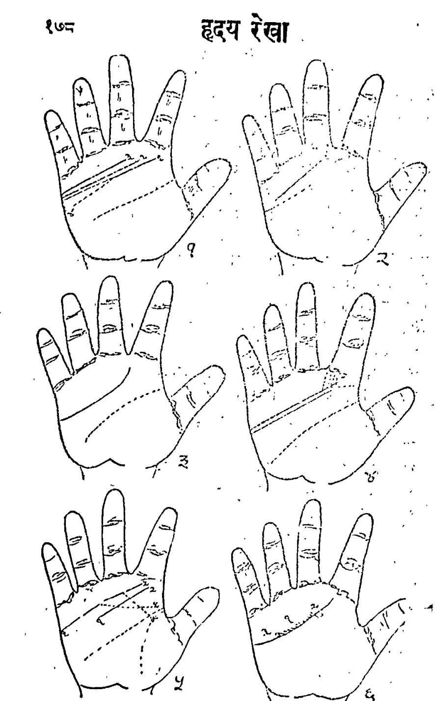
>
> **Individual Hand Variations (१ to ६):**
>
> * Hand 1: `Hand 1`
> 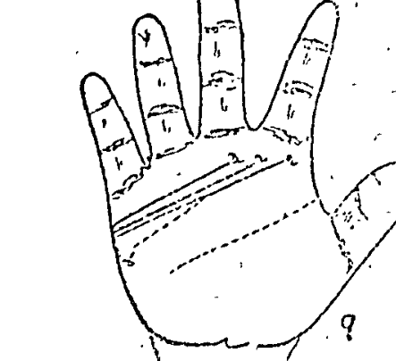
>
> * Hand 2: `Hand 2`
> 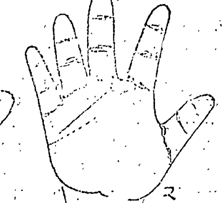
>
> * Hand 3: `Hand 3`
> 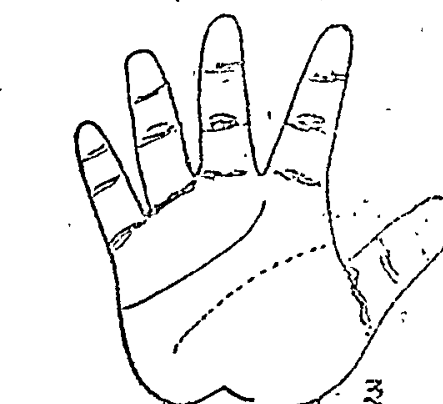
>
> * Hand 4: `Hand 4`
> 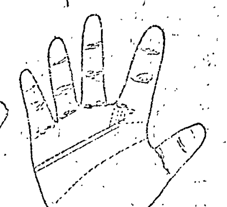
>
> * Hand 5: `Hand 5`
> 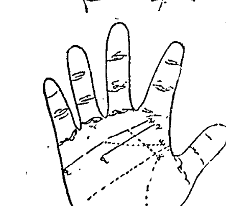
>
> * Hand 6: `Hand 6`
> 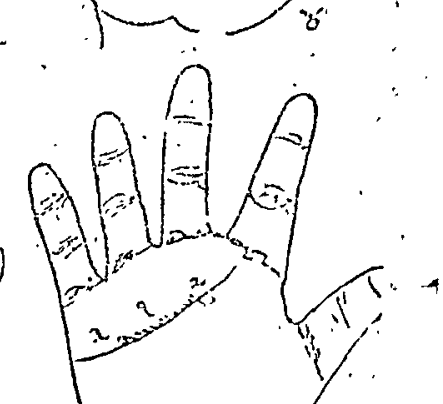
>

178
Heart Line

1

2

3

4

5

6

---

## Page 83

( 176 )
At the same time, if the Mount of Venus is excessively elevated, and under such conditions, the Fate Line also strives to extend even beyond the base of the middle finger (Saturn), such a person invariably goes to prison. He will be debauched and will be sent to jail on charges of adultery. Further interpretation of his sinful deeds should be made by observing the qualities and flaws of the Head Line, the Heart Line, and the Fate Line. (Figure 2, Location 3)

Similarly, if the Fate Line extends further downward, cutting across the Rascette (bracelet lines) of the wrist, it is also considered inauspicious. Just as a deep, clear, and distinctly visible Fate Line is a symbol of good fortune, an unclear, dull, and indistinct Fate Line indicates that a person possessing such a line is devoid of vigor, vitality, and strength. His life is spent enduring hard times. (Figure 2, Location 2)

2—If the Fate Line originates from the region of the Life Line near the Rascette and proceeds forward in a straight, deep, and clear manner while touching the Life Line, it clearly signifies that such a person elevates his destiny solely through his own hard work and the application of his intellect. His life and his destiny become integrated. All his endeavors lead to his prosperity. While new adversities do arise in the life of every individual, a person with this line overcomes all such calamities by virtue of this line. He attains continuous progress. (Figure No. 3)

If the Fate Line remains unbroken from beginning to end and is not intersected by any other minor lines, then a person possessing such a line...

---

## Page 84

(180)

The individual’s path to progress remains free of thorns. They continuously advance on the path of unimpeded success.

It is often observed that the Fate Line originates from the *Manibandha* (bracelet/tabula rasa) or its vicinity and, proceeding further, merges into the Life Line after a short distance. In such a scenario, it can be definitively stated regarding an individual possessing this line that the very beginning of their life was marked by domestic complications, and they became so entangled in troubles created by relatives and kinsmen that they never obtained the opportunity to achieve progress. Their advancement comes to a standstill. (Figure 2, Location 2)

At the same time, if this Fate Line separates from the Life Line once again and begins to proceed towards the Mount of Saturn, it is certain that in the near future, through their own strenuous efforts, they will succeed in leading their life onto the path of prosperity. Regarding this success, it is also necessary to take into consideration the qualities of Saturn (*Shani*).

3. When the Fate Line originates from the center of the palm—which is considered the region of the Mount of Mars—and proceeds forward, it clearly indicates that the individual’s early life was full of adversities and fraught with anguish. That individual never even worried about their own progress, or even if they did, they were unable to achieve it. If this line, continuing forward in a clear and unbroken condition, proceeds towards the Mount of Saturn, the individual should understand that in the latter half of their life, their fortune will surely shine. They will advance on the path of prosperity during the middle portion of their life.

---

## Page 85

> ### 🖼️ Diagram: Fate Line Variations (भाग्य रेखा)
>
> 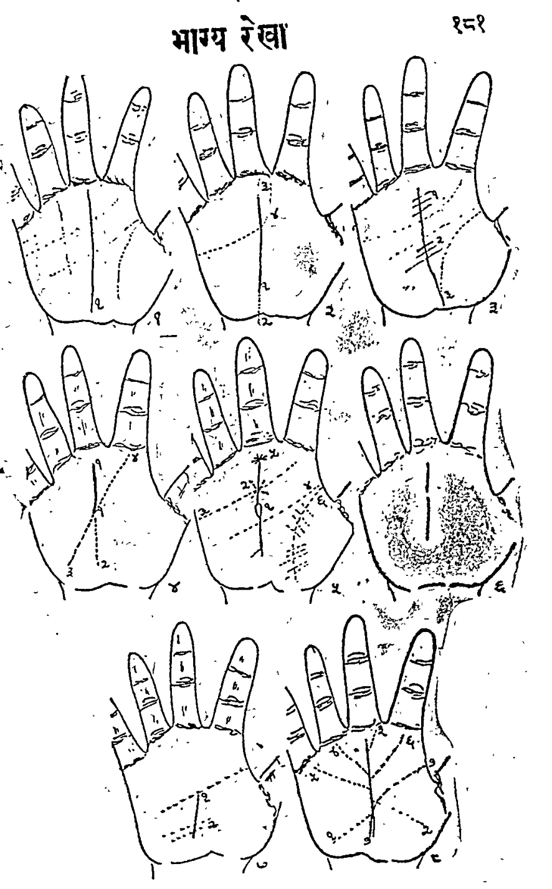
>
> **Individual Hand Variations (१ to ६):**
>
> * Hand 1: `Hand 1`
> 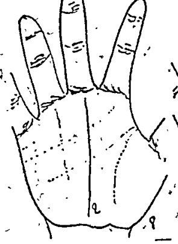
>
> * Hand 2: `Hand 2`
> 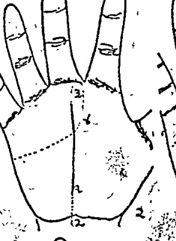
>
> * Hand 3: `Hand 3`
> 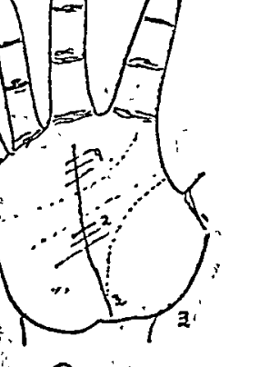
>
> * Hand 4: `Hand 4`
> 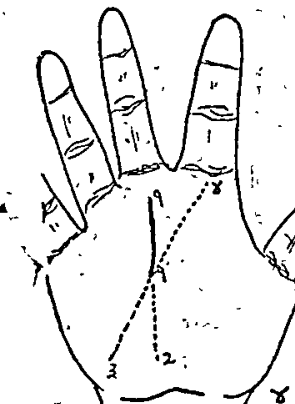
>
> * Hand 5: `Hand 5`
> 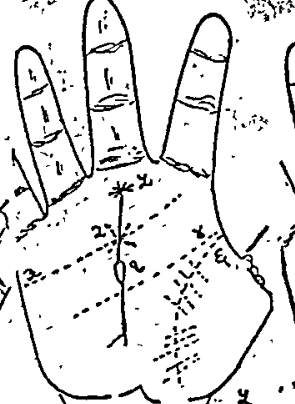
>
> * Hand 6: `Hand 6`
> 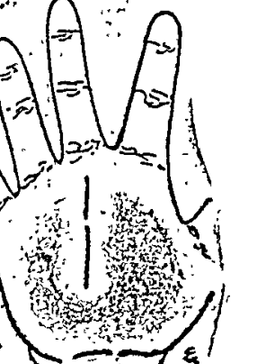
>

Fate Line
184

---

## Page 86

(182)

[Figure No. 4, Line 1-1]

4. If the Fate Line is in an elevated condition—meaning clear, deep, and distinct—originating from the Mount of Moon and proceeding toward the Mount of Saturn, such individuals certainly strive to progress, yet their thoughts lack stability. Just as the phases of the moon continuously wax and wane, the psychological state of such individuals similarly fluctuates. They alternately become fickle and attempt to attain steadfastness; however, regardless of their efforts, they fail to achieve true success. The sole reason for this is their volatile nature. [Figure No. 4, Line 1-3]

The lives of such individuals are profoundly influenced by women. They are sensual and prone to being infatuated with women to the point of self-effacement. Consequently, the cooperation or involvement of women is visibly indicated in their rise and fall. If this line terminates upon the Mount of Jupiter, it signifies that the individual's married life will be blissful. He receives inspiration from his wife, and it is precisely through the cooperation of his wedded wife that he is able to achieve advancement.

It is frequently observed that another line originates from the Mount of Moon and merges with this Fate Line. The effect of such a combined line is that if an individual possessing a similarly formed line enters the life of this person, a profound upheaval is incited. When two individuals of a lunar temperament unite in the same sphere, the impact that their volatile natures can manifest is easily understood by all.

A Fate Line of this nature, emerging from the Mount of Moon, is found particularly in the hands of women rather than men.

---

## Page 87

( 183 )

The various forms of the Fate Line have been described above. However, we shall now provide detailed information regarding how its combination with various other lines alters its effects. It has already been stated that every line on the hand inevitably exerts its influence. Therefore, upon the emergence of a line, it is essential to ascertain the effect that the contact of other lines has upon it. It has already been established that one line invariably exerts a certain degree of influence upon another.

The influence of the Fate Line undeniably extends over the social, practical, and financial spheres of an individual’s life. This line originates from the Rascette (Manibandha), near the Life Line, from the Mount of Mars, or the Mount of Moon, and ascending from the center of the palm, terminates beneath the middle finger at the Mount of Saturn. A straight, clear, and deep Fate Line is indicative of good fortune, whereas a faint, indistinct, and dull Fate Line signifies a sorrowful life.

It is the opinion of some Eastern astrologers that the presence of an island or a star sign (shula or nakshatra) upon the Fate Line is inauspicious. However, others maintain that these two signs are not as inauspicious as the breaking of the line itself. We certainly agree that while these two signs act as obstacles to human progress, they are not as fatal as a break in the line.

The individual whose Fate Line is broken finds their progress cast into doubt, for progress does not occur instantaneously. It begins from a humble level, and just when the apex or time of advancement arrives, a halt occurs. In such a state, progress comes to a standstill.

---

## Page 88

(184)

remains right where it is. For this reason, a break in the Fate Line is considered inauspicious. (Figure 4, Line 2-1, the middle point 1)

If an island mark is present on the Fate Line of an individual, and the Heart Line is stronger than the Head Line, such a person becomes so entangled in love that they are forced to face social disgrace on account of this attachment. They must endure humiliation, and it is even possible that due to this romantic bond, they may experience profound sorrow and attempt suicide. (Figure 5, Location 1)

If the island mark on the Fate Line appears on the hand of a person belonging to the utilitarian (practical) type, the significance of this island becomes entirely nullified. The 'utilitarian hand' itself is considered to possess such lofty characteristics that the malefic nature of an island situated on the Fate Line is rendered completely ineffective in such a hand. Individuals with utilitarian hands are people of principle. Their resolves are firm, and their inclinations are always noble. In such individuals, who are the architects of their own destiny, the island mark on the Fate Line is either absent altogether, or even if it is found to be present, its significance is destroyed.

In the hands of married individuals, if the island mark appears after their marriage has taken place, it clearly indicates that the individual’s love will be enduring. If the Heart Line of such a person is exceptionally clear and well-defined, it must be concluded that their marital love is of the highest order. However, if by misfortune a star or a grill (lattice) mark happens to appear on the hand, it should be understood as yielding destructive and adverse results. (Figure 5, Location 2 and Location 5)

---

## Page 89

> ### 🖼️ Diagram: Head Line Variations (मस्तक रेखा)
>
> 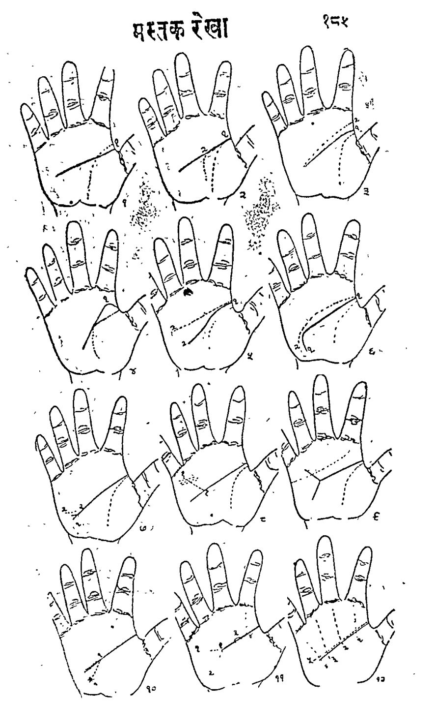
>
> **Individual Hand Variations (१ to ६):**
>
> * Hand 1: `Hand 1`
> 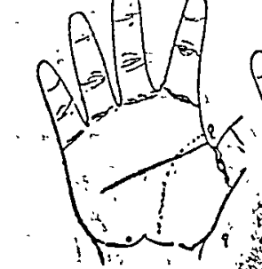
>
> * Hand 2: `Hand 2`
> 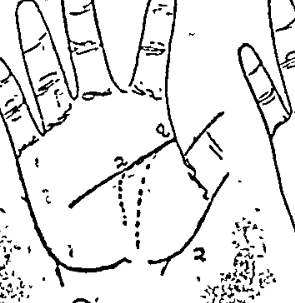
>
> * Hand 3: `Hand 3`
> 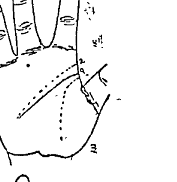
>
> * Hand 4: `Hand 4`
> 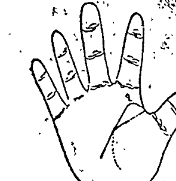
>
> * Hand 5: `Hand 5`
> 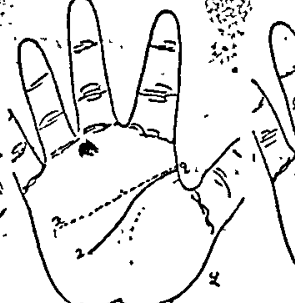
>
> * Hand 6: `Hand 6`
> 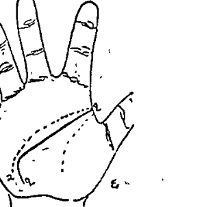
>

Head Line 182

10

11

12

---

## Page 90

( 186 )

It has also been observed that in the hands of many individuals, right at its point of origin, the Fate Line splits into a snake-tongue shape (forked). In such a condition, this line proves to be detrimental. A person with this type of line possesses an unstable mind. Their consciousness finds no peace, and they continually cause financial losses to their loved ones, including their mother, father, relatives, and kin. (Figure 5)

If the Life Line of an individual with this type of line is also flawed—meaning wavy, broken, entangled, or obscure—then it can be stated with certainty that such a person is short-lived, frail, sickly, and prone to anger over trivial matters. Before arriving at such a conclusion, it is essential to pay close attention to the Life Line.

If the Fate Line is halted mid-course due to the intersection of the Head Line, leaving no trace of it further ahead, the result is that individuals with this type of line do achieve progress, but their advancement fails to reach its full development. Their own intellect acts as a thorn on their path of progress. Mental flaws such as madness, foolishness, anger, uncertainty of thought, and excessive imagination obstruct their path to advancement. (Figure 7, Location 1)

It is frequently observed that minor lines originating from the Mount of Moon either merge with the Fate Line or intersect it. The effect of these lines is that the lives of such individuals are invariably influenced by other people. When these minor lines intersect, it is often seen that if the Fate Line is clear, straight, and deep, it serves to further propel their progress.

---

## Page 91

(187),

certain individuals undoubtedly play a role. If the line is faint and impure, certain individuals will surely contribute to leading one down the path of decline. (Figure 7, Site 2)

Western astrologers hold the view: "Various effects which meet the line of Fate somewhere near the middle of palm denote that the destiny of the being lie under the effect of others. It must also be borne in mind that the fate line should be clear & distinct. If the line is faint and indistinct the effect will be adverse."

That is to say—it is generally observed that if minor lines touch the Fate line at or around the middle of the palm, and the Fate line is clean and distinct, the assistance of other beings will also play a role in the path of progress for such an individual. However, this point must also be kept in mind that if the Fate line is impure and indistinct, the effect will be contrary.

If branches arise directly from the Fate line of an individual and spread in various directions, their effect corresponds to the nature of the planet toward which those branches extend and fade away. If a branch emerging from the Fate line goes and dissolves into the Mount of Moon, it signifies that such an individual will achieve success in gambling, speculation, etc., but their progress will be temporary. (Figure 8, Branch 1)

If this branch terminates toward the Mount of Venus, its effect will be that such an individual will attain success solely through foreign travel. Roaming about, he will expand the circle of his acquaintances.

---

## Page 92

( 112 )

successful in enhancing it, and will be able to reap profits accordingly. Such an individual will be proficient in commerce, yet their prosperity will not remain enduring for long. Due to the influence of Venus, they achieve advancement initially, but subsequently, their mind becomes fickle, and their progress turns into decline. [ Figure 8, Branch 2 ]

If a branch of this nature originates from the Fate Line and merges into the Mount of Saturn, it signifies that a person possessing such a line will attain all-encompassing accomplishments. All obstacles in their path will be destroyed, and they will rise in prosperity. Success will be subservient to them. Furthermore, if the Fate Line itself becomes remarkably clear as it approaches the Mount of Saturn, such an individual possesses the capability to fulfill every desire of their heart. Regardless of how many inauspicious signs may be present in the hand of such a person, success is assured to them. This is the influence of Saturn. [ Figure 8, Branch 3 ]

If a branch emerging from the Fate Line terminates and merges within the Mount of Sun, an individual with such a line attains fame and renown. Their name remains immortal. They are radiant like the sun, and their reputation grows exponentially day by day due to their public service. They are a lover of poetry, literature, and painting, and shine brightly as a successful artist, poet, leader, or actor. [ Figure 8, Branch 4 ]

The person whose branch originating from the Fate Line merges into the region of the Mount of Mercury receives acclaim for their erudition and intelligence. Such an individual is endowed with knowledge, science, and artistic skill,

---

## Page 93

> ### 🖼️ Diagram: Life Line Variations (जीवन रेखा)
>
> 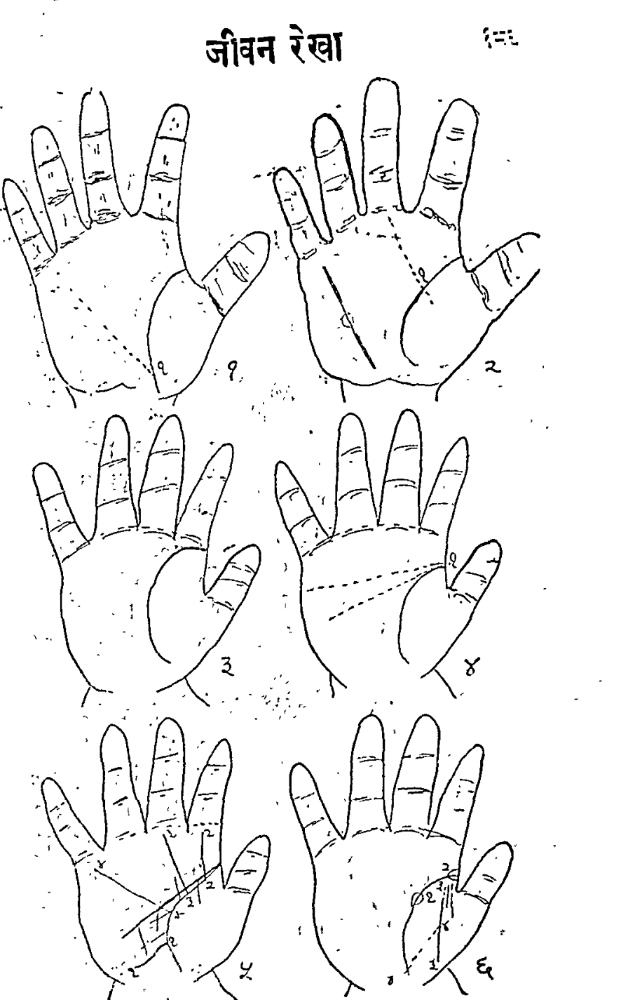
>
> **Individual Hand Variations (१ to ६):**
>
> * Hand 1: `Hand 1`
> 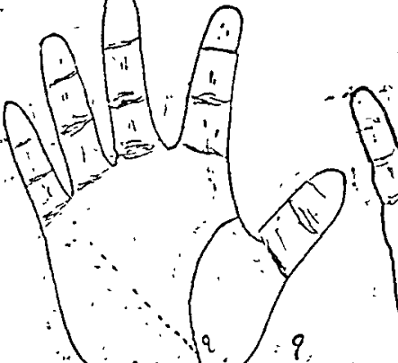
>
> * Hand 2: `Hand 2`
> 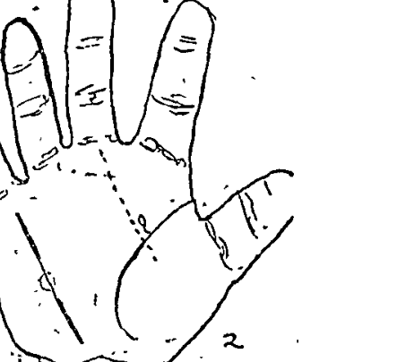
>
> * Hand 3: `Hand 3`
> 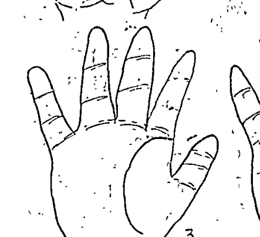
>
> * Hand 4: `Hand 4`
> 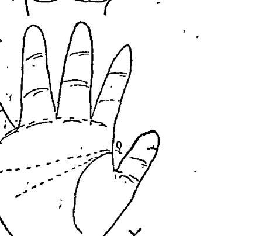
>
> * Hand 5: `Hand 5`
> 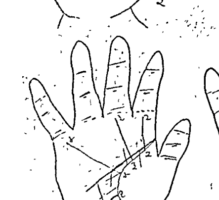
>
> * Hand 6: `Hand 6`
> 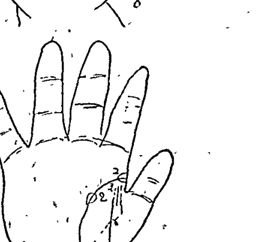
>

Life Line

---

## Page 94

(160)

...they become painters, musicians, mathematicians, astrologers, merchants, and so forth. The direct answer to this is that in their hands, the Sun Line originates from the Head Line; consequently, their mental faculties are exceptionally sharp, and through their personal competence—gained as the fruit of their dedicated practice and intellectual power—they attain renown. They continue to progress throughout their lives. (Figure 1, Dotted Line 3)

4. In the hands of certain individuals, the Sun Line originates from the Heart Line. Such a person possesses an unpretentious and sincere heart. They are incapable of deceit, fraud, and betrayal. Such individuals are generally pure at heart, clearly expressing in their words whatever resides in their minds. Furthermore, regardless of how their past life might have unfolded, their final days in this life remain peaceful and free of obstacles. They have no anxieties to bear in their old age. They spend the remainder of their lives in a tranquil manner. (Figure 1, Dotted Line 4)

5. In the hands of certain individuals, the Sun Line originates from the central region of the palm, namely the Mount of Mars, and extends forward. This line comes under the influence of the planetary deity Mars. Mars is the commander-in-chief of the celestial gods; therefore, all the planetary deities of the palm are subdued by his dominance. For this reason, an individual in whose hand the Sun Line emerges from the Mount of Mars succeeds in advancing upon the path of progress. No matter how many obstacles may lie in their path, they march ever onward, overcoming them all. (Figure 2, Dotted Line 5)

---

## Page 95

( 161 )

After halting for some time, he will resume his progress on the path of advancement and ultimately reach his goal. However, it is also essential to bear in mind that if the line becomes indistinct at the point of the break, and remains faint and unclear even when it restarts, this is not auspicious. Not only will there be obstacles in his progress, but even after overcoming those hurdles, he will fail to attain his objective. (Figure 7)

The person whose Fate Line originates from the middle of the palm spends a life of great toil. If this Fate Line extends further upward to reach the Mount of Saturn, that individual achieves success through his own hard work and spends his old age in comfort. If the line fails to reach the Mount of Saturn, he remains unable to attain success despite a million efforts.

If an island mark appears on the Fate Line right in the middle of the palm, its effect is that such a person is compelled to face grave adversities during the middle period of his life. If that mark disappears, he will also be delivered from those tribulations. For as long as that mark persists, obstacles will continue to arise on the path of his progress.

Despite all these indications, it is proper for every individual to acquire the knowledge of this line to understand his future, and with firm resolve in his mind, advance steadily upon the path of progress. For if a person desires to conquer all obstacles in life, there is only one fundamental mantra: *Purushartha* (diligent effort).

---

## Page 96

[ 162 ]

Human effort possesses such power and capability that it can annihilate the defects of the lines and endeavor to elevate a mortal to the pinnacle of success in life. Action lies in the hands of the mortal, while the fruit is bestowed by the Divine—on this principle, both Eastern and Western astrologers are in complete agreement. Concurring with the views of Eastern scholars, Western savants have stated: "Action is thy duty; reward is not thy concern." 

One must continue to perform one's duty unceasingly.

Chapter Seven
The Sun Line

The Sun Line has the unique privilege of endowing the Fate Line with radiance. The very influence of the Sun Line is that it illuminates the qualities of the Fate Line. In the hand of any individual where a fine Sun Line accompanies the Fate Line, the result is that the destiny of such a person shines brightly. The Sun enhances their fame and renown manifold. A powerful Sun Line together with a powerful Fate Line is rarely seen in human hands, but in whosever hand they exist, that person progresses by leaps and bounds—experiencing exponential growth day and night. These two lines appear prominently in the hands of kings, emperors, magnates, leaders, and the like.

It is not necessary that the Sun Line be present in the hand of every individual. Many hands have been observed in which the Sun Line [is absent...]

---

## Page 97

> ### 🖼️ Diagram: Sun Line Variations (सूर्य रेखा)
>
> 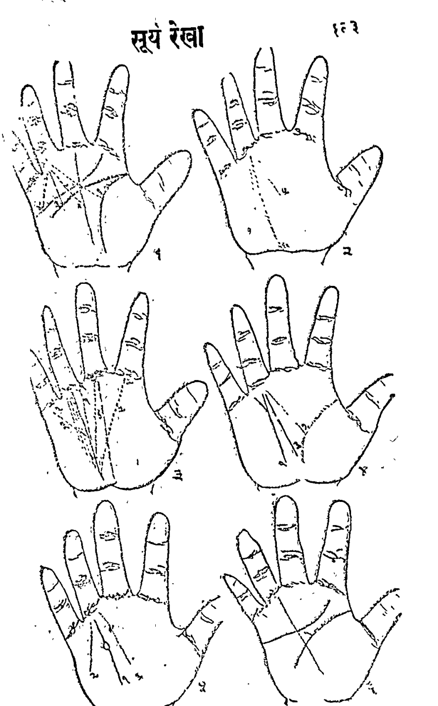
>
> **Individual Hand Variations (१ to ६):**
>
> * Hand 1: `Hand 1`
> 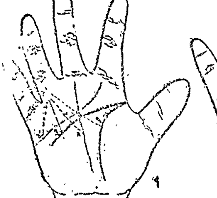
>
> * Hand 2: `Hand 2`
> 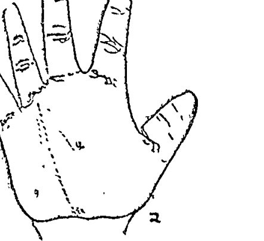
>
> * Hand 3: `Hand 3`
> 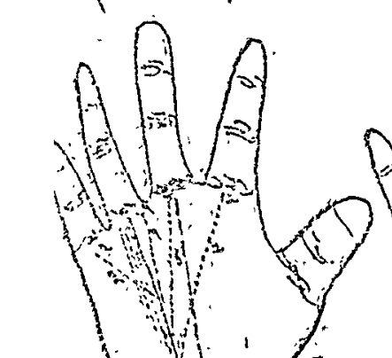
>
> * Hand 4: `Hand 4`
> 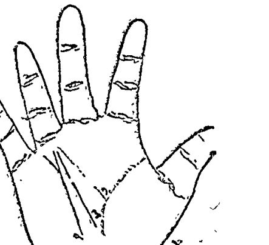
>
> * Hand 5: `Hand 5`
> 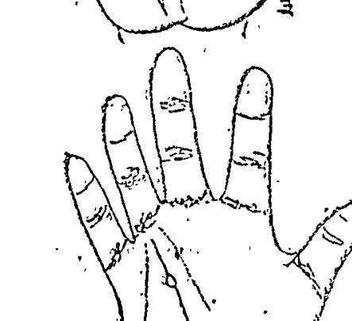
>
> * Hand 6: `Hand 6`
> 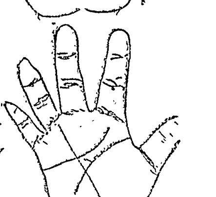
>

Sun Line
163
1
2
3
4
5
6

---

## Page 98

( 144 )

The Sun Line has several points of origin, which are described below:

1. In the hands of certain individuals, the Sun Line originates from the Life Line. Such a line guides the person toward the path of progress in the future and enhances their renown. These individuals are worshippers of art, possessing a special interest in natural beauty. Through their own labor and dedication, they become successful artists. The ability to comprehend any matter merely by a hint is inherently present within them. (Figure 1, Dotted Line No. 1)

2. In the hands of some individuals, the Sun Line originates directly from the Fate Line. Such persons achieve progressive advancement throughout their lives. The primary reason for this is that because the Sun Line arises from the Fate Line itself, it suppresses the flaws of the Fate Line and brings its virtues to light, thereby granting the individual the strength to walk the path of success. When the qualities of the Sun Line combine with the Fate Line, it is akin to adding fragrance to gold (a doubly auspicious circumstance). A clean, clear, and deep Sun Line bestows the fruit of immortal fame. (Figure 1, Dotted Line No. 2)

3. In the hands of certain individuals, the Sun Line begins from the Head Line. The consequence of this is that the person’s intellectual capacity is remarkably sharp. Utilizing their mental prowess, they accomplish tasks that even highly intelligent men cannot fathom. Frequently, individuals are also observed who do not know a single letter in the name of education, yet they become exceptionally skilled engineers,

---

## Page 99

(165)

He attains an important position in fields such as business and possesses the ability to articulate his thoughts clearly before his associates. He is a brilliant orator and earns great renown. (Figure ढ, Branch 5)

If a branch originating from the Fate Line merges into the Mount of Jupiter, such a person achieves advancement in their career and attains a high designation. His superiors remain pleased with his work and give credence to his words. He possesses administrative capabilities; his counsel proves beneficial, and for these very reasons, he progresses day by day. Another manifestation of this sign could be that he achieves success as a skilled businessman, editor, or writer. (Figure ढ, Branch 6)

If the Fate Line begins near the Life Line and, as it extends forward, touches the Life Line before continuing its course, it is certain that the life of such an individual will be heavily influenced by a woman. If the individual is a man, he will be guided by a woman's advice. If unmarried, his lover will become an obstacle on his path to progress. He will drown so deeply in the love of his lover that, consumed by sensual desires, he will himself halt his own advancement. This emotional entanglement will exert a profound impact on his life's trajectory. (Figure ढ, Location 7)

Generally, a broken Fate Line is considered inauspicious; however, if the Fate Line is deep at the point of the break, and when it resumes it remains deep and clear, it clearly indicates that a sudden obstacle will arise on the individual's path to progress, after which...

---

## Page 100

( • 166 :)

6 - In the hands of certain individuals, the Sun Line originates from the rascette (bracelet line) or very close to it, and extends upwards. In this condition, it is essential to observe whether the Sun Line proceeds in close proximity and parallel to the Fate Line. If the Sun Line is close to the Fate Line and advances parallel to it, this constitutes a most auspicious sign. An individual possessing such a line achieves success in whatever endeavor they undertake. Their colleagues love them, superiors praise them, and they attain honor in society. (Figure 2, Dotted Line 6)

7 - In the hands of certain individuals, the Sun Line originates from the Mount of the Moon and proceeds toward the ring finger. There is an ancient enmity between the Sun and the Moon, and the nature of the Moon-god is perpetually fickle. Consequently, due to the influence of the Moon, the advancement of an individual with this type of line remains doubtful. Although such persons desire to achieve fame and wealth through progress, they are unable to remain steadfast due to the fickleness of their thoughts. They make efforts as well, but because their resolve is weak, they fail to attain success. (Figure 7, Dotted Line 7)

The view of Western scholars is: -
"Success line, which is often called the line of Apollo, or sun line has no fixed starting point, nor it is to be found on all hands; whenever it exists, it will run to-wards the mount of Apollo. It may rise from various points of

---

## Page 101

( 167 )

the hand and may terminate at the bottom of the third finger or may not even reach the same. Yet its presence on the hand is bound to influence the success of the man. Its qualifications are to indicate capability, accomplishment of virtuous status in life and society etc, without this line, the prospects of rising to fame, however clever & talented are more or less remote.

That is to say, the prominent line, often called the Apollo Line or Sun Line, does not originate from one fixed place on the hand, nor is it found in every hand. However, whenever it is present on the hand, it always proceeds toward the domain of the planet Sun situated beneath the ring finger. It originates from various locations on the hand and may terminate even before reaching beneath the third finger. Yet, its appearance on the hand is bound to influence life and enhance the renown of the person. Its attributes are that it indicates diligence, the manifestation of merits, and the attainment of honor in life and society. Without this line, a person—no matter how clever, skilled, or intelligent they may be—can never attain true fame.

A straight, well-formed, distinct, deep, and clear Sun Line, running parallel to the Fate Line right from the wrist (Manibandha), is considered the most auspicious. The person in whose hand this line is found attains all-around accomplishments and achieves great renown. Conversely, a faint, obscure, and indistinct Sun Line, rather than bringing fame, does not necessarily cause infamy, yet the progress of the individual...

---

## Page 102

(198)

definitely creates obstacles. (Figure 3)

It is frequently observed that scattered minor lines run alongside the Sun Line, eventually merging into it. Such lines exert a direct influence on the Sun Line. The planetary mount from which these lines originate imparts its corresponding influence upon the Sun Line, with the result that the deity of that particular mount assists in the individual's advancement. However, if some of these lines intersect the Sun Line at various points, the consequence is that the individual’s progress is hindered by the influence of the planets from which those lines originate, and diverse obstacles begin to impede their advancement. In such a state, it is proper for the individual bearing such lines to maintain their composure and engage in their work with true dedication and perseverance; success will then lie at their feet. [Figure 3]

It is also observed that near its termination, the Sun Line splits into a fork resembling a serpent's tongue. The result of such a line is that the individual's mind becomes fickle and restless, rendering them unable to conduct their endeavors successfully. Temptations and allurements cross their path, causing their concentrated focus to be fractured into multiple directions. The consequence of this division of dedication is that the individual fails to advance upon the path of progress with absolute resolve, resulting either in disrepute or, at best, a complete lack of renown. (Figure 4, Line 1)

When the Sun Line originates from the Life Line, it signifies that the individual can achieve progress only by finding a foundation directly connected to their own life and vitality. In such a condition, it is possible...

---

## Page 103

(146)

It is possible that a person of humble means may marry someone wealthy, or a wealthy relative may leave them a fortune at the time of death, and so forth. Only after acquiring wealth in this manner can such a person progress on the path of prosperity; this is the distinct characteristic of this line. (Figure 4, Dotted Line 2)

When various branches emerge from the Sun Line and merge into the domain of another planetary deity, the results are modified by the influence of that respective planet.

When a branch of the Sun Line extends and merges into the Mount of the Sun, the result is that the individual attains fame and glory. Such a person becomes a political leader, a religious preacher, an orator, or someone deeply interested in public service, achieving success specifically within public life. (Figure 3, Location 1)

When a branch originating from the Sun Line goes and merges into the domain of the divine preceptor, namely the Mount of Jupiter, the effect is that a person bearing such a line secures a position within the ruling class. By exercising their authority judiciously, they become the recipient of the grace and affection of their subjects, earning honor and renown. Their people love them, and they progress by attaining high authority in governance. (Figure 3, Location 2)

When a branch starting from the Sun Line merges into the domain of the deity Mercury, the advancement of such an individual is achieved solely in artistic endeavors. They become an accomplished artist, painter, writer, musician, dramatist, or actor, attaining mastery in their chosen field. People are deeply influenced by their art.

---

## Page 104

(200)

...are present, and he attains fame and glory due to his artistic talents. (Figure 3, Site 3)

When a branch originating from the Sun Line merges into the Mount of Saturn, one’s fortune reaches the pinnacle of success. However, this is conditional upon the presence of a strong Fate Line in the individual’s hand alongside such a mark. Since Saturn is the son of the Sun, the father and son act in tandem to fully assist the individual in becoming happy and prosperous, further extending their renown and glory. (Figure 3, Site 4)

If, along with this line, many other minor lines originate from the center of the palm and merge into the Mount of the Sun, their influence is also auspicious. These lines serve to support the main Sun Line, assisting in the individual's progress and reputation. They are all considered auxiliaries to the Sun Line.

If the Sun Line is broken at any point, that specific location signifies the individual’s disgrace and infamy. A broken Sun Line is not considered auspicious. Its breakage halts progress, leads to scandal, shifts the direction of the individual’s advancement, and sets them on a path of decline. For all these reasons, a break in the Sun Line is not regarded as a favorable sign. (Figure 4, Line No. 3)

If an island mark appears directly on the Sun Line of an individual, its impact is not considered particularly significant. While the presence of an island is generally an unfavorable sign, it does not exert a profound effect on the Sun Line itself. Whatever impact it does have remains confined to the Sun Line.

---

## Page 105

601)

It is virtually non-existent. A broken Sun Line is considered more detrimental than a line containing an Island mark. (Refer to Line No. 1 in Figure 4).

When the Sun Line in an individual's palm originates from the Mount of Mars and, while extending upwards, becomes faint and disappears before reaching or merging into the Mount of the Sun (Apollo), such a person faces various obstacles, adversities, and disappointments in their life. The future of their progress remains shrouded in darkness. (Refer to Line No. 2 in Figure 5).

If a Square mark is found on the Sun Line, it is considered highly auspicious. The Square mark nullifies the effects of all inauspicious signs present on the Sun Line and, through its own influence, fosters new vitality, enthusiasm, and a sense of duty in the individual's life, inspiring them to tread the path of progress. It further assists in enhancing their fame and reputation. (Refer to Line No. 3 in Figure 5).

If an artisan possesses a Sun Line, its influence is such that their fame will not spread during their lifetime. The characteristic effect of a Sun Line in an artisan’s hand is that their renown spreads only after their death. Generally, however, the Sun Line is rarely found in the palms of artisans and merchants. For this reason, these individuals are required to perform strenuous labor and constant, dedicated effort to sustain their livelihood. Occasionally, even a highly skilled artisan must toil tirelessly just to secure the means for their survival. However, an individual who possesses a Sun Line attains prestige and glory.

---

## Page 106

(202)

...definitely attain it, though it comes to them only in the twilight of their lives or even posthumously.

If the Sun Line is clean, distinct, and deep, and alongside it, the Mount of Moon and the Mount of Venus are well-developed and prominent, then such an individual possesses a profound interest in literature and elevates their renown within the literary domain. They are counted among distinguished writers and critics.

Although the star sign is generally not considered a favorable omen in other contexts, if a star mark appears on the Sun Line, it enhances good fortune and serves to augment fame and glory. This is regarded as an exceptionally auspicious sign on the Sun Line (refer to Figure 5, line no. 3, depicting the star situated on the line).

A line originating from the Heart Line confirms that an individual possessing such a mark becomes a recipient of the reverence and respect of their companions and colleagues due to their pure and candid nature. By temperament, they are simple-hearted, generous, diligent, guileless, and well-liked. Their associates honor them and hold them in high regard; their progress is a direct consequence of these aforementioned virtues.

Western scholars state: "The length of this line determines the extent and duration of its influence; the longer the line, the more effect it will have, while the shorter it is, the less will be its importance. This line, when starting from the wrist, running through the palm, and reaching the mount, will indicate the possession of great..."

---

## Page 107

(202)

Talent and Fame: If the Sun Line starts low in the hand and runs only for a short distance, the individual will possess talents, but they will not yield significant results.

In other words, the length of the Sun Line reveals the duration of the influence of one’s progress and fame. If the line is long, it will exert an elevated influence over the individual’s life for a prolonged period; conversely, if the line is short, its effect will be brief. The Sun Line that commences near the wrist (bracelet lines), travels through the middle of the palm, and terminates in the Mount of Apollo (Sun) is considered exceptionally auspicious. If the line originates higher up and remains short, it exerts less influence on the individual's progress. (Figure No. 6)

"If the line rises higher in the hand and covers the space between the Head and Heart lines, thus forming a Quadrangle, the special talents of the subject will operate during the period it remains a part of the palm. If the line runs on to the Mount, he will be well-endowed with an Apollonian character, and in whichever world he finds himself, he will be brilliant and acquire reputation."

If this line passes through the upper part of the palm and joins the Heart Line and Head Line to form a triangle, the individual possessing such a line makes excellent use of their talents for the purpose of their own advancement, thereby attaining fame and glory. The duration of their progress...

---

## Page 108

> ### 🖼️ Diagram: Health Line Variations (स्वास्थ्य रेखा)
>
> 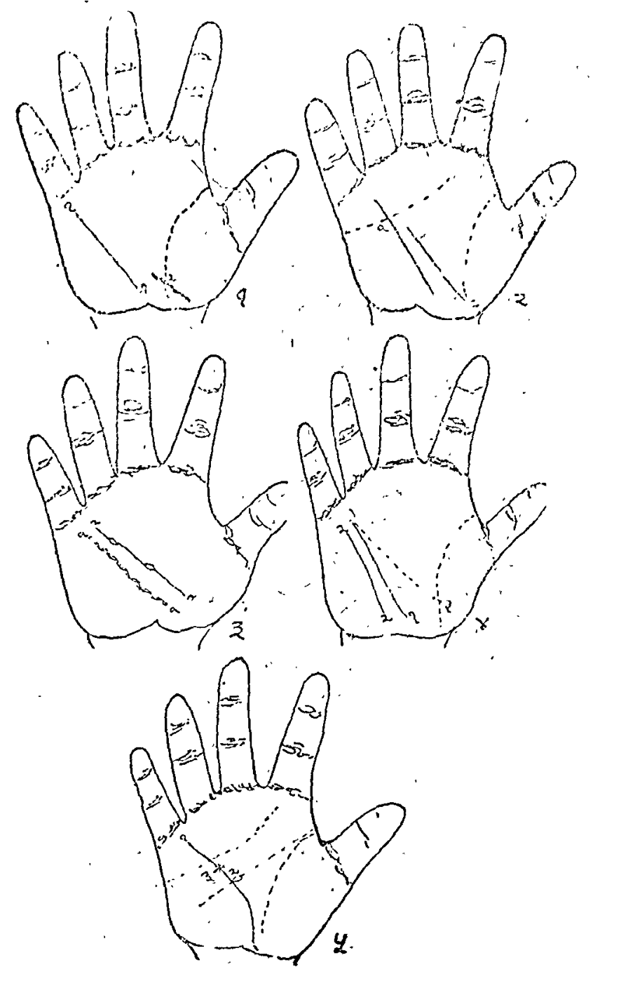
>
> **Individual Hand Variations (१ to ६):**
>
> * Hand 1: `Hand 1`
> 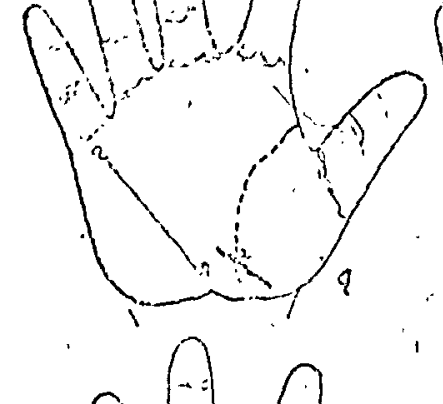
>
> * Hand 2: `Hand 2`
> 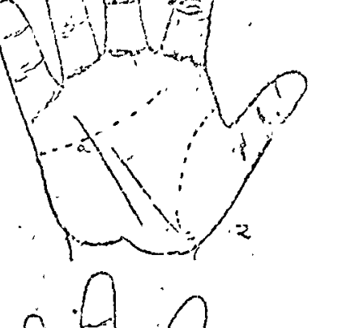
>
> * Hand 3: `Hand 3`
> 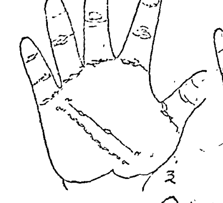
>
> * Hand 4: `Hand 4`
> 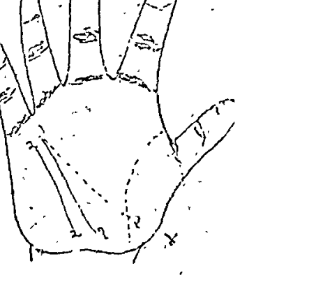
>
> * Hand 5: `Hand 5`
> 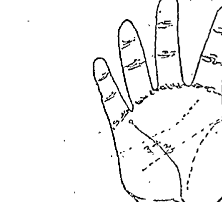
>
> * Hand 6: `Hand 6`
> 
>

1
The science of Samudrik Shastra serves as a profound lens through which the subtle imprints of destiny, inscribed upon the physical form, are decoded. It posits that the human body is a living manuscript wherein the past, present, and future are articulated through anatomical contours and symbolic markings.

2
When examining the palm, the Life Line serves as the primary axis of vitality. A clear, unbroken Life Line indicates robust health and a long, stable existence. Conversely, the presence of an Island mark along this line often signifies periods of significant physical depletion or psychological turbulence, necessitating caution during those specific cycles.

3
The Fate Line, often referred to as the Saturn Line, governs the professional trajectory and material success of the individual. Its origin—whether it rises from the Moon, the Venus, or the Life Line—determines the nature of one’s external support and personal initiative. A well-defined Fate Line reaching the base of the middle finger suggests a life characterized by purpose and eventual fulfillment of karmic objectives.

4
The Mounts act as reservoirs of planetary influence. The Mount of Jupiter represents ambition, leadership, and wisdom, while the Mount of Venus signifies aesthetic sensibilities, passion, and vitality. Should a Square mark appear on the Mount of Jupiter, it is interpreted as a protective sign, mitigating potential obstacles and bestowing authority and social standing upon the individual.

5
In the context of the Sun Line, or Apollo Line, its presence denotes fame, artistic recognition, and inner radiance. When this line runs parallel to the Fate Line, it amplifies the impact of one's efforts, often leading to public acclaim. Furthermore, the Heart Line provides insight into the emotional constitution; its clarity determines the capacity for devotion, while deviations or chain-like formations suggest emotional vulnerability or complex interpersonal dynamics.

---

## Page 109

(205)

A similar phenomenon occurs when the Sun Line is observed in conjunction with the Heart Line and the Head Line. If this line rises upward and reaches the mount of the respective planet, its effect is such that the individual becomes endowed with all the virtues of the Sun, attaining great progress in the world and achieving immense fame and renown. (Triangle on Figure 1)

The Sun Line serves as an inspiration for progress and is a provider of fame.

Chapter Eight
The Marriage Line

Every living being in this world has a partner. Nature has established a balance such that there is a female for every male, ensuring the continuity of creation and enabling beings to engage in the sustenance of their lives. For this very reason, every individual, upon reaching youth, desires a companion. The Marriage Line indicates to the individual what their partner will be like; that is, what impact the arrival of this person will have on their own life.

Although the Marriage Line is categorized among the minor lines, its significance is by no means diminished. Because every being is inherently governed by the influence of Kamadeva (the god of desire), their partner—who provides solace to their passions—inevitably exerts a profound influence on their life. It is for this reason that the importance of this line is all the greater.

---

## Page 110

> ### 🖼️ Diagram: Marriage Line Variations (विवाह रेखा)
>
> 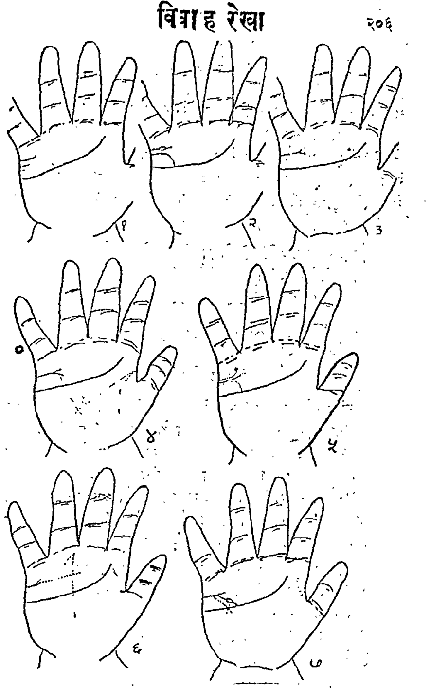
>
> **Individual Hand Variations (१ to ६):**
>
> * Hand 1: `Hand 1`
> 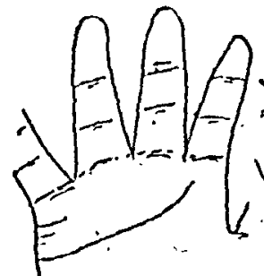
>
> * Hand 2: `Hand 2`
> 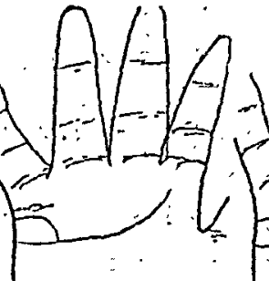
>
> * Hand 3: `Hand 3`
> 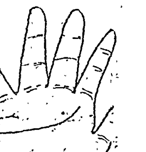
>
> * Hand 4: `Hand 4`
> 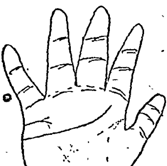
>
> * Hand 5: `Hand 5`
> 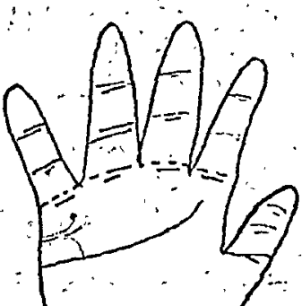
>
> * Hand 6: `Hand 6`
> 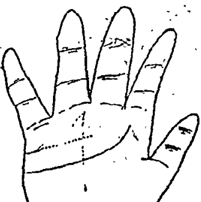
>

Marriage Line 206

1
The Marriage Line is typically found on the percussion of the hand, situated between the base of the little finger and the Heart Line. Its clarity, length, and markings provide profound insights into the nature, timing, and stability of one’s matrimonial or significant romantic relationships.

2
If the Marriage Line is deep, clear, and well-defined, it indicates a harmonious and enduring marital union. Conversely, a line that is faint, fragmented, or obstructed suggests potential instability, frequent misunderstandings, or emotional distance within the partnership.

3
Should the Marriage Line terminate in a fork, it often signifies a period of separation or a divergence in the paths of the couple. If the line bends downward toward the Heart Line, it may imply emotional disappointment or difficulties arising from the partner’s influence; if it curves upward toward the base of the little finger, it may indicate a reluctance toward marriage or a preference for independence.

4
The presence of an Island mark on the Marriage Line is considered an inauspicious sign. It typically denotes periods of domestic discord, prolonged illness affecting the partner, or significant emotional turbulence during the relationship.

5
A Square mark appearing on or adjacent to the Marriage Line is interpreted as a protective sign. It suggests that despite potential crises or threats to the stability of the relationship, the bond will be preserved, and the couple will find a way to navigate through challenges.

6
If multiple fine lines are present near the main Marriage Line, they often represent significant attachments or deep emotional connections that do not necessarily culminate in marriage. It is the most prominent, deepest line that serves as the primary indicator for a formal marital bond.

7
In the study of Samudrik Shastra, the influence of the Mount of Venus and the Fate Line is always considered alongside the Marriage Line. A strong Mount of Venus suggests vitality and passion, which, when balanced with a clear Marriage Line, promises a fulfilling and long-lasting domestic life.

---

## Page 111

(207)

The marriage line is generally the shortest of the primary lines. It originates from the percussion of the palm, located beneath the Mercury finger and above the Heart Line, extending toward the Mount of Jupiter. It is not necessarily the case that there is only one such line on the hand; multiple marriage lines may appear in this area, separated by small intervals. (Refer to the small lines above the Heart Line in Figure No. 5).

Western scholars hold the view that: "These lines of marriage may be called the lines of affection, because it has been noticed in many a hand that a beautiful line occurs in the hand and yet the being dies unmarried. The effect of the line is not unproductive; though the creature remains unmarried in his life, he must have fallen in love and remained affectionate to his lover until the end. Therefore, it is not necessary that the mere possession of a good line means a suitable marriage; it also signifies affection and love."

In other words, the marriage line is also known as the line of affection. This is because it has been observed in many palms that despite the presence of a well-formed marriage line, an individual may pass away unmarried. Although the individual remains single, the influence of the line is not nullified; such a person, despite remaining unmarried, likely harbored a deep love for someone throughout their life and maintained that devotion until death. Thus, it is not essential that a clear marriage line points only to the institution of marriage; it also clearly signifies the capacity for, and the experience of, love within an individual.

---

## Page 112

(288)

The standards of society have changed significantly. The meaning of marriage has transcended the definition originally established by the Aryans. Marriage is no longer considered merely the bond of union between two beings; the romantic union and love-play of two hearts in love are now accorded no less importance than formal matrimony. Marriages are no longer performed solely for the fulfillment of the duties of a householder (Grihastha Dharma); rather, in contemporary times, they are often contracted to sustain romance, satisfy carnal desires, acquire wealth, or secure high-status employment. It is precisely because of these diverse psychological inclinations that the marriage line is found to manifest in each hand in accordance with one’s personal temperament.

The marriage line originates from its source and extends toward the Mount of Mercury, located beneath the little finger, where it eventually fades. If this line is clean, distinct, and deep, the individual’s married life is characterized by happiness and peace. There is mutual love between the couple, and they refrain from any actions that would bring grief to themselves or inflict pain upon their partner—their co-practitioner of dharma. (Observe the topmost deep marriage line in Figure No. 1).

If the marriage line, upon reaching the point where it should fade, begins to curve upward, the consequence is that the individual remains alone in their pursuit of love. Such a person does not marry; they are destined to remain unmarried throughout their life. Plans for marriage are made and proposals arrive, but obstacles invariably arise, leaving the individual a bachelor for the duration of their life.

If the marriage line, before reaching its point of termination, curves downward in a circular fashion and descends to touch the Heart Line, eventually merging into it, it indicates that one of the partners will meet an untimely death. Their marital happiness will not endure for long.

---

## Page 113

(206)

cannot continue. Although death is an inevitable consequence for every living being according to the natural order of the world, under the influence of this line, the individual meets their end before fully experiencing the joys of life. If an island mark appears on the marriage line of an individual’s hand, it exerts a similar impact upon their life. [Figure No. 2]

When the marriage line is forked like a serpent's tongue, it signifies the beginning of bitterness in the couple's married life. They become so disgruntled with each other that they prefer to live apart and eventually sever their relationship. One of them, weary of married life, may even contemplate suicide—by drowning in a river, immolating themselves, or consuming poison. However, this extreme course of action occurs only when the individual's heart line and head line touch one another, and the forked branch of the marriage line inclines toward the heart line. [Figure No. 3]

If a person's marriage line is forked and a faint, erratic line cuts across the head line to touch the marriage line, then the life of such an individual is spent in turmoil. The couple will face constant conflict, and domestic life will seem as torturous as hell. A couple possessing such a line will never find harmony; their life together will be filled with strife. [Figure No. 4]

If a forked marriage line descends downwards, or if a small, erratic line touching it merges into the Mount of Venus, then the individual possessing such a line...

---

## Page 114

(210)

There are many instances where a marriage proposal is initiated, yet the marriage never comes to fruition. Even if a marriage is somehow settled, it ultimately ends in separation.

The Western scholars hold the view: "A break in the line of affection indicates the sudden death of the partner. When the line of affection, after going straight and without breaking, takes a turn and thus touches the Heart Line, it clearly indicates a miserable life for the couple, ending in widowhood. Widowhood is evident when the Line of Affection terminates in a star on the Mount of Mercury."

In other words, if the marriage line is broken at any point, it signifies the death of one of the spouses. When the marriage line, while straight and unbroken, curves to touch the Heart Line, it is evident that the couple’s life will be filled with strife and will culminate in widowhood. Widowhood is deemed inevitable, or self-evident, when the marriage line extends to the Mount of Mercury and terminates in a star mark. (Figure No. 5)

If a line branches out from the marriage line and connects with the Sun Line (Apollo Line), and if this line is well-formed and clear, then in such a case, the marriage proves to be one that enhances the individual's fortune. A person possessing such a line gains wealth, status, property, and fame through marriage. (Figure No. 6)

However, when the marriage line itself cuts across the Sun Line and extends beyond it, in such a state, the individual, after marriage, experiences a decline in their wealth,

---

## Page 115

(211)

One observes the status of honor, family, fame, and reputation through this. It is often heard said that a Lakshmi (a woman bringing prosperity) has arrived who has illuminated the household; conversely, it is also heard that a 'Chandala' (an ill-omened or destructive influence) has entered, leading to the utter ruin of the home. Not only is the wealth lost, but the individuals themselves perish. (Illustration No. 6)

In this regard, Western scholars state:
"Line of Affection which gets forked at the end, if turns into an island, in that case the matrimony becomes a cause of defamation, ill-reputation, and thus ends in divorce or separation. If the forked line of Affection ends into 'x' just above the line of Fate, then it clearly indicates an ill-fated life which ends in the gallows."

That is to say, if the marriage line (Line of Affection) is snake-tongued (forked) and forms an island, then in such a condition, the marital relationship becomes a cause of humiliation and infamy, ultimately ending in divorce or separation. If the snake-tongued marriage line forms a cross (x) mark and meets the Fate Line, then it must be understood with certainty that this sign indicates an ill-fated marital bond that concludes in execution by hanging. (Illustration No. 7)

Before drawing any definitive conclusions regarding the gains or losses indicated by the marriage line, it is best to thoroughly examine the structure of the hand and the merits and demerits of the other lines present therein. The marriage line possesses no independent influence of its own; rather, its effect is contingent upon its convergence with other lines.

---

## Page 116

(212)

For this reason, it can produce dire consequences. In such a situation, all the lines of the hand must be examined with great care.

People are always eager to know, "At what age will I get married?" The fundamental reason for this is that individuals of marriageable age are in their youth, and it is natural for such sentiments to arise during this phase of life. Although many astrologers calculate the age of marriage, it cannot be assumed that such calculations are always accurate. No irrefutable proof can be provided to answer this question definitively; however, it can be indicated through subtle signs: the closer the marriage line is to the Heart line, the earlier the marriage will take place.

Through constant practice, palmists become so experienced that they can estimate the age based on this distance, and their estimates are generally found to be accurate. While the 'seven-year rule' is also employed for calculating age, it is neither easy nor practical to dedicate so much time to such detailed calculations. Therefore, the age of marriage is usually predicted by estimating this distance.

Scholars of Western thought state that:
There are no hard and fast rules to calculate the marriageable age. As a rule, one must judge it through the distance between the Line of Affection and the Heart line. The only way to ac-

---

## Page 117

(213)

"To acquire correct judgement is one's own power of judgement."

That is to say, at what age will a marriage take place? There is no absolute certainty in predicting this; however, as a rule, the age should be determined by the distance between the Marriage Line and the Heart Line. To reach a definitive conclusion in this manner, one must ultimately rely on the power of one’s own experience and discernment.

Chapter Nine
Progeny Lines

The importance of Progeny Lines is quite minimal, yet because a person desires to gain knowledge regarding all problems of life, they also harbor a curiosity to know about their progeny. The nature of these lines is peculiar. Generally, these lines are not found in the hands of men, but are typically observed in the hands of women. However, it cannot be stated as an absolute rule that Progeny Lines do not exist in the hands of men at all.

Progeny Lines are those small lines that either begin from the Marriage Line and extend upwards towards the base of the little finger (the Mercury finger), or they emerge from the Heart Line and extend upwards. (Figure No. 1)

---

## Page 118

(214)

Beautiful, clear, and straight lines, whether found upon the Marriage Line or the Heart Line, are indicative of the birth of sons. Conversely, lines that are shallower or curved denote the number of daughters. For instance, if an individual possesses a total of seven lines across the Marriage Line or Heart Line, and four of these are straight, well-defined, and deep, it confirms that the individual is destined to have four sons. The remaining three lines, being shallow and inclined, indicate that the individual will give birth to three daughters. (Figure No. 2)

It is generally observed that these lines are not of uniform length, but vary in size. It is evident from this that long and clear lines signify that the offspring will be a source of happiness and comfort to their parents. Those lines which are short and defective [convey...]*

*Note: The original text ends abruptly at "दोष" (defective/flawed).*

---

## Page 119

(255)

The presence of such marks indicates that the progeny will provide little happiness to the parents; rather, they will remain a source of sorrow.

It is frequently observed in many palms that the progeny lines rising from the Heart Line reach and touch the Marriage Line. In such cases, individuals with these markings possess a profound sense of love and affection for their children.

If the progeny lines are clearly visible on the Mount of Mercury, the individual is blessed with children at an early stage in life. If, however, these lines appear towards the inner side, the birth of children will occur during the middle period of life, that is, after the age of 30.

If these lines are clean, well-formed, deep, and distinct, the children will be healthy and a source of happiness. Such offspring will respect their parents and relatives, bringing peace and prosperity into the home. Conversely, if these lines are crooked, wavy, unclear, or faint, the children will be prone to illness and will treat their parents and relatives poorly.

If there is an island mark at the beginning of a progeny line, but it terminates further along and the line resumes its original, clean state, it signifies that the child may suffer from illness early on but will later become healthy and bring happiness to the parents. (Figure No. 3)

If an island mark appears at the end of a progeny line, it signifies that such a child will cause the parents distress due to their ill health and will eventually pass away.

---

## Page 120

(214)

Beautiful, clear, and straight lines, whether appearing on the Marriage Line or the Heart Line, are indicative of the birth of sons. Conversely, shallow or curved lines indicate the number of daughters. For instance, if an individual possesses a total of seven lines on their Marriage Line or Heart Line, and among them, four are straight, well-defined, and deep, it confirms that the individual is destined to have four sons. The remaining three lines, being shallow and curved, indicate that the individual will be blessed with three daughters (Figure No. 2).

It is generally observed that these lines are not uniform in length but vary in size. It is evident from this that long and clear lines signify that the children will be a source of happiness and comfort to their parents. Conversely, lines that are short and flawed...

---

## Page 121

(215)

The presence of these signs confirms that such offspring will not bring happiness to their parents; rather, they will be a source of constant distress.

It is frequently observed in many palms that the progeny lines rising from the Heart Line reach and touch the Marriage Line. In such cases, individuals with these lines are found to possess an exceptional depth of love and affection for their children.

If the progeny lines are clearly visible on the Mount of Mercury, the individual will be blessed with children at an early stage. However, if these lines appear slanted inward, the birth of children will occur during the middle phase of life, specifically after the age of thirty.

If these lines are clean, well-defined, deep, and distinct, the offspring will be healthy and a source of happiness. Such children will respect their parents and relatives, bringing peace and prosperity to the household. Conversely, if these lines are crooked, wavy, faint, or unclear, the children will be sickly and will behave poorly toward their parents and kin.

If an island mark appears at the beginning of a progeny line but fades away, with the line returning to its original state and continuing clearly, it indicates that while the child may suffer from illness in early life, they will subsequently become healthy and bring happiness to their parents. (Figure No. 3)

If an island mark appears at the end of a progeny line, it signifies that such a child will cause distress to their parents during their own period of illness and will eventually pass away.

---

## Page 122

(216)

The parents will also have to endure the grief of the child’s death. (Image no. 3)

Nothing can be said with absolute certainty regarding the lines pertaining to progeny. When answering queries on this subject, one must deliberate carefully, taking into account the virtues and defects of the lines, while also applying the wisdom of one's own practical experience.

The view of Western scholars is:

“It is very difficult to judge the number of children through the language of lines only. The lines indicating children are so insignificant and tedious that it takes a lot of labour and use of one's common sense to arrive at a certain result. Generally, it has been noticed that those lines very seldom appear in masculine hands. Females possess these lines and they also eagerly wish to know about them.”

That is to say, "It is very difficult to determine the number of children an individual will have merely by observing these lines. These lines are so complex and subtle that it is not easy to observe, interpret, and arrive at a specific conclusion using one's own proficiency. Generally, these lines are found less frequently in the hands of men. These lines exist in the hands of women, and they possess a keen curiosity to learn about them."

---

## Page 123

(217)

Regarding the lines pertaining to progeny, one must exercise one's own discernment and judgment.

Chapter Ten
The Bracelet Lines (Manibandha)

Typically, the lines that encircle the wrist beneath the palm—three in the hands of men and two in the hands of women—are known as the Bracelet Lines or Manibandha. In the hands of men, these three lines are designated as: 1. The Line of Wealth, 2. The Line of Commerce, and 3. The Line of Dharma (Righteousness). In the hands of women, they are known as: 1. The Line of Auspicious Fortune (Saubhagya) and 2. The Line of Progeny (Santana-Sukh).

A man possessing all three lines is considered to be of excellent fortune. If only two lines are present, it is considered average, and if only one line exists, it is considered inferior. A woman possessing two such lines enjoys complete prosperity and the happiness of having children. She who possesses only one line may attain material prosperity, but the joy of progeny is not destined in her karma. (Illustration No. 1)

When the Bracelet Lines of an individual are strong, smooth, and distinct, they are considered to bestow auspicious results. Conversely, if the Bracelet Lines are indistinct and broken at the second position, they are indicative of poverty and misfortune. (Illustration No. 2)

---

## Page 124

(21)

Clear and unbroken lines are indicative of good health, tranquility, and a fortunate life.

A chained Rascette (bracelet line) suggests poverty and an unstable, struggling life (see Figure No. 2, Line No. 3).

If there is a triangle or an angle situated above the Rascette, it signifies the acquisition of wealth accompanied by honor in old age (see Figure No. 3, Line 2).

The presence of a star mark indicates the acquisition of wealth from a stranger (see Figure 3, star on line 3).

If a line originates from this point and extends to the Mount of Jupiter, it indicates a marital alliance with someone of a significant age difference.

---

## Page 125

(216)

If a line extends towards the Mount of Sun (Apollo), it is an indication of receiving special favor from a wealthy individual. If a line extends towards the Mount of Mercury, it signifies the sudden acquisition of wealth.

Longevity is also determined by the bracelets (Manibandha). Each line represents an age of approximately 30 years. If all three lines are complete and clear, it is a sign of a lifespan of nearly 60 years. If there are four bracelet lines, it indicates a lifespan of 20 years. If a line is broken in the middle, or appears to be a half or a quarter length, the age is estimated accordingly—for instance, a half-line represents 15 years, and one-and-a-half lines represent 45 years, and so on.

If lines originate from the bracelet and extend towards the Mount of Moon, it indicates travel by sea. If these lines terminate at the Life Line, it foretells death during such a journey.

If a line rises from the first bracelet and takes a circular shape, it is a sign of internal weakness. In a woman’s hand, this indicates obstacles in conception and the likelihood of a miscarriage before the full term. If there are more than three lines and they appear broken directly beneath the Mount of Saturn, it breeds arrogance and deceitfulness.

If there is a cross mark (X) above the bracelet, it signifies that one will face many hardships; however, life will ultimately end in comfort and peace.

The opinion of Western scholars is that:
"The Rascettes or Bracelets are the lines which cross the wrist below the palm. In many hands, they are three in number, but in others there may be only two or even one. The first..."

---

## Page 126

(220)

"Rascette, if deep and clear, will indicate possession of strong constitution. If the Rascette is poorly marked, broad, and shallow or chained, the constitution will be weak."

That is, "The Rascette or wrist lines are located on the wrist below the palm. Usually, there are three; in some individuals, there are only two, and in others, only one. If the first Rascette line is deep and clear, it is an indicator of a healthy and sturdy body. If the Rascette is indistinct, broad, shallow, or wavy, the physical constitution is weak."

"A straight line from the Rascette, rising high to the Mount of Mercury, indicates a sudden and unexpected increase in finances. A similar line rising to the Mount of Saturn will indicate the return of a dear one after a long interval."

That is, "When a line rises from the Rascette and extends toward the Mount of Mars, it indicates a combination for the sudden acquisition of wealth. Similarly, if it touches the Mount of Saturn, it signifies that a lover, separated for a long period, will return." (Figure 3, Line 1-1)

Eleventh Chapter
Miscellaneous Lines
Girdle of Venus: This line commences from between the index finger and the middle finger and extends toward the space between the little finger and the ring finger.

---

## Page 127

(221)

...it terminates by reaching the designated section. (Refer to Figure No. 1, Line No. 1).

This line exerts a profound influence on the carnal desires of the individual. A person possessing this line tends to be excessively lustful. Due to its influence, no matter how much an individual attempts to abstain, they find it impossible to divert their interest away from carnal indulgence. Their thoughts become fickle. Driven by this sexual energy, they become disproportionately focused on the opposite sex.

Whatever vital energy or charisma one might possess is gradually depleted by the interplay of other lines. It is a well-established fact that excessive sexual desire shatters the coherence of an individual’s thought process. In the pursuit of satisfying this thirst for carnal pleasure, the individual will stop at nothing.

If, unfortunately, the Marriage Line touches the Girdle of Venus, married life becomes a living hell. Conflicts arise between the couple regarding sexual matters, and constant friction acts like poison in their lives, leaving the individual distressed and overwhelmed by suffering. Due to the resulting mental fragility, the individual often becomes a victim of ailments such as epilepsy or hysteria.

If the color of the Girdle of Venus is pale, such an individual is depraved and may even earn their livelihood through illicit activities, such as prostitution.

Regardless of the condition in which the Girdle of Venus appears, its manifestation is invariably unfavorable.

---

## Page 128

(222)

Ring of Saturn
The line that encircles the Mount of Saturn in a circular form beneath the middle finger is known as the Ring of Saturn. (See Figure No. 1, Line No. 2)

Because this line intersects the region of the planet Saturn, its influence is considered unfavorable. An individual possessing such a line is often plagued by misfortune. They struggle to achieve success anywhere in life. The primary reason for this is that they are surrounded by numerous obstacles, which keeps their mind in a state of constant restlessness, preventing them from applying themselves to any task with a focused or concentrated heart.

When work is not performed with a focused mind, the question of success does not arise. Consequently, the individual is forced to spend their entire life in the midst of failures.

Ring of Jupiter
Similar to the Ring of Saturn, this line encircles the Mount of Jupiter in a semi-circular form at the base of the index finger. (See Figure No. 1, Line No. 2)

This line is found very rarely. It directs the individual's attention toward liberation (Moksha). Those who possess this line contemplate the afterlife and the transcendental realms. They dedicate their time to religious pursuits and introspection; they focus their attention on penance (Tapa), sacrificial rites (Yajna), and strive in every way toward the attainment of salvation.

It is also frequently observed that individuals with this line have an inclination toward occult sciences, necromancy, spirit communication, mesmerism, and magic.

---

## Page 129

( 223 )

They possess a deep interest in primordial sciences, which they study and in which they attain mastery.

The Degraded Line (Nikrishta Rekha)

This line begins from the Mount of Moon and extends toward the Mount of Venus. It curves downward in the shape of a bow and intersects lines such as the Life Line. (Refer to Figure No. 1, Line No. 4)

The nature of this line is evident from its very name. An individual possessing this line is prone to addiction. Driven by a mania for intoxication, such a person may engage in the most heinous misconduct to satisfy their carnal desires. When the need for money to procure intoxicants arises, they resort to theft and dishonesty, and when intoxicated, they become involved in physical violence and criminal disputes.

All such actions ultimately culminate in mental anguish, loss of social reputation, and imprisonment through legal proceedings.

Chapter Twelve
The Significance of Lines

It has been observed through experience that individuals with distinct line patterns achieve success in specific professions. We present below a summary of the characteristics of the lines that lead to such success.

---

## Page 130

( 224 )

1. Physician
If the Mount of Mercury is elevated, the finger is long, and the Sun Line is clear, the individual is likely to be a practitioner of medicine. If there are three small vertical lines, the fingers are long, the first phalanges are well-developed, and the Mount of Venus is prominent, such a person becomes a vaidya (Ayurvedic physician), hakim, or medical doctor.

2. Veterinarian
The palm is firm, the tips of the fingers are thick, and the phalanges are well-formed and beautiful.

3. Wet-nurse
The hand is strong, broad, or flat; there are lines on the Mount of Mercury, and the Mounts of Venus and Moon are elevated.

4. Alchemist
Two or three small vertical lines appear on the Mount of Mercury.

5. Practitioner of Mantras
If a single straight line runs across all the phalanges of the little finger, and a triangle or a white spot is present on the Head Line beneath the Mount of Mercury.

6. Dyer
The Mounts of Venus and Mercury are elevated.

7. Tragedian (Actor in tragic roles)
If branches of the Head Line extend toward the Mount of Mercury.

---

## Page 131

(225)

If the Fate Line bifurcates at its termination, the finger of Saturn is dominant, and the mount inclines toward the Sun.

8. Actor in Tragic Roles
When the Head Line ascends toward Mercury, and the Head Line is conjoined with the Life Line, the Mount of Mercury is elevated, and the nail of the Mercury finger is small.

9. Stage Manager (Sutradhar)
The finger of the Sun is beautiful, rounded, slender, and flat; the fingers are nearly uniform in length and set apart, and the thumb is widely abducted.

10. Gambler
The ring finger is equal in length to the middle finger, and the Sun Line is clear, or the Head Line is deflected downward.

11. Merchant
A branch from the terminus of the Head Line extends toward the Mount of Mercury.
A line extends from the Fate Line to the Mount of Mercury.
A line extends from the Life Line to the Mount of the Sun.

12. Broker or Contractor
When a branch extends from the Life Line to the Mount of the Sun.

13. Trader in Jute, Timber, and Mineral Products
A branch rises from the Life Line and extends to the elevated Mount of Saturn.

---

## Page 132

(226)

14. Religious Teacher (Dharmacharya)
When the Mount of Jupiter is elevated, and a long line rises from there, passing between Jupiter and Saturn, extending towards the Heart Line.

15. Knower of Brahman, Vedantin
The index finger (Jupiter finger) is dominant, the Mount of Moon is well-developed, the little finger (Mercury finger) is pointed, and the Head Line is long and sloping.

16. Perfumer
The Mount of Mercury and the Mount of Venus are both elevated.

17. Tailor
The fingers are long, and the first phalange of the ring finger (Sun/Apollo finger) is well-formed.

18. Liquor Merchant
The Mount of Mercury and the Mount of Venus are both elevated.

19. Expert in Palmistry and Astrology
Possesses a clear Ring of Solomon, and the Mounts of Mercury, Venus, and Saturn are elevated.

20. Astrologer
One whose fingers are square-shaped with long phalanges. The Mounts of Mercury and Saturn are elevated, the Mounts of Moon and Sun (Apollo) are free from defects, and the associated lines—specifically the maternal (lineage) and vertical lines—are strong. Such a person, possessing a hand adorned with auspicious signs like the triangle, becomes an astrologer.

---

## Page 133

( 227 )

21. One endowed with Intuition and Divine Vision
The fingers are set apart.
If the Mount of Mercury is elevated, the corresponding finger is pointed.
The finger of Jupiter is pointed.
There is a line of inner wisdom.

22. A Servant
The fingers are short.
The Fate Line (Saturn Line) is absent.
The palm is longer than the fingers.

23. A King
The Sun finger (Apollo finger) is long, straight, and the first phalange is elongated.
The Head Line is straight and the Saturn finger is long.
If the finger of Venus is pointed, the line of Jupiter is long, and the Mount of Jupiter is elevated, the individual is a valiant warrior.

24. A Royal Envoy
The Mount of Jupiter is prominent, and the Head Line is bifurcated.
The finger of Mercury is long and pointed, and the nails are lustrous.

25. A Commander (General)
If the Mount of Mars and the Mount of Saturn are elevated and the fingers are supple, the person becomes a commander of an army.
If the Mount of Mars is elevated and the finger of Mercury is short, the person is a soldier.

---

## Page 134

(228)

26. Artisan
If the Mount of Jupiter is elevated, the Sun finger (ring finger) is straight, long, and possesses a well-developed mount, the Sun Line is excellent, the Mount of Moon is raised, and there is a noticeable gap between the fingers of Jupiter and Saturn, then the individual is an artisan.

27. Singer
When the Sun Line is clear and the Sun finger is pointed, and the Mount of Venus is firm and well-developed, the individual is a singer.

28. Musician (Instrumentalist)
A clear Sun Line combined with the characteristics of Venus, an elevated Mount of Venus, and soft, supple fingers indicate a musician. One with a large hand tends to have a penchant for small instruments, whereas one with a small hand prefers larger musical instruments.

29. Actor
If the tips of the fingers and the thumb are pointed, and the Mount of Venus is raised, the individual possesses the traits of an actor.

30. Banker (Hundiwala/Merchant)
When the fingers of Saturn and the Sun are approximately equal in length, the hand is round, slender, and flat, and the Head Line is straight, the individual is a banker or merchant dealing in financial instruments.

31. Agriculturist
Long and thick fingers, elevated Mounts of the Sun, Venus, and Moon, a broad palm, and a long Saturn finger with a well-developed second phalange indicate a person engaged in agriculture.

---

## Page 135

(226)

32. Magician
If there is a triangle on the Mount of Moon, or if the Saturn mount (Mount of Saturn) is elevated and bears a triangle mark upon it.

33. Mathematician
When the fingers are spatulate (square-tipped) and long with developed joints, the first and second phalanges are firm, the palm is thin, and the Head Line is straight and long. The Saturn finger is heavy, and its second phalanx is notably long; alternatively, there is a triangle mark on the Mount of Venus.

34. Philosopher
When the Mercury finger is long enough to reach the nail of the ring finger (Apollo finger).

35. Man of Letters (Literateur)
There should be a strong and well-formed Mercury finger with a long first phalanx, complemented by a good Head Line; the fingers should be square with soft tips. 
For a literary critic, the nails are short, the Jupiter finger is dominant, and the Mount of Moon is minimally developed.

36. Preacher
The Jupiter finger is dominant, and the thumb is long and well-developed.

37. Skilled Artisan/Artist
The Sun finger (Apollo finger) is pointed, or there is a star mark on the Sun Mount (Mount of Apollo).

---

## Page 136

(230)

38. Painter
If the Mount of Moon and the Mount of Mars are indented in such a way that they press against the wrist bracelet lines (Rascette), and if the Head Line is long and the Sun finger (ring finger) is thick, then the person becomes a painter.

39. Lawyer
If the Head Line is long and branched at the end, the Head Line is separated from the Life Line, the Mount of Mercury is well-developed, and the fingers and thumb are long, the person becomes a lawyer.

40. Attorney/Agent (Mukhtar)
If the Saturn finger is long and the Jupiter finger is straight, the person acts as an attorney or representative on behalf of others.

41. Officer/Official
If the index finger (Jupiter finger) and the little finger (Mercury finger) are of excellent quality and the Plain of Mars is not excessively elevated, the person holds an official position.

42. Clerk (Babu)
If the Mount of Sun is highly elevated and slightly inclined towards the area below the ring finger, the person serves as a clerk.

43. Writer
If there is a well-formed Head Line, or if the influences of the Mount of Venus are prominent, and the Sun Line is excellent in both hands with elevated mounts, and the Head Line is branched and slopes towards the Mount of Moon, the person becomes a writer.

---

## Page 137

(231)

44. Teacher
If the Mounts of Jupiter, Sun, Mercury, and Saturn are elevated, the individual becomes a teacher. The fingers should be long with thick tips; the second phalange of the middle finger (Saturn finger) should be long, and the Sun Line should be well-defined.
If the Mount of Venus is elevated, the individual will engage in professions such as singing, playing musical instruments, painting, gardening, watchmaking, jewelry craft, or the manufacturing of musical instruments.
Just as the future of boys is determined by observing their hands, the same can be ascertained by examining the hands of girls, and one will achieve success in providing accurate predictions.

45. Editor
The nails are long and less broad. There are markings or characteristics related to the Mount of Venus present in the hand of an editor.

46. Orator (Lecturer)
A long Head Line is present. There is a triangle mark on the Mount of Mercury. The finger of Mercury is long, reaching up to the nail of the ring finger (Apollo finger).

47. Judge
The palm is large, the finger joints are prominent (knotted), the index finger (Jupiter finger) is straight, and the first phalange of the Mercury finger is long.

48. Magistrate
The fingers are long and knotted, the first phalange of the Mercury finger is long, and the Mount of Mars is well-developed and prominent.

---

## Page 138

(232)

46. Barrister
The Head Line should be long and branched, or the Head Line should be separated from the Life Line; the Sun Line (Apollo Line) should be long.

50. Sailor
The Mount of Moon should be elevated, the first phalange of the thumb should be well-developed, and the palm should be broad.

51. Soldier
The Mount of Mars should be significantly elevated beneath the Mount of Mercury, and there should be a triangle mark at this location.
The fingers are often short; the fingertips may be rounded, slender, spatulate, or square. The index finger (Jupiter finger) should be long and dominant, the thumb should be heavy, and the Mount of Mercury should be well-developed.
In the hands of military personnel, the Heart Line is typically short, and the Mount of Saturn is prominent.

52. Engineer
There should be a clear, well-defined Head Line, and the Mounts of Mars, Sun (Apollo), and Mercury should be elevated.

53. Surgeon
There should be a beautiful and clear Sun Line. 
There should be some long vertical lines present on the Mount of Mercury. A triangle mark should be present on the Mount of Mars, specifically adjacent to the Mount of Mercury.
The Mounts of Mars and Mercury should be robust or elevated; the fingers should be long, slender, and spatulate, with well-defined, strong joints.

---

## Page 139

(233)

54. Physician (Vaidya)
When there is an excellent Head Line and a beautiful Sun Line (Apollo Line), accompanied by a few lines extending from the third phalange to the second phalange of the Mercury finger, and if the Mount of Mercury is well-developed with a small line upon it, the individual is likely to be a physician.

Other Lines and Their Interpretations

1. Sudden Acquisition of Wealth
If a crooked line of a reddish hue emerges from the Mount of Moon and extends toward the Mount of Mercury, it indicates the acquisition of wealth from buried treasures or mines. 
If a line branches out from the Head Line and ascends to the Mount of Apollo (Sun), it signifies the sudden acquisition of wealth.

2. Alcoholism and Accidents
An excessively elevated Mount of Moon indicates a tendency toward alcoholism. 
If a line departs from the Life Line and extends toward the Mount of Venus, it suggests that the person may suffer a fall from a high place.

3. Freedom from Worldly Desires
If the Mount of Venus is devoid of any marks (signs), the individual is considered to be free from worldly desires.

4. Righteousness
If the Head Line is straight and clear, and concurrently the thumb is straight and well-developed, the individual is righteous and loves justice.

---

## Page 140

(234)

5. Death of parents in childhood
If there is a triangle or an island mark at the beginning of the Fate Line, it indicates the death of either the mother or the father.

6. Illicit love
If there is an island mark on the Heart Line in both hands, it signifies illicit love, which is often a source of distress.

7. Love for a relative or close kin
If there is an island mark on the Heart Line beneath the Mount of Mercury, it indicates an amorous inclination toward a relative.

8. Loss of property through litigation
If there is a black spot, a mole, or any other adverse marking on the Mount of Mars in both hands, it signifies that property will be lost through litigation.

9. Sudden loss of wealth
If there is a black spot (mole) on the Mount of Mercury, it indicates a sudden loss of wealth.

10. Wealth through marriage
If there is a cross or a star mark on the Mount of Jupiter, it indicates the acquisition of wealth through marriage, and such a marriage proves to be blissful.

11. Happiness in love
If there is a cross or a star mark on the Mount of Jupiter, and the woman also possesses a Mars Line in her hand, it indicates happiness in love.

---

## Page 141

(235)

12. Longevity
If the Life Line is deep, long, and of a clear pink hue, and all three bracelets (manibandha lines) at the wrist are well-developed, then the individual is long-lived.

13. A Peaceful Life
If the Fate Line is beautifully formed and terminates perfectly between the Mount of Jupiter and the Mount of Saturn, the person leads a life characterized by a love of peace.

14. Success and Fame in Profession
If there are many vertical lines between the ring finger (Apollo finger) and the little finger (Mercury finger), the individual attains significant profit from their profession and earns great fame.

15. Imprisonment
If there is a square mark on the Mount of Venus or the Mount of Mars, or if the Saturnian region appears chained, or if there is a fourth phalange on a finger, it indicates the possibility of imprisonment.

16. Romance without Marriage
If an influence line appears on the Mount of Moon but does not intersect or join the Fate Line, the individual experiences romance; however, it does not culminate in marriage.

17. Loss of Wealth
The indications of continuous financial loss are as follows: a sunken Plain of Mars, a Sun Line crossed by horizontal lines, a Sun Line that is broken in several places, or the presence of an island mark on the Sun Line. Additionally, an island on the Health Line, an island on the Fate Line, or lines descending downward from the Life Line all serve as indicators of the dissipation of wealth.

---

## Page 142

(236)

18. Indications of Ruined Life Due to Love
If the Fate Line is broken or marked with a star, or if it meets the Heart Line beneath the Mount of Saturn; if a wavy Head Line terminates at the Heart Line; if the Fate Line or the Sun Line is weak or marked with a star; or if there are two Heart Lines present, these are signs of a life ruined by love.

19. Love for Other Women
The number of horizontal lines present between the base of the thumb and the Line of Influence (Pitri Rekha) indicates the number of women from whom one will suffer distress and serves as an indication of illicit affairs.

20. Signs of a Murderer
If the Mount of Mars is raised and bears a star mark, and if there is a blue-colored line on the Head Line beneath the Mount of Saturn, it indicates the nature of a murderer.

21. Death by Weapon
If there is a star mark on the third phalange of the middle finger, it indicates death by a weapon.

22. Death Sentence
If a line emerges from the index finger and proceeds to join the joint of the first phalange of the thumb, it indicates that the individual will be sentenced to death upon being proven guilty.

23. Inclination Toward Religion
If the index finger (Jupiter finger) is straight and pointed, and the first phalange of the little finger (Mercury finger) is long, the individual possesses an inclination toward religion and becomes a devout person.

---

## Page 143

(237)

24. Inclination Toward Theft or Thievery
If the little finger is knotty and bears a circular mark, and the tips of the fingers are flat, it indicates an inclination toward acts of theft.

25. Characteristics of a Liar
A crooked fourth finger, a Mount of Moon raised towards Mercury or marked with lines, a symbol of Jupiter on the Mount of Mercury, or the influence of the Mount of Jupiter combined with a drooping and widely separated Head Line—these are signs of a tendency to lie.

One who possesses a very small hand or one that is fleshy, or has a cross mark formed by bent or crooked lines on the third phalanx of the little finger, or has a raised Mount of Mercury with a bulbous or thick tip on the little finger, or possesses a crooked, reddish-hued Head Line, or has a star-like mark on the Mount of Mercury, or has thick joints on the little finger, is prone to thievery. The greater the number of these coinciding signs, the more certain is the individual's propensity for theft.

26. Deception in Love
If there is a large island mark situated between the Mount of Venus and the Mount of Saturn, the individual is avaricious.

27. Financial Hardship
If the Fate Line is chain-like and there are small lines branching downward from the Life Line, it indicates the presence of financial difficulties.

28. Over-Self-Confidence
If there is a significant gap between the starting points of the Life Line and the Head Line, the individual is characterized by excessive self-confidence.

---

## Page 144

(235)

29. Mental Power
If the finger of Mercury (little finger) is long, the first phalange of the thumb is large, and the Head Line is well-formed, then one possesses immense mental power.

30. Travel by Land
If small lines emerge from the Life Line and extend towards the Mount of Venus, it indicates that the individual will travel by land.

31. Travel by Sea
If a line emerges from the bracelet line (Rascette), crosses the Mount of Venus, and proceeds towards the Mount of Moon, it suggests that the individual will not undertake travel by sea.

32. Transformation for Betterment
If the Fate Line is broken but a new, clear Fate Line begins before the previous one ends, it indicates a rise in fortune and progress in life.

33. Chastity of a Woman
If a woman possesses a Mars Line in her palm, she is considered to be of pure character. If there is a cross mark on the first phalange of the ring finger (Apollo finger) and the Mount of Jupiter is prominent, she is a devoted and virtuous wife (Pativrata).

34. Death in a Foreign Land
If the Life Line divides into two parts at its terminus, and one of these branches extends towards the Mount of Moon, it indicates that death will occur in a foreign land.

35. Untimely Death
If the Life Line is short or broken in both hands, or if the Head Line...

---

## Page 145

(236)

If the Life Line and the Heart Line converge beneath the Mount of Mercury, it indicates premature death.

37. Accusation of Adultery
If there is an island mark on the Fate Line in both hands, it is a sign of an adulterous nature and indicates a tendency to be enticed by others.

38. Unmarried Life
If the Marriage Line curves upward towards the little finger (the finger of Mercury), marriage does not occur.

39. Longevity
A person whose fingers possess phalanges that are distinct and well-defined, and whose fingers are reddish in color, is long-lived.

Diseases can also be diagnosed through hand examination, revealing their hidden complexities. For instance, if a hand is covered with many fine lines, the Mount of Moon is significantly depressed, and the fingers are crooked, the patient will be hypochondriacal, tending to exaggerate minor discomforts. If the thumb is small, the Mount of Mercury is absent, and the little finger is weak or short, recovery of health becomes difficult. Regardless of how much such a patient is encouraged, they will remain despondent and insist that they cannot recover. Conversely, if the Mount of Mercury is well-developed, the patient will recover quickly, as they possess hope and cheerfulness. It is a fundamental truth that those who remain lighthearted stay healthy. Therefore, one should always advise patients to remain cheerful and maintain the firm belief that they will surely recover.

---

## Page 146

(240)

A man whose Mount of Mars is well-developed and whose thumb is strong possesses great courage and is capable of enduring all manner of hardships.

Through this science, even hereditary diseases can be identified. Physicians can receive assistance in diagnosing ailments that remain undetectable by medical doctors. Furthermore, it reveals whether a patient is profligate or undisciplined in their habits.

If a sign of illness appears on one hand but is absent on the other, the outcome should be considered ambiguous. For instance, if the lines on a person’s palm indicate a premature death, but such markings are absent on the other hand, the danger should be acknowledged, yet death will not occur.

If there is a dark spot on a person’s line, it indicates death by poisoning; however, if this mark is absent from the other hand, the poison will take effect but will not prove fatal. Death is certain only when such a mark appears on both hands.

1. Diseases of the Eye
If an island mark, a black spot, or a dot appears on the Head Line or the Heart Line beneath the Sun Line (Apollo Line), it indicates an affliction of the eyes.

2. Diseases of the Throat
If an island mark appears on the Head Line beneath the Mount of Jupiter, it indicates suffering in the throat.

3. Hysteria
The palm is soft, the lines are chain-like, and the outer part of the hand appears shriveled.

---

## Page 147

(241)

4. Indigestion
Characterized by spots on the nails and a highly elevated Mount of Moon.

5. Fever
The center of the palm is hot or dry, or there is a black mark on any phalanx of the ring finger.

6. Dropsy (Jalandhar)
Indicated by a star mark on the Mount of Moon. If the lower portion of the Mount of Moon is elevated and intersected by multiple lines, with a star mark positioned within that area, it signifies the occurrence of dropsy.

7. Boils and Abscesses
Indicated by an island mark on the Health Line, combined with a downward-curving Head Line.

8. Pain in the Ribs or Chest
If there is an island mark on the Life Line from which a branch extends toward the Mount of Jupiter, it indicates pain in the abdomen or ribs.

9. Spinal Pain
Indicated by an island mark on the Life Line located beneath the Mount of Saturn.

10. Insanity
Characterized by a cross mark on the Mount of Moon, a long, sloping Head Line, or the absence of the Mount of Saturn, or a crooked Saturn finger.

11. Epilepsy
Characterized by crooked, pointed fingers and depressed (recessed) mounts.

---

## Page 148

(242)

12. Blood Disorders
Indicated by red-colored nails or the presence of small half-moons.

13. Hereditary Diseases
Indicated by the presence of an island mark (yav) on the Life Line.

14. Intestinal Disorders
Indicated by soft hands, spotted nails, or a broken Health Line.

15. Heart Diseases
Indicated by black spots on the Heart Line, a large island mark on it, or the line appearing yellow and discolored.

16. Dental Afflictions
Indicated when the Mount of Saturn is excessively raised or covered with a network of many lines. If the Fate Line or Health Line is long and wavy, and the second phalanges of all fingers are long, it suggests chronic dental issues.

17. Leg Ailments
Indicated when the Mount of Saturn is overly prominent or marked by excessive lines, particularly if the Head Line is broken beneath the Mount of Saturn.

18. Piles (Hemorrhoids)
Indicated when the Mount of Mercury is highly raised or features an excessive number of lines. Further signs include a spot or a star mark on the Mount of Moon, and a star or island mark on the Health Line accompanied by a black spot in the same area.

---

## Page 149

(243)

16. One Inclined to Suicide
An individual who possesses a cross on the Mount of Moon, with a similar cross at the end of a line, is prone to committing suicide. If the Head Line and the Health Line are joined, the Life Line is intersected by other lines, and the Mount of Saturn is elevated, the person will commit suicide. If the first phalanx of the middle finger is elongated and square-shaped, and there is a cross on the Mount of Mercury or the Mount of Mars, the individual will commit suicide. If any of the aforementioned characteristics are observed, it should be understood that this person will either commit suicide or, due to their own faults, be killed by another using a weapon.

20. The Extravagant Person
If the first phalanx of the thumb is bent backward and the fingers are flexible; if the Life Line and Head Line are uncharacteristically broad and the Head Line is downward-sloping; and if the Sun Line and Fate Line are ill-defined while the Mount of the Sun is not clear, then an individual possessing such marks is a spendthrift.

21. Fame and Success
If there is a star mark on the Mount of Jupiter, and there exists a clear Fate Line rising from the wrist (Manibandha) and terminating at the Mount of Saturn, the Mount of Jupiter, or the Mount of the Sun, accompanied by a well-defined Sun Line ending at another star mark; or if there is a clear, solitary line or a small sister line on the Mount of the Sun, and both the Head Line and Heart Line are clear and long—excluding the Saturn [area]...

---

## Page 150

(144)

If the other mounts relative to the Moon are elevated, it signifies fame and success.

22. Suffering Related to Female Birth

If the plain of Mars is depressed towards the Moon, the lower portion of the Moon Mount is elevated, or if there are numerous lines, a cross mark on this mount, or if the Life Line extends down to the base of the Moon Mount, the individual experiences suffering related to female birth.

If there is a spot on the lower part of the Life Line, or if the Health Line is very narrow, discolored, or frequently broken, or if there are black spots on the Head Line, or black or blue spots on the Heart Line, such an individual is prone to suffering from fevers.

If there is a star mark on the first bracelet (Rascette) of the wrist, or a triangle, or a cross mark within an angle, and there is a long second line stemming from the Head Line, such an individual receives wealth through an inheritance or will.

If the first finger (index finger) is excessively long, with long, hard nails, the first phalanx of the thumb is prominent, the Mount of Jupiter is highly elevated, or there is a deep, straight Head Line extending from one side of the palm to the other, or if the Heart Line is absent—the presence of any of these characteristics indicates a person of ruthless or cunning nature.

If a person has small, yellow nails, an absent Heart Line, or crooked fingers, especially the fourth finger (little finger), that person is deceitful.

If the palm is thin and soft, with long, knotty fingers bending inward, and the mounts of Mars, Mercury, and Jupiter are depressed, it indicates a specific temperament.

The Fate Line, an ascending line, passes through the center of the palm and touches the Mount of Saturn; knowledge of one's destiny is derived from this line.

---

## Page 151

(245)

The Sun Line (or Apollo Line) originates from the lower part of the palm and ascends towards the ring finger (the finger of Apollo). It signifies fame, success, and the acquisition of knowledge. The Girdle of Venus (or Venus Ring) arches above the Heart Line, enclosing the mounts of Saturn and the Sun.

Effects of Moles on the Body: Auspicious and Inauspicious

If a woman has a mole on her right side, her husband will remain pleased with her.

If a mole is located on the left side of the forehead, it indicates that there will also be a mole on the left side of the abdomen or the arm. However, this is considered inauspicious for both men and women. If a mole is present on the left eyebrow, it signifies a corresponding mole on the left side of the chest, and the individual will be destined for frequent travel.

If a mole is situated between the two eyebrows, a corresponding mark will be found in the center of the abdomen; such a woman is often characterized by pride.

If a mole is found on the nose, there will be a corresponding mark near the navel; this indicates a capacity for love, and the individual will marry into a respectable family.

If a mole is located on the temple, there will be one on the breast. If it is on the right side, the husband will be happy. If a woman has this mark, she may suffer the fate of widowhood. If it is on the left side, the individual is prone to illness.

If a mole is near the ear, there will be a corresponding one on the abdomen. This mole is considered troublesome for both men and women.

If a mole is located on the tip of the nose, there will be one in the anal region. In men, this indicates a short lifespan, and in women, it suggests a tendency toward self-destruction.

If a mole is on the cheek, there will be a corresponding one on the hip. If this mole is on the right side, it is auspicious, whereas if it is on the left side, it is considered inauspicious.

---

## Page 152

(56)

A mole on the lips indicates a corresponding mole on the anus; the individual will be greedy, and the result is considered inauspicious.
A mole on the lower lip indicates a mole on the knee, suggesting that the marriage will take place in a distant land.
A mole on the chin indicates a mole on the back or the foot; if it is on the right side, it is auspicious, but if on the left, it is inauspicious.
A mole on the index finger signifies the destruction of enemies; the person will be wealthy and prone to harboring malice.
A mole on the middle finger brings wealth and bestows a peaceful and happy life.
A mole on the ring finger signifies one who is famous, valiant, happy, and possessed of wealth and knowledge.
A mole on the little finger indicates an individual who, while blessed with wealth and sons, will have an unstable mind and will acquire wealth through others.
A mole on the thumb signifies a person who is highly skilled and inclined toward extensive travel.
A mole on the left eyebrow suggests suffering caused by a woman. A mole within the right eye indicates a person of exceptionally sharp intellect. If a woman has a mole at the corner of her right eye, she will be wealthy but will endure great suffering during her prime youth. If a mole is situated above the left corner of the eye, it portends the risk of drowning, falling from a great height, and a tarnished reputation.
A mole on the right side of the neck indicates a devout and wise person; if it is on the left side, the individual faces the risk of drowning in water or falling from a height. A mole on the chin indicates an eccentric or childish nature.
A mole on the right foot signifies a person who is wise and has a happy spouse; a mole on the left foot indicates inauspicious results.

---

## Page 153

(247)

If a woman has a red mole on the tip of her nose, she becomes a queen. If it is black, she becomes unchaste and a widow.

If there is a mole on the left side of the ear, cheek, or throat, the firstborn child is a son. In the case of a man, if the mole is on the right side, the firstborn is a son; if it is on the left side, the firstborn is a daughter, and he will have many children.

A woman with a red mole on her left cheek is fortunate, blessed with wealth and progeny, and lives a life of joy.

If a man has a mole on his forehead, he will be incompetent in his master’s work and will always be subservient to his master's whims.

A mole in the eye indicates a hardworking nature. A mole on the ear grants success in all endeavors, while a mole on the nose indicates a wicked disposition.

A mole on the cheek signifies elegance; on the lip, it denotes greed; on the chest, it signifies good fortune; on the arm, wealth; and on the genitals, an excessive attachment to women.

A mole on the thigh indicates a sensuous nature; on the foot, it suggests the acquisition of royal transport (conveyances); a mole in the center of the palm ensures a steady flow of wealth. Moles on the back, waist, or private parts are considered insignificant and yield no fruits.

If there is a red or black mole on the lines of the palm, it amplifies their results, and the negative effects of any malefic lines are neutralized.

A mole on the forehead indicates prosperity. A mole on the right side of the forehead increases one's prestige, whereas a mole on the left side suggests a life spent in hardship.

---

## Page 154

(248)

If a mark is on the chin, there will be a lack of harmony with one’s spouse. If on both eyebrows, it indicates frequent travels. If on the right eye, one will have love for their spouse; if on the left eye, one will face persistent trouble. If on the right cheek, one will be wealthy; if on the left cheek, one will remain impoverished. If above the lip, one will be indulgent and pleasure-seeking; if below the lip, poverty will persist. If on the ear, it indicates a short lifespan. If on the neck, one will experience comfort. If on the right arm, one will attain honor; if on the left arm, one will be quarrelsome. If on the nose, one will frequently travel. If on the right side of the chest, there will be love for one’s spouse; if on the left side of the chest, there will be conflicts with one’s spouse. If on the waist, one will spend their life in distress. If in the armpit, one will cause harm to others. If on the right chest, one will remain troubled; if on the left chest, one will be lustful. Between the chests, one will live a life of comfort. If on the heart, one will be intelligent. If on the ribs, one will remain timid. If on the stomach, one will desire fine food; if in the center of the stomach, one will be cowardly. If on the back, one will be constantly traveling. If on the right palm, one will be wealthy; if on the right hand, one will be a treasurer. If on the left palm, one will be extravagant. If on the back of the right hand, one will be frugal; if on the back of the left hand, one will be intelligent. If on the right palm, one will be traveling; if on the right foot, one will be highly intelligent; if on the left foot, one will have high expenditures.

Method for taking an impression (print) of the hand

First, have a thick piece of wood planed and smoothed, which is slightly raised in the center so that when placed under the hand, the thumb, fingers, and the lines of the hand can be captured clearly and easily. Cover that wooden piece with cloth and place a sheet of soft paper over it. Then, have a small roller made of gelatine or a similar material. Now, using that roller, [apply ink to] a small square thick piece of glass, iron,

---

## Page 155

(246)

Place a small amount of printing ink on a piece of rubber, wood, or stone and grind it thoroughly. Continue grinding with a roller until the characteristic crackling sound of the ink ceases. Once the ink reaches this consistency, apply it to the hand such that the lines, fingers, thumb, wrists, and the entire structure of the hand are covered. Subsequently, place the hand gently onto the aforementioned wooden surface and apply pressure to ensure that no lines or features remain unprinted. Trace the outline of the hand with a pencil and carefully lift the hand.

Technique for taking an impression using camphor smoke

First, take a thin sheet of paper, similar to that used for typewriting. Place a piece of camphor on a saucer and ignite it. Pass the paper rapidly over the camphor flame until it becomes thoroughly blackened. Ensure that the paper does not catch fire and that no yellow stains appear from holding it over the flame for too long. Prepare a small, flexible pad that is not excessively soft, or use a thick piece of wood, planed down to be slightly elevated in the center. Place a small, egg-shaped pad made of paper on top of this base to ensure that the hollow area of the palm is supported and captured correctly.

Place the camphor-treated paper over this setup, ensuring the pad is positioned beneath it. Place your hand upon this arrangement with the fingers spread, and press down with both gentleness and firmness to obtain the impression.

---

## Page 156

(250)

Before lifting the hand, draw an outline around it using a sharpened pencil.

Lift the hand quickly so that no smudges are left on the paper. Using a blowpipe or an atomizer, spray a fixative from a distance so that the impression obtained becomes permanent.

Take the impressions of both hands, and if the print is not clear, repeat the process until a distinct impression is obtained.

---

## Page 157

Part 3
—-
Lines of the Feet

---

## Page 158

Part 3.
Chapter One
Physical Characteristics
The Arms

A man whose arms are long enough to reach below his knees is known as 'Ajanu-bahu' (one whose arms reach the knees). As a result of this, he is destined to be a great man. One whose arms reach only up to the waist is considered of base and petty nature. He whose arms extend below the waist and reach the middle of the thighs is a proactive businessman and a person of skilled hand. He whose arms reach just above the knees is prosperous, yet greedy and dishonest. At times, such a person may also be violent. He whose arms reach below the waist but remain above the middle of the thighs is considered wretched.

He whose forearm (the part below the elbow) is longer than the upper arm is diligent and a devout believer. One whose upper arm is longer is of a petty and predatory nature. Such a man is extremely sensual and pleasure-seeking. He whose arm segments are of equal length (measured by one's own fingers; the beginning of the arm is measured from above the armpit and the end is the wrist) is a businessman and industrious. Such a person does not inherit ancestral property; he achieves everything through his own strength.

A person whose hand is long and clumsy is impoverished. One whose hand is long but well-proportioned and...

---

## Page 159

(243)

A person with a thick-set hand is indolent and rarely achieves significant wealth. One who possesses a long, fleshy, and well-formed hand is considered fortunate. A hand shaped like a betel leaf indicates a person destined for prosperity and fame. A hand with a coarse or unattractive structure belongs to a person of low status, while a square-shaped hand is characteristic of a robber. A round hand denotes a businessman. A hand resembling that of a monkey—where the palm is parallel to the skin of the wrist—indicates a person of base intellect, wicked thoughts, and sensuality, yet such a person is often devout and God-fearing.

A person with a deep-set palm is perpetually driven by the craving for wealth. If the fingers are long and the palm is small, the individual is foolish. One with a broad palm is clever and fortunate, while one whose palm and fingers are perfectly balanced is a prosperous businessman.

An individual with thick, long, and well-knit fingers will find happiness through hard work and is considered lucky. If the total number of lines on the fingers (phalanges) amounts to fifteen, the person is base, a thief, and a traitor; such a person should not be befriended. One with sixteen lines is average and behaves like a father figure. One with eighteen lines is an ideal son, while one with sixteen lines (in specific contexts) enhances the glory of his lineage and becomes wealthy. A person with twenty lines is rich but cruel. One with twenty-one or twenty-two lines is enterprising, thoughtful, and talented. Those with more lines than this tend to be impoverished and foolish. Note that the lines on the phalanges of the thumb are not to be counted.

An individual whose nails are perfectly round and small belongs to the mercantile class. One whose nails are short, round, and...

---

## Page 160

( 254 )

An individual whose nails are trimmed in a semi-circular shape is destined to become a representative of the state, a physician, or one who earns a livelihood through celestial or intellectual pursuits.

A person whose nails are long and rounded is considered lowly. One whose nails are long but trimmed in a semi-circular shape is industrious, learned, and trustworthy.

A person whose fingers are crooked and fail to close properly when joined is not considered fortunate. Conversely, one whose fingers are well-proportioned, robust, and aesthetically formed in relation to the hand is considered auspicious. An individual whose thumb is long, tapering, and rounded beyond the middle joint is devout and possesses a tranquil mind. A person whose thumb is short, wide like a knot, and semi-circular in shape leads a mediocre life. A thumb that bends backward is considered a sign of a good character.

Chest and Abdomen

A man who has no hair on his chest appears straightforward but possesses a tainted heart. Such an individual is often dishonest and treacherous, though they may simultaneously be hardworking and persevering. If there is a distinct, well-defined line of hair running from the chest down to the navel, such a person appears simple but is hedonistic in nature; they often derive pleasure from inciting conflict between others. A person with sparse hair on the chest is considered ordinary, while one with an abundance of hair is considered contrary or erratic in nature. One with golden-hued body hair is fortunate but prone to vices. An individual with golden mustaches is considered exceptionally lucky. A person with a large abdomen is a hearty eater and prone to anger, yet they are typically righteous and fortunate.

---

## Page 161

(255)

An individual with a small and thick abdomen is indigent. A person with a thick waist is highly self-indulgent, whereas one with a slender waist is courageous and valiant. A woman with a slender waist is generally virtuous and beautiful.

One whose forehead is marked with two broken or fragmented lines is indolent. If a person has only a single line on the forehead and that too is broken or fragmented, he is of evil intent. One whose forehead bears many lines similar to these three is a renunciant.

The Neck

One who possesses three parallel lines on the neck, running in order, is a king. These lines must not be broken or disjointed. A person with two lines is fortunate but lazy; one with a single line is of perverse thought and an atheist. A person without any lines on the neck is devout and firm in his resolve.

One who has vertical lines on the neck is wealthy and endowed with genius, whereas one with broken or fragmented lines remains perpetually embroiled in misfortune.

The Abdomen

One who has three parallel lines on the abdomen is self-indulgent and fortunate. One who has two is industrious and highly skilled. A person with one line is indigent, one with four is greedy, and a person with many lines is unfortunate. One who possesses vertical lines on the abdomen is destined to be a universal monarch (Chakravarti).

---

## Page 162

> ### 🖼️ Diagram: Foot Lines: Figure 2 (पैर की रेखायें चित्र २)
>
> 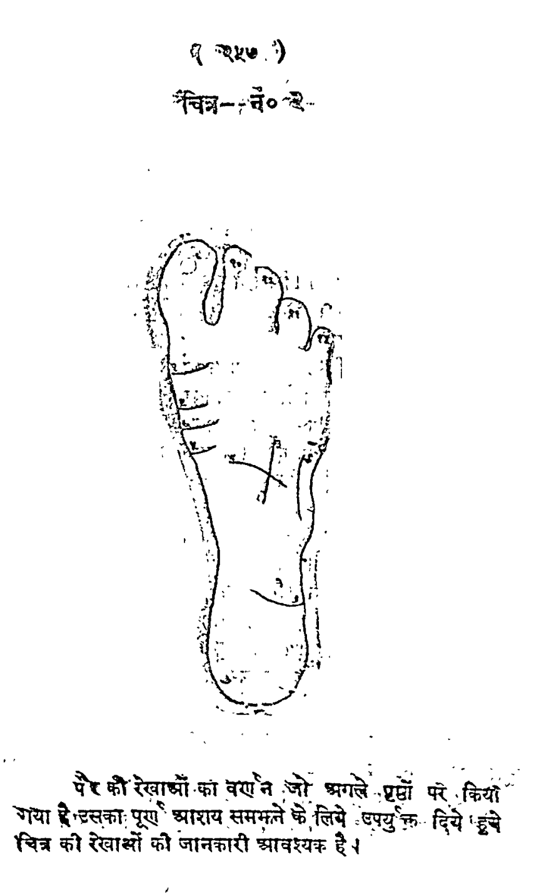

(257)
Figure No. 2

To fully comprehend the description of the lines of the foot provided on the following pages, it is essential to have an understanding of the lines illustrated in the figure above.

---

## Page 163

(252)

A person whose middle line (on the forehead) is broken or fragmented will be wealthy; however, he will be unable to enjoy the companionship of his wife and will be of depraved thoughts and self-indulgent. One whose lower line is broken will be extremely indigent.

A person who has only a single line on their forehead will be poor and will endure many calamities. One with two lines will be straightforward, industrious, and fortunate. A person who has crescent-shaped lines above their eyebrows is a noble soul (Mahatma). One who possesses such a mark between the eyebrows and above the nose is generally fortunate. However, a woman with this mark is often widowed or faces many hardships in life. A person with this mark is an expert in their craft; if this mark consists of only a single line slanting toward the right, his wife will be virtuous and devoted. If it slants toward the left, his wife will be a shrew.

If a person has two parallel lines (||) at the aforementioned place between the eyebrows, he is studious, industrious, and steadfast in his resolve. If the line is inclined toward the right, he is honest, trustworthy, and clever. If it is on the left, the person is deceitful and cruel. A person with lines rising upward from the ends of the eyebrows is intelligent.

A person whose three forehead lines (numbered 1, 2, and 5) are broken or fragmented is unfortunate.

3. This line is double; such a person is blessed with sons.

4. This line is also double; such a person is a man of profound contemplation and a successful traveler.

---

## Page 164

(256)

5. This individual is indigent (impoverished).

6. This individual is a consummate scholar, exceptionally talented, and wealthy; he achieves progress solely through his own strength and intellect.

7. This is the 'Elephant Line' (Gaja Rekha). A man possessing this line is wealthy, fortunate, cheerful, and devout, but lacks intellectual steadfastness. His thoughts are prone to shifting from moment to moment.

8. This line is found in the palms of men who are destitute.

9. If this 'Mace Line' (Gada Rekha) is straight, the man will be a valiant warrior. If it is inverted, he will flee from the enemy on the battlefield and perish in defeat.

10. A man bearing the 'Flag Line' (Dhvaja Rekha) becomes a sovereign ruler (Chakravarti).

11. One who bears the 'Trident' (Trishula) sign becomes a leader and attains honor within the state.

12. A person possessing this mark will be a 'Purushottama' (an excellent or noble man) in this world. He will not die from disease; instead, his death will be caused by a cranial fracture or a traumatic injury to the head.

13. This line belongs to a scholar.

14. This person is wealthy.

15. A man possessing this line is blessed with children.

16. This individual will be indigent; if the 'Sarvani' line is also present, he will be extremely impoverished.

17. A man with this line will be a staunch devotee.

18. One who bears this 'Sorrow Line' (Shoka Rekha) will be a great ascetic (Yogishvara).

19. A person with this line will rejoice in the rise of his own fortune; this line is distinct from the first line and deeper in appearance.

---

## Page 165

(260)

20. One who possesses the 'Fish' sign (Matsya Rekha) on the sole shall be exceptionally talented and a master of refined arts.

21. If this line extends halfway to the center of the sole, the man shall be profoundly learned.

22. One who bears the 'Swastika' mark on the sole shall defeat external enemies in battle. However, he will remain under the influence of dull-witted people. Simultaneously, he shall also be a man of great stature in the world.

23. This line indicates a man of poverty.

24. A man possessing this line will misappropriate the wealth of others.

25. A man with this line will acquire the accumulated wealth of others.

26. A person with this line is virtuous, yet he quickly falls into poverty.

27. A person with this line meets an untimely death in a foreign land.

28. A person with this line is a diplomat.

29. These lines are of two types: Firstly, if the line breaks and moves towards the little finger (the Mount of Mercury), the man will inherit no ancestral property; he will rise from poverty to become wealthy, famous, and renowned. He will possess a pure and clear mind, though he will be highly indulgent and pleasure-seeking. Secondly, if a branch line emerges and moves towards the thumb (the Mount of Venus), the man will be born into a highly capable and prestigious lineage, and will be famous and wealthy. He will, however, inevitably be greedy.

30. This man will be wealthy. Suddenly, he will abandon all worldly attachments, become an ascetic, and attain the status of a realized soul (Siddha Purusha).

31. This man will be adulterous and will forever remain enthralled by carnal desires.

---

## Page 166

(261)

32. Such a person will have a short lifespan, yet they will be prosperous, renowned, and a great personality of their time.
33. This individual will be a liar and a hypocrite.
34. This person will commit suicide.
35. This person will be a realized yogi or a king.
36. This line will be the lowest among the lines above it. The individual possessing this line will be the sole male descendant of their lineage.
37. This individual will be a gentleman and generous.
38. This individual will be a lover of truth.
39. This person will be an expert in diplomacy.
40. This person will be a liar and a betrayer of trust.
41. This individual will be wealthy and generous.
42. This individual will be a brilliant astrologer or a scholar of the Vedas; if a woman, she will be a courtesan or a procuress.
43. This individual will have a short lifespan but will be of good character.
44. This individual will be endowed with material illusions (Maya).
45. This individual will be fickle-minded.
46. Individuals with a triangle mark [on their palm/soles] will wander to foreign lands for the sake of their livelihood.
47. This individual will be logical and either an atheist or a philosopher (Vedantin).
48. If this line forms an angle, the person will be extremely clever and proficient in mathematics.
49. If this line intersects the aforementioned angle to form a triangle, the person will certainly face imprisonment.
50. If this quadrilateral [square mark] appears in a similar manner on anyone’s foot—

---

## Page 167

(262)

If [such a mark] is present, the person will become the head of a monastery (Mathadheesh); if there is only a square mark, then the individual will inherit a kingdom or acquire wealth and property belonging to others.

51. If this line is crooked in this manner, the person will enjoy royal comforts but will suddenly be trampled upon and disgraced.

52. This person will be ostentatious and hypocritical.

53. A person with this line is clever and rises from humble beginnings to greatness; in their own estimation, they will consider themselves superior to all.

54. A person with this line will be fortunate.

55. This person will be indigent.

Just as lines on the palm lose their efficacy or face complications when intersected by others, the lines on the feet produce results in a similar manner. Therefore, it is of the utmost necessity to possess complete knowledge of their positioning.

56. One with this type of crooked line will be a scholar of Mimamsa and a master of Ayurveda.

57. This person will be an admirer of foreign talent.

58. This person will be extremely generous and possess a royal temperament.

59. This person will be perpetually devout and will attain the vision of the Divine.

60. A person with this line will be a hypocrite, cruel, and jealous.

61. This horizontal line is double. Such a person will be the possessor of great wealth.

62. Since this line is double, the death of the individual will occur in a foreign land.

63. If this double line forms an angle, the person will be exiled. If this line meets the 62nd line, they will never return.

---

## Page 168

> ### 🖼️ Diagram: Foot Lines: Figure 3 (पैर की रेखायें चित्र ३)
>
> 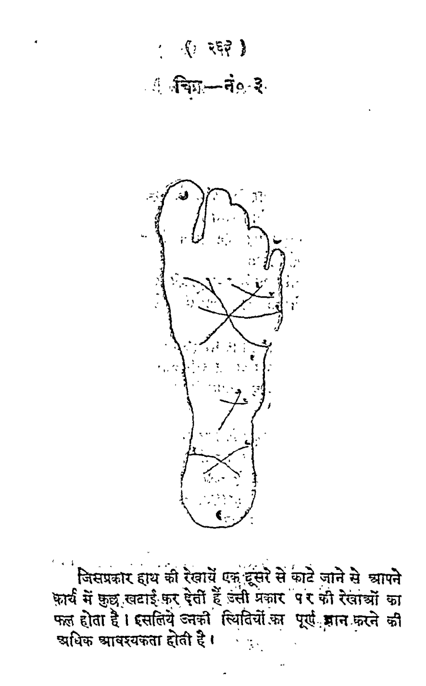

(262)
Figure No. 3.

Just as the lines of the hand, when intersected by one another, tend to obstruct or diminish the efficacy of their respective functions, the influence of lines on the feet is governed by similar principles. Therefore, it is of the utmost importance to possess a comprehensive understanding of their specific positions and configurations.

---

## Page 169

(254)

64. A person possessing this line is highly illustrious. If it is a single, clear line, the individual will be exceptionally renowned. Such a person will receive numerous favorable opportunities to perform significant deeds, though they will also possess a strong libidinous nature.

65. This is the 'Scale Line' (Tula Rekha). The individual will derive substantial profits in business ventures.

66. This mark resembles the numeral four; the individual will be a scholar of the Vedas and highly proficient in their pursuits.

67. If a square mark is intersected or broken in the center, the individual will lose their accumulated wealth.

68. If this line originates from the direction of the thumb and extends toward the heel, dividing the foot into two parts, the person will die as a result of a fall.

69. This man will be a renunciate (viragi).

70. The 'Eye Line' (Netra Rekha): This indicates that the individual will perceive the world through the eyes of others.

71. This individual will be indolent and will tarnish the reputation of their ancestors.

72. The emergence of this mark indicates that the person will suffer from illness. If they do not succumb within four months, they will recover and attain great fame. However, later in life, their death will be caused by violence or conflict.

73. The emergence of this semi-circular line leads to travel abroad and brings wealth. If this mark is present from birth, the individual will be exceptionally fortunate.

74. The person possessing this will be a seeker of dharma (righteousness) but will constantly dwell in confusion, possessing a skeptical and indecisive intellect.

75. Whoever possesses this mark will acquire immense wealth, but they will also be prone to vices.

76. This double line is characteristic of a protector of dharma (righteousness).

---

## Page 170

( 265 )

77. A person possessing this line is devious by nature.
78. When this line emerges, it enhances fame and reputation.
79. This line increases status and prestige; if present from birth, it bestows the growth of one's lineage and provides renown.
80. Such a person is conspiratorial.
81. This line is found on the palms of profound scholars.
82. This is observed in contemporary reformers.
83. Upon its emergence, an individual faces losses and suffers from ill health.
84. When it emerges, it restores health to a sick person and generally facilitates the birth of a son. If present from birth, the individual is fortunate.
85. This line is found on those who are religious reformers. These individuals tend to dismantle ancient traditions.
86. When this line is thin, long, and straight, the person is simple-hearted and easily influenced by the words of others.
87. This individual is a hypocrite and prone to ailments caused by an imbalance of the Vata (wind) humor.
88. An individual with a scorpion-shaped line will die by drowning and will be exceptionally wealthy.
89. A sign of a sitting serpent indicates that the person is treacherous and devious.
90. A sign of a standing serpent indicates that the person is predatory, much like a wolf.
91. This individual is simple-hearted but internally unstable and harbors disdain for the female gender.
92. When this line emerges, it proves fatal to the eldest member of the family, such as the parents; however, if it is present from birth, that individual shall attain a high position.

---

## Page 171

> ### 🖼️ Diagram: Foot Lines: Figure 4 (पैर की रेखायें चित्र ४)
>
> 

(266)
Figure No. 4:

In the foot illustrated above, the lines have altered their positions. Therefore, to ascertain the complete analysis, a detailed examination of these lines is essential.

You may acquaint yourself with the significance of these lines by reading the descriptions provided in the following pages.

---

## Page 172

(267)

63. This man will be a saintly person.
64. This man will be a wrongdoer.
65. This man will be a gentleman, yet hedonistic.
66. A person possessing a double line will be a leader.
67. This line, upon rising, brings misfortune.
68. This man will be detached (a renunciant); however, he will leave the illusion of the world only to fall back into it again.
69. This man will spend his entire life in search of truth.
100. This man will establish a new path or religion.
101. This man will view every object with a critical and skeptical eye.
102. This man will be highly skilled and proficient.
103. This man will be frail and sickly, yet wealthy.
104. This man will be righteous and a devotee of the Divine.
105. This man will be foolish and base.
106. This man will always remain harsh and abrasive.
107. This man will be compassionate and a believer in God.
108. This man will desire perfection in every task, yet will be unable to accomplish anything; he will suffer a decline.
109. This man will be extremely hedonistic and will engage in immoral conduct.
110. This man will be exceptionally well-mannered, a follower of his traditional duties, and the most distinguished member of his lineage.
111. This man will be a devoted lover and a seeker of knowledge.
112. If this is the only line present, and no other signs (such as 11, 11, etc.) are found, the man will be extremely destitute.

---

## Page 173

(268)

113 & 114. If [the sign] is accompanied by the number twelve, the individual possessing this line will be peace-loving.
115. With the presence of this also, he will be exceptionally renowned.
116. An individual with this line will be highly prestigious; he will possess great wealth and will remain respected throughout his life.
117. This individual will be an extraordinary man.
118. This individual will be a scholar of logic and dialectics.
119. This individual will be unfortunate.
120. This individual will be deceitful and aggressive.
121. He will be beloved by all.
122. He will be contentious, that is, quarrelsome.
123. This individual will be a mischief-maker; that is, he will incite two people to fight and enjoy the spectacle himself.
124. He will be wealthy.
125. That individual will be of a very humble nature, soft-spoken, and a believer in the divine.
126. This individual will be extremely generous.
127. He will be a hypocrite.
128. This individual will be wise and discerning.
129. This individual will either be a commander of an army or a notorious brigand.
Note: If all lines from 125 to 129 are present, such an individual will be immensely wealthy and extraordinary; hundreds of people will follow him.
130. This individual will be deeply contemplative and virtuous (sattvic).
131. Such men are rarely found. If one exists, he will be a truly great soul (Mahapurusha).

---

## Page 174

> ### 🖼️ Diagram: Foot Lines: Figure 5 (पैर की रेखायें चित्र ५)
>
> 

(266):

Figure No. 1

This illustration has been prepared to demonstrate the sequence of lines corresponding to the left foot. To understand the significance and influence of these lines, it is essential to comprehend this diagram thoroughly.

---

## Page 175

(270) :

132- Such individuals are extremely clever and diplomatic.
133- These individuals are benevolent and friendly.
134- This person is simple-hearted and generous.
135- This person is inquisitive and possesses a deep longing for spiritual liberation (Mumukshu).
136- All the virtuous desires of this person will continue to be fulfilled.
137- These individuals appear innocent, but are cunning, hedonistic, and act as predators in the guise of protectors.
138- They are extremely generous and self-restrained.
139- This person will be immensely wealthy and learned, yet bereft of a spouse.
140- If there are two such lines, the person will be wealthy; if three, they will be cunning; if four, a thief; if one, an ascetic; if five, a king; and if six, they will attain spiritual perfection (Siddha).
141- This person is clever and sharp-witted.
142- If there are two such lines, the person is charitable; if one, greedy; if three, hedonistic; and if four, wealthy.
143- The individual possessing this line is long-lived and thoughtful. Such a person will desire to renounce the world, but will be unable to do so.
144- If there are three such lines, the person is extremely fortunate; if one, ordinary; and if two, farsighted.
145- A person with three such lines will be generous, one with two will be crooked, and one with a single line will be lustful.
146- A person with three such lines is prone to anger; with two, they will be wealthy; and with one, they will be a skillful businessman.
147- This individual is exceptionally gifted.

---

## Page 176

(271)

148. The presence of a line at the joint of the finger or toe is auspicious. If it is shaped like a barley grain (Yava-akara), it is considered highly excellent; however, if it appears chained, it is an indicator of poverty.

149. This person will be a great scholar.

150. Driven by intense lust, this person is capable of doing anything.

151. This person is deeply devout and God-fearing, yet often prone to lasciviousness.

152. This person habitually wastes their life by engaging in futile and trivial preoccupations.

153. This person will remain happy, whether at home or abroad.

154. This person will be destitute.

155. If an individual’s line extends to meet the Elephant Line (Gaja Rekha) and terminates there, the rise of their fortune is dependent upon their wife’s destiny. Such a person is usually married to a fortunate woman.

156. If this line rises upward to meet the Elephant Line and terminates there, the individual will be wealthy, a connoisseur of merit, and kind-hearted.

Chapter Three
The Left Foot

157 and 159. If both these lines are present, it is auspicious. Similarly, lines 158 and 160 are also considered favorable.

In the diagram of the left foot, the sequence of the lines begins from number 1.

---

## Page 177

(272)

The description of the lines numbered 1 to 15 has been provided separately; these do not correspond to the figures.

1. If the lines on the left foot and the right foot are identical, the individual will lead an ordinary life.

2. If there are more lines on the left foot than on the right, the individual will be physically frail but will attain fame and wealth through his wife or other women. This principle also applies to wealth inherited from one’s mother or maternal grandmother.

3. If royal symbols such as the conch (Shankha), discus (Chakra), mace (Gada), lotus (Padma), or flag (Pataka) appear on the left foot, it is considered inauspicious. The individual will be oppressed or trampled upon by others.

4. If the barley-corn mark (Yava) on the sole of the foot is triangular in shape, the individual is fortunate.

5. If a square mark (Chatushkona) appears on the left foot, the individual is unfortunate. He will sell his ancestral property and depart for a foreign land.

6. If the elephant line (Gaja Rekha) appears on the left foot, the individual finds no peace in household life; his existence remains filled with discord.

7. If an inverted mace line (Gada Rekha) appears on the left foot, the individual will never be subdued by enemies and will be a great warrior, but he will be killed through treachery.

8. If the fish line (Matsya Rekha) appears on the left foot, the individual’s desires will be grand, yet they will never be fully realized.

9. If the scorpion line (Vrishchika Rekha) appears on this left foot, the individual’s wife will have been raised by her maternal uncle or her father's sister, and he will acquire wealth through that connection.

10. If the serpent line (Sarpa Rekha) is present, the individual will be extremely generous but also highly irascible. Such a person is destined to be bitten by a snake or killed as a result of conspiracies orchestrated by women.

---

## Page 178

(Page 273)

11. An individual whose left toe is crooked will never find happiness in relation to his wife.
12. A person who drags his right foot while walking shall be wealthy.
13. One who possesses a "Netra Rekha" (eye-shaped line) on the foot will be inclined toward adultery.
14. An individual who has a circular, zero-like mark on the foot will be extremely wealthy and honored, yet will lose everything toward the end of his life.
15. If there is an inverted fish symbol on the left foot with its mouth facing toward the heel, such a person will be profoundly hedonistic and perpetually immersed in sensual desires.
16. An individual with [this specific] line will be extremely destitute.
17. This individual will find peace of mind through religious and righteous activities.
18. This individual will constantly engage in wicked behavior.
19. This individual will be violent by nature.
20. This individual will be extremely straightforward, gentle, and soft-spoken.
21 to 25. If all the lines (from 21 to 25) are present, the person will be exceptionally wealthy and prestigious. If only three are present, he will be childless; if only one or two are present, he will be unfortunate.
26 to 30. If all the lines from 26 to 30 are present, the individual will be fortunate, and whatever task he undertakes will be successfully completed. Furthermore, he will be a great diplomat.
31. A person with the line at position 31 will be a staunch atheist.
32. This individual will be a perpetrator of grave misdeeds.
33. This line is found in those who walk the path of vice.

---

## Page 179

(274)

34. This person will initially remain an atheist, but will later become a follower of true righteousness (Saddharma).

35. A person with a double line will always indulge in baseless fantasies. They will engage in futile arguments, remain skeptical at every turn, and constantly devise new schemes.

36. This person will be of an extremely superior nature.

37. This person will be adept at taking loans and will always have their eyes on the belongings of others.

38. This person will always perform virtuous deeds but will be prone to jealousy.

39. This person will be generous, blessed with sons, and highly renowned.

40. This person will be extremely lustful, yet a friend to the downtrodden.

41. This person is not fit to sit in the company of women. If given the opportunity, they will attempt to engage in illicit affairs even with venerable women. If this line appears on the right foot of a woman, she will also be unchaste.

42. This person is a believer, yet serves the Divine only when it suits their desire; they are extremely indolent.

43. This person understands the true value of time.

44. This person will always be instrumental in pushing others toward the path of vice.

45. This person will be unable to bear the sight of others' prosperity and will constantly lie in wait to usurp it.

---

## Page 180

> ### 🖼️ Diagram: Foot Lines: Figure 6 (पैर की रेखायें चित्र ६)
>
> 

(275)

Figure No. 6

To understand the extent to which the presence of a mark resembling a ghee-pot (ghrita-patra) on the foot corresponds to the circumstances of one’s life, it is highly instructive to examine this foot and discern the individual’s condition through it.

---

## Page 181

(276)

46. This man will always be self-indulgent in ephemeral pleasures; he will never succeed in any undertaking, will remain perpetually engrossed in indolence, and will be excessively luxurious.

47. He will undertake pilgrimages.

48. He will visit two cities.

49. He will be fickle-minded and will abandon tasks after commencing them.

50. If his lines intersect with the 46th line to form a square mark, then this man will be extremely fortunate and a beacon of prestige for his lineage.

51. This man will be a scholar of logic and will be blessed with a beautiful wife.

52. He will attain a wife from a noble family and will concurrently acquire wealth.

53. This man will always perceive things through the eyes of others and hear through the ears of others (i.e., he will be easily influenced and lack independent judgment).

54. This man will always devise cruel stratagems and entrap those close to him within them.

55. Influenced by the words of others, he will squander all his possessions.

56. An individual possessing this line is always serious, farsighted, punctual, and cunning.

57. This man will be combative by nature.

58. This man will be deceitful.

59. This man will find greater happiness away from his home.

60. This man will be blessed with a beautiful wife.

---

## Page 182

(277)

61. This person will be blessed with handsome sons.
62. This person’s son will be of wicked conduct.
63. This person will attain a high position.
64. Individuals of this nature are typically merchants; they engage in large-scale trade and enjoy the favor of high-ranking officials.
65. This man typically finds himself with a sickly wife.
66. This man frequently suffers from contagious diseases and harbors an affection for women of low character.
67. This man typically earns his wealth through the trafficking of women.
68. Such individuals are extremely generous and devout followers of the Divine.
69. This person consistently lives off the food provided by others.
70. These individuals live off the earnings of others and are inherently lazy.
71. This person is a habitual liar and a deceiver.
72. This person will always gaze upon the wives of others with an evil intent.
73. This person invites his own total ruin by getting entangled in the conspiracies of unchaste women.
74. If this man is a Brahmin by birth, he will be a disgrace to his lineage; however, if he belongs to other varnas, he is considered favorable.
75. Such men are typically driven by intense carnal desires.
76. These men always covet the wealth of others and are destined to be unfortunate.
77. This person will be devoid of progeny.
78. This person will be a possessor of knowledge in many sciences and disciplines.
79. This person always boasts based on the strength of others and engages in the acquisition of ill-gotten wealth.

---

## Page 183

(278)

He will not hesitate or reflect before accepting anything.

80. Such individuals are often yogis (ascetics or spiritually inclined).

81. Upon the emergence of this line, the individual will attain a high position.

82. Upon the emergence of this mark, one will face a fall or be dismissed from their position.

83. Upon the emergence of this mark, one will discover hidden treasures.

84. Upon its emergence, a man will meet his friend or wife, and in the case of a woman, she will meet her husband.

85. If this barley-grain shaped mark (Yava) is present on all five fingers, that person will enjoy royal comforts.

86. This person will generate wealth through physical labor.

87. This person will be a poet.

88. This person will be a scholar.

89. Despite being thoughtful, he will be highly susceptible to the influence of women.

90. He will be a worshipper of beauty, a poet, or an artist.

91. He will only abandon a task once it has been brought to completion.

92. This person will be a judge.

93. This person will be a supreme devotee of the Divine (Param Bhagavata).

94. This person will be a practitioner of Tantra.

---

## Page 184

> ### 🖼️ Diagram: Foot Lines: Figure 7 - Chain & Net Formations
>
> 

(276)
Figure No. 7

To understand the significance of a lattice or chain-like formation of lines on the foot, and to determine under what circumstances it proves beneficial or detrimental to an individual, it is essential to have a thorough knowledge of its characteristics and positioning.

---

## Page 185

> ### 🖼️ Diagram: Foot Lines: Figure 8 - Straight Line Formations
>
> 

(280)
Figure No. 8

The detailed description of how straight lines on the foot influence one's life is provided on the following pages; however, it is essential to first comprehend their positioning through this illustration.

---

## Page 186

( 281 )

95. This individual will be a devotee of spirits or occult entities.
96. This individual will attain a high position.
97. This individual will be long-lived.
98. This individual will lose their life on account of a woman. They should remain cautious of water.

99. This individual will be extremely fortunate.
100. This individual will be very wealthy, yet will have an unworthy son.
101. A person with this line is a destroyer of their own brothers.
102. This individual will be highly renowned but also envious.
103. This individual will have a greater number of daughters.
104. This individual will have an equal number of sons and daughters.
105. This individual will sire children for others by donating seed to other women, yet will remain childless themselves.
106. This individual will be of questionable lineage, born from the seed of another family.
107. This individual will be a devout, wealthy, and godly person, but also lustful.
108. This individual will be prone to administering immediate punishment and will possess a hard heart. Their friends will be few.
109. This individual will be a recipient of favor from high-ranking officials and will be a talented figure in society.
110. This individual will have many enemies, but they will be destroyed in quick succession.
111. This individual will be a beggar.
112. This individual will be addicted to vices.

---

## Page 187

(182)

113. This individual will be a disgrace to their lineage. However, this person will be clever and appreciative of virtues in others.
115. This person will be clever but prone to jealousy.
116. This person will return favors with disdain and malice.
117. This person will be wealthy despite appearing frail, and will possess a humble disposition.
118. This person will be extremely arrogant and will consequently suffer losses.
119. If this person engages in the trade of white commodities, they will reap profits.

120. This person will be simple-hearted and possess the temperament of a yogi.
121. This person will constantly attempt to extricate themselves from complexities but will only become further entangled.
122. This person will argue over trivial matters and will always be prepared for conflict.
123. These individuals possess independent thoughts and do not accept the authority of others.
124. These individuals often ruin themselves by following the advice of others; although they are inherently progressive, their friends and advisors tend to lead them toward ignoble deeds.
125. These individuals are learned and are lovers of the musical arts.
126. These individuals possess a nocturnal nature.
127. This person will be born of a base or inferior lineage.
128. This person will be enterprising.
129. This person will always boast of their own authority and be governed by lust.

---

## Page 188

(123)

130. He will always be engaged in disparaging others.
131. He will initially lead an ascetic life, but will subsequently become a householder.

132. He will be compassionate.
133. He will remain chronically ill.
134. He will forsake his own wife to develop an illicit attachment to another woman.

137. He will be highly learned.
138. This person will be extremely industrious and clever.
139. He will always be dependent on others.
140. He will be simple-hearted and generous.
141. This person will be magnanimous, famous, and handsome.
142. He will be self-restrained but an atheist.
143. He will be self-restrained and a constant devotee of the Lord.
144. If a triangle is formed by the intersection of three double horizontal lines, it indicates three highly capable sons. All three will be master craftsmen (skilled in their respective fields). The middle one, however, may be somewhat of a deceiver.
145. He will be prone to jealousy.
146. He will take great delight in the company of scholars and will be blessed with four sons.
147. He will possess feminine traits and have many daughters.
148. He will be wealthy, honorable, and possess high aspirations.

149. He will instigate conflicts among his own kinsmen, leading to their downfall. Although he may appear grave and serious in demeanor, he is a great conspirator and also very wealthy.

---

## Page 189

> ### 🖼️ Diagram: Foot Lines: Figure 9 - Island Formations
>
> 

(284)
Figure No. 8

The line can be identified from the line shown in Figure No. 2 of the island mark. It is essential to examine this to understand its position and the resulting consequences.

---

## Page 190

(255)

150. Such a person possesses a gentle temperament and is wealthy. However, if this mark appears in isolation, he will be unable to accumulate wealth.
151. If only this particular wheel (chakra) mark is present, the individual will be extremely frugal.
152. If only this particular wheel mark is present, the individual will be extravagant.
153. If only this particular wheel mark is present, it will incite enmity with others, yet the individual will ultimately emerge victorious.
154. If only this particular wheel mark is present, the individual will make others dependent upon him.

155. If two wheel marks are present on the thumb and the index finger, the person will be wealthy. If two wheel marks are on the thumb and the middle finger, he will be wealthy. If two wheel marks are on the thumb and the ring finger, he will be blessed with a beautiful wife. If two wheel marks are on the thumb and the little finger, the individual will be obstinate. If two wheel marks are on the index finger and the middle finger, he will have a beautiful wife and be fortunate regarding progeny. If wheel marks are on the index finger and the ring finger, the person will remain obstinate and blinded by arrogance. If wheel marks are on the index finger and the little finger, he will be renowned; if the mark is only on the index finger, it is an auspicious combination (yoga). If the wheel mark is present only on the middle finger, it is unfavorable. If it is on the ring finger, or on the ring finger along with the little finger, the individual will be blessed with virtuous sons. If the wheel mark is only on the ring finger, he will be wealthy, and if it is accompanied by the little finger, he will be a government official. If it is present only on the little finger, he will be pleasure-seeking.

156. Regarding the presence of conch (shankha) marks: if all five fingers possess conch marks, the individual is of a saintly nature. The presence of four indicates a sorrowful life; three signifies a happy life; two indicates being devoid of sons; and if there is only one, the individual will be wealthy but devoid of sons.

167. If there are three lines present, the individual will be wealthy; however, having one or four (more than three) lines is not considered favorable.

---

## Page 191

(286)

167. Individuals possessing this line always dedicate their lives to the welfare of others.
168. Such a person will never covet the wealth of others and will remain content with their own trade or business.
169. This person will never experience happiness in their relationship with their wife.
170. This person will be highly sensuous or indulgent by nature, yet will remain unmarried.
171. This individual will be a skilled artisan or craftsman.
172. This person will be remarkably curious, jovial, and possess a witty or clownish disposition.
173. This person is destined to face imprisonment.
174. If this mark appears during one’s lifetime, it brings physical suffering; however, if it appears later in a positive context, it indicates the birth of a son. If it is present from birth, understand that the person is blessed with sons.
175. This indicates the sorrow of losing a son (or suffering due to a son).
176. This signifies the acquisition of wealth or property from one's father-in-law.
177. This mark indicates that the person will be subjected to imprisonment.
178. This indicates multiple marriages, but the wives are destined to predecease the individual.
179. This person will continue to receive divine assistance from time to time.
180. This person will be an adherent of independent religious and moral principles.

181. This line is of two types. In one, a branch splits off and extends toward the thumb, and in the other, it extends toward the little finger (the Mount of Mercury). The person with the first type will earn a great deal of wealth but will be unable to accumulate or save it. The second type of person will have a beautiful but shrewish or sharp-tongued wife.
182. If this line emerges (during a specific period), it signifies a period of two months characterized by severe adversity or illness. If it is present from birth, the line [may be seen] shifting here and there.

---

## Page 192

(287)

leads to distraction. In its initial phase, it provides peace following a period of illness.

183. This causes death after a three-month-long illness; however, if there are favorable planetary influences, it may be mitigated. If present from birth, one will have a harsh-tongued wife and suffer the sorrow of losing a son.

184. This person is a philosopher and a renunciate.

185. Upon its emergence, this person becomes detached from worldly life.

186. Among those seeking liberation (Moksha), this person attains the supreme state.

187. This person will be extremely lecherous. Upon its emergence, one suffers from a scarcity of food.

188. This person will be abrasive; they will incite conflicts among others and constantly scheme to fight or provoke others.

189. This person is exceptionally compassionate. Upon its emergence, a daughter will be born to them.

190. This individual will be humble and loving, yet highly hedonistic. Upon its emergence, it grants a son and wealth; at its conclusion, it causes physical suffering.

191. This person will be extremely hedonistic, a lover of romantic aesthetics (Shringara Rasa), and an expert in the art of music.

192. This person will be of a gentle and soft temperament and very wealthy. Upon its emergence, however, they will face a calamity as devastating as a thunderbolt.

193. This person will be extremely miserly, and their sons will not survive.

194. This person will be a devotee of spirits (prets) and violent by nature.

195. This person will be extremely virtuous and well-behaved. Upon its emergence, the spouse will die.

---

## Page 193

> ### 🖼️ Diagram: Foot Lines: Figure 10 - Circles & Crosses
>
> 

(265)
Figure No. 10

It is of utmost importance to fully comprehend the consequences that arise when two lines intersect within a circle, as this configuration carries significant prognostic implications.

---

## Page 194

(226)

166. This individual will be extremely ruthless. If this sign is rising, the person will commit theft; if it is fading, it portends their death.

167. If this sign is rising, it will cause great suffering to the person. Such an individual will be short-lived and unfortunate. However, for a woman, this line serves as a bestower of eternal marital bliss.

168. This person will engage in the trade of yellow-colored goods.

169. This person will be deceitful and follow wicked paths. If the sign is rising, they will acquire wealth through their cunning schemes; if it is fading, it will lead to their total ruin.

200. This person will be extremely clever and progressive, yet they will be imprisoned due to false allegations or wrongful charges.

201. This individual will suffer losses in business. When this sign is rising, they will face nothing but loss. (However, if they conduct business in a woman's name, they may see profit.)

202. This person will be self-respecting and litigious, yet treacherous and fickle-minded.

203. This individual will be of immoral conduct.

204. This person will be highly virtuous and a skilled official in state assemblies. When this sign is rising, they will attain a high-ranking government position. Generally, this sign does not fade; if it does, it causes no harm.

205. This person will be wealthy. As a result of their past actions, they will inherit property, but at the time of acquisition, someone else will usurp half of it, leaving them with only half the portion.

206. This individual will be highly intelligent and successful in business. When this sign is rising, they will secure a lucrative employment opportunity. This sign does not fade; if it does, it causes no harm.

207. This person will be simple-hearted and will have many daughters. If this sign is rising, it portends the death of a son.

---

## Page 195

(260)

208- This person shall enjoy the company of beautiful women, be wealthy and distinguished, and possess royal insignia.

209- This person will be simple and trusting. If these signs are present on both feet, he shall certainly be blessed with a vision of the Divine.

210- This person shall be a connoisseur of music and archery. Upon the emergence of this sign, he may face some form of wrath or displeasure.

211- This person is of a harsh nature and possesses a suspicious mind.

212- He is simple, trusting, and a devotee through many births. In this life too, he remains a devotee; not only does he hope for a vision of the Divine, but the rest lies in the will of the Lord (Hari).

213- This person remains a devotee and longs for a vision of the Divine, and performs virtuous deeds. Upon the emergence of this line, he shall receive wealth from an unexpected source.

214- This person remains addicted to vices and is a lover of courtesans.

215- He is blessed with a beautiful wife and possesses noble thoughts. Upon the emergence of this sign, he may attain certain divine experiences.

216- This person will be fond of strife and conflict, and shall also be troubled by spirits or discarnate entities.

217- This person is of perverse intellect and serves to destroy the honor and dignity of his ancestors. Upon the emergence of this sign, the individual may commit an extraordinary and reprehensible act.

218- A person with the sign of an upright serpent considers no one his equal, respects no one, and is always intent on demeaning others.

219- This person, in the name of a woman... [Text cuts off]

---

## Page 196

(261) If it manifests and one performs a grand task, one shall attain profit and success; otherwise, it is not so. If it emerges, it portends the death of one’s spouse.

220. This individual shall be a servant of the lowly, yet wealthy.

221. This person shall be deviant and engage in reprehensible acts; however, they shall certainly be wealthy.

222. This person shall always remain dependent on others. Upon its emergence, both wealth and prestige shall be destroyed.

223. This individual shall always befriend the base and perform ignoble deeds. Upon its emergence, the person acts against their caste and familial traditions. Such a person becomes an outcaste and ought to be excommunicated from their community.

224. This individual is of a calm and refined disposition. Wherever they reside, they bring welfare to all around them. They shall be an exemplary person.

225. This individual shall be a high-ranking official.

226. This individual is very simple, loyal, and patient; they are blessed with four capable sons.

227. This individual is blessed with two capable sons. This is difficult to achieve.

228. This individual possesses noble thoughts and remains a master of their senses.

229. An individual who possesses a grain-shaped (barley-like) mark on the nails of their thumbs shall be wealthy. If this appears on the index finger, the person shall be prone to illness.

Chapter Four
Individuals Possessing the Qualities of Different Planets

Those with the qualities of Jupiter:
Average height, sturdy build, fair complexion, and a well-fleshed body.

---

## Page 197

(262)

The individual possesses large eyes, a smiling countenance, and pupils that are large, round, and clear. Their eyelids are thick, eyelashes long, and hair is long, thick, and wavy. They have arched eyebrows, a prominent nose, and a large mouth. The lips are thick, rounded, and fleshy, and the chin is elongated. The body has a dense growth of hair and is prone to excessive perspiration. They walk with a silent, dignified gait, and their fingers are rectangular in shape. Their speech is clear and melodious.

Health: They possess a bilious (Pitta) constitution and a jovial temperament; they are often prone to arthritis. They are hearty eaters and drinkers, yet they are controlled by their senses and do not harbor base desires. Jupiter governs the head, lungs, and throat; consequently, they frequently suffer from complaints related to the lungs and throat.

Mental Attributes: Such individuals are inclined toward public service, often attaining high positions. They are highly self-respecting, hospitable, and fond of eating and serving fine food. They are noble-natured, generous, spendthrift, and harbor a deep disdain for anything base or miserly. They are religious and perform rituals with grandeur and a sense of external decorum. They favor regal splendor, uphold traditional customs, and adhere strictly to laws and directives. While they prefer peace, they detest treachery and discord; they will fight fiercely against anyone who harms their loved ones. They are easily pleased and remain steadfast in their friendships.

If they possess inauspicious marks, they become arrogant, excessively frugal, selfish, and boastful, with a natural lifespan of 60 years.

Attributes of those governed by Saturn:

Tall, thin, possessing a pale complexion, a long face, and hollow cheeks.

---

## Page 198

(213)

The bones are thick, the eyebrows are black and joined, and the eyes are small, sunken, dark, and often moist. The whites of the eyes tend to be somewhat yellowish; the ears are large; the nose is thin and pointed with nostrils that are slightly flared. The mouth is large with thin lips, and the teeth, while beautiful, are prone to early decay. The beard is black, the chin is long and prone to causing distress, and the neck is long. The fingers are long and knobby, and the first phalange of the thumb is notably large and flat. The voice is coarse and low. Those under the influence of a malefic Saturn typically have hair that is sparse and fine in texture. They are often indifferent toward their personal appearance.

Health: They are prone to injuries in the shins and feet; many individuals influenced by a negative Saturn are wayward or disreputable. They are frequently affected by melancholia, which may manifest as states akin to insanity. They harbor an aversion to water and tend to live in squalor. Saturn governs the ears, teeth, and calves; consequently, these individuals are susceptible to ailments of bile and wind (vata). Their teeth often decay painfully and fall out early, and they are prone to accidents involving falls or being crushed.

Mental Disposition: They are melancholic, grave, steadfast in religious matters yet fanatical, and possess a love for music and mathematics. They are intelligent and find contentment in their own ways, frequently engaging in debates on religious subjects according to the occasion. They are fond of occult sciences. They are generally insubordinate and have a tendency to incite others. They have a preference for items of a black color. They do not contribute to the daily joys of life and dislike the company of others. They possess a harsh temperament. They are frugal to the point of miserliness. They are lethargic, solitude-loving, and often harbor a disdain for humanity; they are hard-hearted and inclined to torment children.

---

## Page 199

( 164 )

Such individuals are prone to imprisonment. If the Mount of Saturn is dominant and the finger of Saturn is weak, the person becomes an absolute egoist, irritable, suspicious, prone to conflict and argumentation, fearsome in nature, and deceitful. Their lifespan is typically seventy years.

Individuals with Solar Characteristics

Those influenced by the Sun possess a vibrant temperament; they are skilled artisans, lovers of beauty, intelligent, and discerning.

They are of average to slightly tall stature, possessing an attractive, refined, and glowing complexion. Generally, their forehead is high, yet broad; their eyes are large, almond-shaped, and sparkling with brilliance. Their speech is clear and sweet, with brown pupils and long eyelashes. Their cheeks are round and firm, the nose is straight, and the eyebrows are elegantly arched. The mouth is not overly large, the voice is resonant yet melodious, and the chin is round rather than protruding. The neck is long, graceful, and well-contoured. They have little body hair and are not physically robust. There is minimal body fat; the fingers are smooth and square-tipped, the thumb is of average size, and the second phalanx is slightly longer. The palm and fingers are approximately equal in length, and the ring finger is firm and well-developed.

Their state of health is generally good. They are optimistic, cautious of fire, highly intelligent, and do not incline toward any form of vice.

For those predominantly influenced by the Sun, ailments related to the eyes, joints, the spinal column, and the heart are possible. The influence of the Sun governs the eyes, spine, and heart.

---

## Page 200

(265)

Those possessing inauspicious hands are destined for blindness and face death far away from their motherland. They are prone to irregular heartbeats, frequent fevers, and the affliction of heatstroke.

Regarding mental capacity: endowed with intuitive knowledge, they grasp subjects with minimal effort. They conceive new inventions with great intelligence and dexterity. They are admirers of nature and craftsmanship, possessing a deep desire for aesthetic beauty and social prestige. They attract people quickly, readily forming both deep friendships and intense enmities. They possess an innate ability to comprehend matters of any complexity with ease, and they often ascend to high positions, thereby accumulating wealth. Their primary vulnerability lies in their tendency to express their inner thoughts too candidly and transparently. In matters of religion, they are not dogmatic and are easily swayed by belief, leaving no room for doubt. Through inner strength, they master esoteric sciences, and their mental faculties remain most active when solving difficult problems. Their temperament is cheerful, compassionate, and inherently drawn to beauty.

One with a Square mark on the Sun Line delights in being surrounded by fine art. In religious observances, they prefer grandeur and music, and they possess a marked affinity for the color yellow.

Women often mock their straightforward nature, and they do not always prove to be shrewd husbands. They are quick to anger but equally quick to calm down. They never harbor jealousy and possess the ability to turn a bitter enemy into a friend. However, their impulsivity generates such resentment that their circle of friends remains small. They have a preference for fresh air and physical exercise, and they are destined to be great travelers.

---

## Page 201

(266)

Such individuals are devoid of arrogance and possess no insatiable cravings, yet they harbor noble aspirations.

Traits of the Mercurial Type

Those dominated by the influence of Mercury possess a natural aptitude for commerce and business, coupled with an inherent capacity to delve into any subject.

They are typically short in stature, sturdy, and possess a cheerful countenance with a somewhat elongated face and a well-built physique. Their complexion is a light olive, their hair is walnut-colored and curled at the ends, their skin is soft, their facial complexion is prone to quick changes, and their forehead is prominent. Their chin is small, their hair is darker than usual, and their eyebrows are thin, arched, and well-set.

Their eyes are deep-set, sharp, piercing, and occasionally restless, with yellowish-white sclera and thin eyelids.

Their nose is long, straight, and rounded at the tip; their lips are thin, the upper lip is full, and the mouth is generally kept slightly agape. Their teeth are small, and the bones are long and pointed, occasionally appearing crooked.

Their neck and shoulders are strong, the chest is broad, and the arms are well-knit. Their bones are small, and their voice is generally soft.

Their hands are large, with flexible palms and fingers of a versatile nature; the fingers of intellect (Mercury fingers) are invariably pointed. The fingers are smooth, save for the first phalange of the Mercury finger, which is knotty; the thumb is long, with the second phalange being notably elongated.

Inauspicious traits include dark-colored teeth, restless and sunken eyes, and a lack of aesthetic appeal. The hands are excessively loose, and the fingers are long and curved backward.

Health: Susceptible to nervous agitation, liver ailments, and digestive issues.

---

## Page 202

(267)
A weak hand is indicative of injury or suffering in the arms, and often, ailments affecting the legs as well.

The intellect governs the brain, the heart, and the kidneys. A deficit in this faculty leads to hysteria, speech impediments, and diseases related to the heart and kidneys.

Regarding mental faculty: Such individuals are characterized by impulsivity in action and thought. They are adept at sports, skilled in oratory, possess a keen ability to judge character, and are excellent administrators. They are initiators of novel projects and exert influence over their peers. They possess a profound understanding of human character and are often mathematicians, experts in esoteric sciences, and connoisseurs of art and literature. In business, they are driven by the ambition to accumulate wealth. Such men often pursue careers as doctors, writers, accountants, merchants, and lawyers. Their advocacy is grounded in logic and persuasive argumentation. They are commanding in presence, possess a talent for mimicry, are affectionate, cheerful, jovial, fond of travel, and admirers of natural beauty. They are industrious, talkative, restless, intelligent, and optimistic. They remain ever-vigilant and possess the power of intuition. Their lifespan is eighty years.

When the hand is inauspicious, the individual becomes deceitful, imprudent, cunning, treacherous, mendacious, and treacherous, claiming knowledge of everything while acting with foolishness to swindle others. At times, they place such excessive faith in their own schemes that they fall into their own traps and invite misfortune. They are prone to theft and are predominantly concerned with their own gain.

Attributes of the Martial Type (Mangal):
Those belonging to the class of Mars do not adhere to conventional customs; they are courageous and industrious.

---

## Page 203

(288)

Those possessing rough, reddish skin, square shoulders, and a thumb where the first phalanx is round and flat, with the third phalanx of the fingers raised from within, exhibit specific characteristics. They have a moderately high, strong, short, and thick head; open eyebrows; a round face; and bright eyes, either small or large, in brownish hues. Their lips are marked with red spots; the mouth is large; the lower lip is thicker than the upper; the teeth are small; and the eyebrows are straight and thick. The nose is long with a beak-like tip, the chin is upturned, the beard is coarse, and the ears are small but set away from the head. The cheeks are thick, the chin is prominent, the neck is short and strong, the chest is uplifted, and the shoulders are broad. They have small thighs, short legs, and a gait that is graceful yet swift. Their voice is harsh or deep. The hands are hard and thick, the fingers are short, and the first phalanx of the thumb is larger than the second. Such individuals are impatient in every endeavor.

In those with an inauspicious hand, the stature is short, the face is bloated, the features are intimidating, the eyebrows are arched or knitted, the voice is gravelly or rasping, and the ears are long, accompanied by short, thick hands.

Health: A serious temperament, blood disorders, and skin diseases are indicative of internal ailments. Such individuals frequently suffer injuries in conflicts because of their combative nature; they are prone to fighting their own battles. Those with an inauspicious hand are often sensual, prone to rage, inclined toward alcoholism, and restless; if provoked, they may commit violent acts that lead to imprisonment or the death penalty. They frequently gravitate toward low company, in which they also find interest.

Individuals with a Martian disposition are prone to high fevers and diseases of the internal organs, and are often subject to accidents involving fire.

Mental Faculty: They are generous at heart, proud, charitable, and true friends. They utilize their wealth both for themselves and for others.

---

## Page 204

(266)

He is destructive and possesses immense, fearless power; he is capable of causing exhaustion or placing others in perilous situations, yet he achieves success in every endeavor. In matters of love, he acts with audacity and refuses to heed the arguments of others. He is a connoisseur of food and drink. He has a preference for circuses, cockfights, and dangerous sports. He is arrogant, ostentatious, and always seeks to lead; he views those who work with a calm temperament with disdain. If he is an artist, he paints scenes of battles and jungle hunts; if a singer, he performs martial songs and dances; if a lover of literature, he narrates tales of war. He is a leader of men and becomes a subject of admiration in crowds. He enjoys traveling and prefers living away from home. He favors vibrant red or blue colors. If such an individual possesses an inauspicious hand, he may become a murderer, a dacoit, or a notorious criminal.

His lifespan is seventy years. Death, in such cases, is often caused by weapons or fire. Those dominated by the Moon possess traits of imagination, love for solitude, detachment, a poetic temperament, a penchant for secrecy, and the ability to have prophetic dreams.

Traits of the Lunar Type:

He has a tall stature, a round and broad head, and eyebrows positioned slightly above the temples. His complexion is fair, his flesh is soft, his hips are large, and his hair is fine; there is little to no hair on his body. His nose is small and rounded at the tip. His mouth is small, lips are thick, and teeth are large, yellowish in color, irregular, and prone to early decay; the gums are often pale.

---

## Page 205

(20)

The eyes are round, large, and prominent, with shimmering brown pupils. The eyelids are large and thick; the chin is prominent and fleshy, and the ears lie flat against the head. The neck is long, fleshy, and marked with several folds. The chest is full of flesh but remains loose and unsightly. The abdomen is protruding, the legs are heavy near the ankles, and the feet are large. The fingers are short and smooth, while the first phalange of the thumb is shorter than average. The speech is soft and lacks vitality.

In inauspicious hands, one may find foul-smelling perspiration or white patches on the skin. Such individuals are often hypocritical, deceitful, envious, incompetent, dissatisfied, and superstitious. Regarding health, there is a deficiency of blood and a lack of stamina for sustained labor. They are perpetually lost in deep contemplation and constantly anxious about their health, with a persistent fear of paralysis, epilepsy, and fainting spells. There is a risk of drowning, as well as ailments related to the kidneys, bladder, genitals, arthritis, and the intestines. Those with a dominant Moon (Chandra) are prone to judgment errors, hysteria, and incidents related to water.

Mental Power: They possess a fickle nature, lack trust, become absorbed in their own thoughts, are selfish, and have a penchant for travel. They are highly suspicious and emotional, with a preference for poetry, literature, and music. Individuals with lunar characteristics are often less articulate in both appearance and taste. Women of this type are affectionate, transient in their ways, sensual, and devoted to their lovers. They struggle to remain committed to a single task and often fail to fulfill their promises; they may find intellectual pleasure in Vedanta but fail to apply it in practice. They eat heartily but drink little water. They prefer strong intoxicants and have a fondness for the colors white and yellow. They generally dislike trade or commerce, but are ardent lovers of the arts and painting. Their complexion is often a deep, pale white.

---

## Page 206

(301)

They prefer the color yellow. They have an affinity for wind instruments such as the Alghoza and the flute.

Those with inauspicious hands are careless, foolishly talkative, and prone to backbiting. They are often mischievous and not genuinely lustful; rather, they are merely agitators who create disturbances. They are ruthless, selfish, and insolent.

Characteristics of those influenced by Venus

Individuals influenced by Venus are beautiful, fond of all sensory pleasures, affectionate, and charismatic. Their complexion is fair with a rosy tint, and their skin is soft and delicate. They are of above-average height, with round, smooth eyebrows that are beautifully arched and tapered. Their hair is black, long, and abundant; it is soft and wavy, whether brown or black, and does not change in texture with age. Their nose is well-proportioned and long, broad at the tip, yet attractive and rounded at the bridge.

Their eyes are large, clear, and beautiful, with a sweet gaze, slightly uplifted, and brown in color. The pupils are wide, the eyelashes are fine like silk, and blue veins are visible beneath the skin.

Their mouth is small and well-formed, with red, slightly thick lips—the lower lip is particularly distinct—and their teeth are smooth, dense, and beautifully aligned. The chin is long and rounded, the ears are small and delicate, and the neck is clear and elegant. The shoulders are narrow and gracefully sloped. The chest, while not broad, is healthy and well-developed. Their waist is slender. Their hands are soft, with small, smooth, and symmetrical fingers; the phalanges are thick, and the thumb is small.

---

## Page 207

(372)

The voice is sweet and magnetic. 

Physical features include unhealthy, pale-colored skin, deep-set eyes, reddish and heavy cheeks, a flat nose, and very thick lips, especially the lower one, which is prominent. There is a large abdomen, difficulty in walking, and a heavy, raspy voice. The hands are limp, clumsy, and ill-formed, with fingers that are thick, smooth, and short.

Health: Generally robust and cheerful, yet susceptible to diseases arising from romantic indulgence and afflictions of the private parts. One is prone to conditions like gonorrhea and syphilis. Since the Mount of Venus governs the reproductive organs, one may suffer from hysteria or other gynecological disorders in women.

Mental Disposition: A cheerful and sociable individual, eager to please others and universally liked. Digestion is excellent, though one is not necessarily a glutton. One possesses a refined taste for fragrances, music, and the beauty of nature; however, one is also highly libidinous, and romantic partners exert a profound influence on one’s life. Such a person values truth but is frequently deceived by others. They are quick to forgive, averse to violence or quarrels, and prepared to sacrifice everything for their beloved. If they are a writer or an artist, they possess the innate ability to captivate the hearts of others. They are fond of travel, enjoy collecting jewelry and silk garments, and find great joy in flowers and perfumes. They show a preference for colors like pink, blue, and yellow, and among musical instruments, they have a particular fondness for the sarangi. 

In the case of an ill-formed or afflicted hand, the individual becomes suspicious, promiscuous, and extravagant. Such persons may suffer from insanity, possess filthy and obscene thoughts, and often face incarceration as a consequence of their actions.

---

## Page 208

Books on Astrology

Karmavipaka Bhasha Tika: This work contains accounts of the three births (past, present, and future); thus, with this in one’s possession, the need for the Bhrigu Samhita is eliminated. Being extremely useful, it is a must-have for your collection. Price for hardcover edition: 5 Rupees.

Jyotishsar Bhasha Tika: This text contains a comprehensive collection of subjects including Muhurta (auspicious timing), principles of horoscope analysis, and Varshaphal (annual horoscope). One can become an adept astrologer quickly through this book. Price for hardcover edition: 3.50 Rupees.

Muhurta Chintamani: This book contains the complete discourse on the science of astrology along with detailed mathematical calculations for every aspect. Price: 3.50 Rupees.

Bhrigu Prashnavali (with key): Price 1.50 Rupees.

Trikalajna Jyotish: A highly renowned book. It explains all branches of the science of astrology in very simple language, accompanied by examples. Price for the hardcover edition of approximately 200 pages is only 2 Rupees.

Jyotish Sarva Sangraha: 2 Rupees
Vivaha Paddhati: 1 Rupee
Shabda Rupavali: 0.50 Rupees
Rekha Vigyan (Palmistry): 0.50 Rupees
Lagna Chandrika: 2 Rupees
Laghu Parashari: 0.50 Rupees
Chamatkar Chintamani: 1 Rupee
Shighrabodha Bhasha Tika: 2 Rupees
Muhurta Ganapati Bhasha Tika: 4 Rupees
Hanuman Jyotish: 0.50 Rupees
Bada Vashikaran Vidya: 1.50 Rupees
Rashi Mala: 0.75 Rupees
Jataka Alankara: 3 Rupees
Bhavishya Phala: 0.50 Rupees
Vyapar Vigyan Jantri: 0.50 Rupees
Jyotish Sarva Sangraha: 2 Rupees

Health and Medicine

It is an indisputable truth that the cause of today’s increasing illnesses and frail physiques is a lack of knowledge regarding health.

---

## Page 209

> ### 🖼️ Diagram: Master Hand Figure 1: Major Lines & Mounts Overview
>
> 

(306)
Figure 1

By observing this figure, one will discern the precise location of the various lines. Without a foundational understanding of these lines, it is impossible to determine the true position and significance of the markings on the hand.

---

## Page 210

> ### 🖼️ Diagram: Master Hand Figure 2: Trajectories across Mounts
>
> 

(307)

Figure 2

By observing the position of all the lines in this figure, endeavor to memorize which line traverses through which specific area.

---

## Page 211

> ### 🖼️ Diagram: Master Hand Figure 3: Intersecting Line Junctions
>
> 

(308)
Figure 3

When these lines intersect with one another, they are compelled to form a new area. What impact do these formations have upon the future of one's life? To ascertain this, a comprehensive understanding of these lines is essential.

---

## Page 212

> ### 🖼️ Diagram: Master Hand Figure 4: Planetary Mount Emergence
>
> 

(306)
Figure 4

How do the origin, trajectory, and intersection of lines in relation to the positions of the planets influence their significance? To comprehend this, it is essential to have a thorough understanding of these planetary placements.

---

## Page 213

> ### 🖼️ Diagram: Master Hand Figures 5 & 6: Triangles, Circles, Squares
>
> 

(310)

Figure 5

It is essential to have a comprehensive understanding of how the presence of a triangle, circle, or square mark in a specific location influences life events. Obtaining full knowledge regarding this is of paramount importance.

Figure 6

Study the various positions of lines that are observed in very few hands.

---

## Page 214

> ### 🖼️ Diagram: Master Hand Figures 7 & 8: Junction of Life, Head & Heart Lines
>
> 

(311)

Figure 7

It is of utmost importance to understand the effects produced by the confluence of the Life Line, the Heart Line, and the Head Line. Their specific positioning is illustrated herein.

Figure 8

Observe carefully the point of origin where the Life Line and the Head Line emerge.

---

## Page 215

> ### 🖼️ Diagram: Master Hand Figures 9 & 10: Serpent-Tongue Forked Lines
>
> 

(312)

Figure 8

Observe the Life Line, Head Line, and Health Line that take the shape of a serpent's tongue.

Figure 10

Observe the position of the Life Line and Heart Line that take the shape of a serpent's tongue.

---

## Page 216

> ### 🖼️ Diagram: Master Hand Figures 11 & 12: Branching Lines
>
> 

(313)

Figure 11

Observe the Life Line, the Head Line, and the minor lines that emerge from or intersect with these principal lines.

Figure 12

Observe the Life Line and the Head Line originating from a joined point.

---

## Page 217

(314)

Figure 13

From which point does the Heart Line originate, and where does it terminate? To understand the results produced by the confluence of this line with others, it is essential to observe this figure closely.

Figure 14

While each of these three lines possesses its own distinct influence, their intersection creates a unique and complex condition. To understand this, observe this figure attentively.

---

## Page 218

> ### 🖼️ Diagram: Master Hand Figures 15 & 16: Marriage Line Interactions
>
> 

(315)

Figure 15

Observe the influences exerted by the Heart Line and the Marriage Line.

Figure 16

The problems that arise due to the positioning of the Marriage Lines and the circumstances created by the lines that come into contact with them—to understand these, a comprehensive knowledge of the above figure is absolutely essential.

---

## Page 219

> ### 🖼️ Diagram: Master Hand Figure 17: Bracelet Lines (Manibandh / Rascettes)
>
> 

(316)

Figure 17

Observe the serpent-tongued lines emerging from the bracelet lines (Manibandha).

---

## Page 220

> ### 🖼️ Diagram: Life Line Additional Variations
>
> 
>
> **Individual Hand Variations (१ to ६):**
>
> * Hand 1: `Hand 1`
> 
>
> * Hand 2: `Hand 2`
> 
>
> * Hand 3: `Hand 3`
> 
>
> * Hand 4: `Hand 4`
> 
>
> * Hand 5: `Hand 5`
> 
>
> * Hand 6: `Hand 6`
> 
>

Life Line
317

1
2
3
4
5
6

---

## Page 221

> ### 🖼️ Diagram: Head Line Additional Variations
>
> 
>
> **Individual Hand Variations (१ to ६):**
>
> * Hand 1: `Hand 1`
> 
>
> * Hand 2: `Hand 2`
> 
>
> * Hand 3: `Hand 3`
> 
>
> * Hand 4: `Hand 4`
> 
>
> * Hand 5: `Hand 5`
> 
>
> * Hand 6: `Hand 6`
> 
>

318

The Head Line

---

## Page 222

3
4
5
6

---

## Page 223

> ### 🖼️ Diagram: Book / Special Line Variations
>
> 
>
> **Individual Hand Variations (१ to ६):**
>
> * Hand 1: `Hand 1`
> 
>
> * Hand 2: `Hand 2`
> 
>
> * Hand 3: `Hand 3`
> 
>
> * Hand 4: `Hand 4`
> 
>
> * Hand 5: `Hand 5`
> 
>
> * Hand 6: `Hand 6`
> 
>

320 Pustak Rekha (Book Line/Line of Knowledge)

---

## Page 224

Astrology

* Chapter One *

If India can take pride in any of its sciences, it is undoubtedly astrology. In no other country in the world has there been as much exploration into this science as there has been in India. Although Western nations have frequently attempted to pursue this field, their knowledge has never surpassed the profound research conducted by the Indians. Recognizing their own best interests, countries across the globe have acknowledged India as the authority in astrology and have sought to acquire the wisdom originating from Indian scholarship.

Among all the sciences of the world, astrology is the most challenging subject. The fundamental reason for this is that this knowledge cannot be attained merely by perusing books; rather, one must engage one's intellect deeply before one can effectively put this science into practice.

It is true that experts in the science of astrology are found very rarely. The primary reason for this is that learning it requires tireless diligence, a significant amount of time, and a sharp intellect. Only after years of such dedicated study and perseverance can an individual become a true master of this discipline.

---

## Page 225

(18)

To foretell events across the three dimensions of time, to ascertain the positions of the planets by calculating the trajectories of the solar cycle and various constellations, and to perceive the unforeseen occurrences in the world—all of this is made possible only through the knowledge of this science.

Astrology comprises several branches. It is such an expansive discipline that mastering every one of its methodologies would require hundreds of years. Consequently, it has been divided into various specialized departments, by learning the application of which one may determine the course of events.

The principal branches of astrology are:
1. Ramal (Geomancy).
2. Swarodaya (The Science of Breath).
3. Samudrik Shastra (Physiognomy and Palmistry).
4. Jafar (Divination).
5. Jataka (Horoscopy), among others.

Through these diverse methods, one can reveal the past, future, and present of every animate and inanimate entity, as well as natural phenomena, within the world. The world is transient, and therefore, every object within it is also ephemeral. As long as any object is undergoing the process of decay, its life cycle encompasses all three divisions of time.

The three divisions of time are:
1. The Past (Bhuta Kala).
2. The Future (Bhavishya Kala).
3. The Present (Vartamana Kala).

When an object is utterly destroyed, only one phase of its life cycle remains, which is the past. The world’s...

---

## Page 226

(16)

History is replete with the deeds of the past. In truth, it would be accurate to state that history is, in a sense, merely the documented ledger of past events.

1. The Past: The days or the period of life that has already elapsed is termed the past. Events of yore constitute the primary components of this timeline.

2. The Future: The days or the period of life yet to come, which a human being envisions or contemplates, is termed the future.

3. The Present: The day or the period of life that is currently unfolding; a time during which one may reflect upon the events of the past and anticipate the occurrences of the future.

Among the various branches of Jyotish Shastra (Vedic Astrology), Samudrik Shastra (Physiognomy and Palmistry) is the most accessible. A layperson can easily study it, as its mastery does not necessitate complex mathematics or other auxiliary sciences, nor does it require the use of cumbersome or elaborate instruments. Man is inherently preoccupied with his own self and possesses a perennial desire to know his future. Thus, through the knowledge of Samudrik Shastra, he can gain insight into his destiny.

Hopes and despairs are merely the outcomes of the struggles inherent in human life. Yet, regarding every endeavor he undertakes, man wishes to know whether he will achieve success or not. It is for these reasons that he seeks refuge in the wisdom of Jyotish.

---

## Page 227

(20)

Through the study of Samudrik Shastra (physiognomy and palmistry), a person can clearly find solutions to the questions arising in their mind. Due to its simplicity and its inherent capacity to satisfy curiosity, the application of Samudrik Shastra has become more prevalent compared to other branches of Jyotish.

Through Samudrik Shastra:
1. By examining the hand, the details of a person's life across all three phases (past, present, and future) can be revealed.
2. By examining the feet, the details of a person's life across all three phases can also be revealed.
3. By observing a person’s nature and forehead, the details of their life across all three phases can be determined.

The practice of reading the hand is the most simple and popular method. The sole reason for this is that it is interpreted through lines. For the purpose of palmistry examination, it is essential to know that:

1. A hand consists of four fingers and one thumb. Some individuals possess six digits, including the thumb; these are referred to as 'chhanga' (polydactyly). When conducting a palmistry examination according to Samudrik Shastra, consideration is given only to the four fingers and the one thumb. The sixth finger or thumb is disregarded; while it may have an influence, it does not have a defined or systematic place in traditional analysis.

2. The part above the wrist is called the hand. During the examination of the hand:
(a) The palm.

---

## Page 228

(21)

(b) The four fingers.
(c) The thumb.

These three elements are examined, and through them, all information is ascertained. There are numerous lines on the four fingers, the thumb, and the palm. These lines are utilized when interpreting one's destiny.

The four fingers and the thumb each possess three lines. These three lines are known as the phalangeal lines. The phalangeal lines divide the fingers and the thumb into three segments (phalanges).

1. The topmost segment is called the first phalange.
2. The middle segment is called the second (median) phalange.
3. The lowest segment is called the third or final phalange.

According to the laws of nature, these phalanges hold immense significance. Had the fingers not been divided into segments, the hand would resemble a shovel for lifting concrete, rendering us completely incapable of writing, picking up objects, or performing any task. Every finger and thumb features three joints, with the assistance of which every task can be, and is, performed with ease.

The palm serves as the primary center for these fingers and the thumb. While the Creator designed the palm to support the fingers and the thumb, scholars of Samudrik Shastra (physiognomy and palmistry) have accorded it the greatest importance.

Predictions can be made only by examining the right hand of a man and the left hand of a woman.

---

## Page 229

Chapter Two
Chiromancy (Palm Examination)

It is the duty of the palmist to articulate predictions based strictly on the extent of his knowledge. He must maintain a composed mind, observe the lines and other essential features with meticulous attention, and if he harbors any doubt, it is appropriate for him to remain calm and silent regarding that matter. One must exercise great caution when delivering readings based on palm examination, choosing every word with careful deliberation. Inauspicious findings should not be stated bluntly, for destroying a person’s hope is more painful than taking their life. Just as a physician, upon discerning that a patient’s death is imminent, does not bluntly tell the patient that their end is near, it is similarly incumbent upon the palmist to refrain from stating unfavorable outcomes explicitly; rather, he should convey a warning indirectly and with tact.

Belief serves as a powerful agent in either strengthening or weakening an individual. By way of experiment, tell a robust and healthy person that their health is declining, and convey it in such a manner that they truly believe it. Within a few days, you will observe that they will indeed become thin, frail, and emaciated.

It is a proven truth that the human mind exerts a profound influence upon the individual. Upon hearing of a bright future, one becomes elated.

---

## Page 230

(23)

[When a person hears a positive prediction], his inner self dances with joy, and he engages in his work with greater enthusiasm and dexterity. Conversely, upon hearing of a bleak future, a person’s heart breaks; his enthusiasm dissipates, and he begins to lead his life with a sorrowful heart. Therefore, it is appropriate for the practitioner of palmistry to exercise extreme caution when delivering a reading. It is highly recommended that instead of stating inauspicious outcomes explicitly, the palmist should attempt to convey them through subtle hints or suggestions.

The individual seeking a reading should listen attentively to the prognosticator’s counsel, accepting what resonates with them and as much fortitude as they can muster. They should embrace positive thoughts and take proactive measures in anticipation of future events so that the consequences are not unduly detrimental, while also keeping in mind the auspicious results that are to come. One should approach the palmistry session with a mind free from all anxieties.

One should approach the preceptor (Guru) with a focused mind, free from lust, anger, greed, and delusion. With great humility, one should offer fruits, flowers, and a customary fee (Dakshina) as a gesture of respect. Before presenting one's hand for examination, it should be washed clean with water.

During the hand examination, one should neither allow a third party to be present nor bring anyone along, as it disrupts the concentration of both the practitioner and the recipient. Furthermore, if there is any mention of a character flaw or vice, it would be revealed to the third party, leading the individual whose hand is being examined to deny even the truthful, albeit unpleasant, aspects of the reading.

---

## Page 231

(24)

Essential Rules

Those who practice palmistry should first predict the auspicious and inauspicious outcomes by examining the right hand of a man and the left hand of a woman. Simultaneously, one must observe all the physical traits on the right side of a man's body and the left side of a woman's body. If a man exhibits signs such as injuries, boils, red or black moles, or scars on his right side, it is considered auspicious; similarly, for women, these same signs are considered auspicious when found on the left side.

One should begin the examination at the wrist (Manibandha), followed by observing both hands and their dorsal (back) sides. Subsequently, one should examine the palm and the lines thereon, followed by the thumb, fingers, and the characteristics of the nails in sequential order.

For men possessing feminine traits, the left hand should be examined, and for women possessing masculine traits, the right hand should be studied. This is because, in a man with a feminine nature, the left hand is more dominant than the right, and in a woman with a masculine nature, the right hand is more powerful than the left.

Until a child reaches the age of fourteen, their nature is considered to be of a feminine temperament. Therefore, one should conduct the examination by considering the child's left hand as primary and the right hand as secondary.

One should not be hasty in delivering predictions. A conclusion must be reached only after careful deliberation and by correlating all observed traits.

The palm should be examined with a composed and steady mind. Failure to do so increases the likelihood of error, as a person's hand is essentially their birth chart (Janmakundali). If examined with precision, an accurate prediction will be provided, to the benefit of both the one seeking the reading and the one performing it.

---

## Page 232

(25)
It is essential to observe the palm lines with caution and a focused mind.

One should analyze wealth, sovereignty, and conveyances from the left hand, and knowledge, prosperity, and progeny from the right hand.

One must not perform readings during the early morning, evening, night, or midday, nor in places of amusement, during journeys, while riding, or while on the road, without the presence of fruits, flowers, or a token offering.

It is forbidden to examine hands in the presence of rogues, fools, scholars, or the destitute. It is appropriate to examine the hand of a person with a beautiful, pleasant, and smiling countenance. Lines pertaining to marriage, illness, or death must be observed carefully in both hands. The hand should be in its natural state. Hold the hand firmly and press the lines so that the blood flow is stimulated; this will reveal the direction in which the lines are inclined to grow.

Before expressing an opinion on the primary lines, one must pay close attention to the structure of the hand—whether the palm is firm or soft. Note whether the upper part of the thumb is straight, bent, long, or short, or if it is pointed or rounded at the tip, and in which direction the fingers are inclined.

Divinities and Sacred Tirthas (Sacred Zones)

The front part of the palm is the seat of Lakshmi, the center is the seat of Saraswati, and the base is the seat of Brahma. The area below the thumb is the Brahma-tirtha; the base of the little finger is the Prajapati-tirtha; the tips of the fingers represent the Deva-tirtha; and the space between the thumb and the index finger is the Pitri-tirtha.

---

## Page 233

(26)

There are seven types of hands:
(1) Square (Samkona), (2) Spatulate (Chamsakar), (3) Philosophic, (4) Artistic or Conic, (5) Elementary (Nikrishta), (6) Idealistic/Psychic, and (7) Mixed.

The Square Hand

Among the seven types of hands, the square hand is considered the most superior and practical. It is termed "square" because of its quadrilateral shape, where the palm and fingers are proportioned in such a way that they form right angles at the junction of the wrist and the fingers. The fingers are flat, supple, and well-formed at their base where they join the palm. The joint located below the middle finger is typically broader in shape, and in such hands, the nails are usually short and square.

Individuals with this type of hand are naturally methodical in their conduct, gentle in temperament, sociable, and enthusiastic. They treat everyone with politeness and are inclined to follow orders, yet they are unable to tolerate uncivilized or rude behavior. They become irritated if they see someone interrupting others without authorization, and they themselves refrain from such intrusions. They are not quarrelsome; rather, they have a deep desire for peace and compromise, and they strive to attain high positions. They are not arrogant, and they look upon those who are uncivilized or haughty with disdain. They possess almost no power of imagination; however, because they are focused and enthusiastic in the pursuit of their goals, they generally succeed in all their endeavors. They have a particular affinity for practical studies and science. Regarding domestic duties as well,

---

## Page 234

(27)

They possess deep affection. They are keepers of promises, steadfast in friendship, determined in their objectives, and ethical and honest in business dealings. They do not engage in pretense in matters of love. If the fingers are firm and spatulate (square-tipped), such individuals are truthful and possess a peaceful disposition. Those whose fingers are smooth and whose Head Line is inclined are fond of fine clothing and maintain great personal hygiene. Their capacity for logical reasoning is high; however, a notable flaw is that they often squander a great deal of their time attempting to prove a point. If the little finger is crooked, it indicates a character defect, and one should advise individuals with such hands to strive to overcome this shortcoming.

Spatulate Hand

The fingers of a spatulate hand are curved or bent. In one variation, the palm is wider near the wrist and narrower near the fingers, whereas in another, it is wider near the base of the fingers and narrower toward the wrist.

If a spatulate hand is wider at the base of the fingers, it signifies exceptional industry and practical proficiency. If such a person makes an invention, they apply their intellect to translate that invention into practical application, thereby creating products useful for life. If the hand is broader toward the wrist (the bracelet/Manibandha), the intellect of such individuals is directed toward achieving progress in worldly affairs. If they are religiously inclined, they will be eager to propagate new forms of worship or devotional singing, and they possess the courage to cause a stir across the world even with a modest degree of devotion. Such individuals...

---

## Page 235

(28)

It is essential to have them in the world, as they serve as guides on the path of progress.

If the hand is strong and firm, the presence of knotted fingers indicates that the individual is industrious and enterprising. Such people never remain idle; they are constantly engaged in some activity. If they are not physically occupied, they engage in profound mental contemplation. They cannot sit idle for even a moment. They are courageous and persistent, possessing the strength to work independently. It is this independent power of thought that compels them to oppose the views of others.

Individuals with simple (smooth) hands desire to rule. They do not like to remain under anyone's pressure; they are prone to conflict, courageous warriors, and revolutionaries. Such people have a habit of approaching a group of four people and introducing a new topic that stirs up a commotion among them. These people are often the pioneers of novel ideas and a new way of life.

If the fingers are knotted, the person is hardworking, simple by nature, possesses a mild temper, and is gentle in speech. Their body is agile. They prefer activities such as horseback riding, hunting, target practice, running, and jumping.

If the fingers are smooth rather than knotted, the individual tends to be boastful and considers themselves superior, often offering advice to others. However, they themselves are not skilled craftsmen. If the fingers are long in addition to being smooth, a greater interest is found in trees, plants, and agricultural pursuits.

---

## Page 236

(26)

The Philosophic Hand

The Philosophic hand is typically long, bony, angular, and slightly concave in the center. The fingers are knotty, with prominent joints and long nails. This type of hand can be recognized quite easily.

An individual with such a hand prefers to accumulate scattered virtues rather than material wealth. They possess intense ambition. These individuals are unconventional in nature, often appearing beyond the illusions of the material world, and their thoughts are pure and lofty. Due to their self-respecting nature, they tend to be quite serious. They rarely have a large circle of close friends, and it is uncommon to find them wealthy. If they do attain wealth, they are inclined to spend it on philanthropic causes. A love for humanity is an inherent quality in them. They are so independent and clear in their thinking that they remain skeptical until they receive absolute proof. Such hands are especially observed in Brahmins, yogis, and those seeking spiritual realization. In these hands, it is noteworthy that prominent, knotty joints on the fingers are considered the primary sign of a thoughtful person, whereas smooth, pointed, and tapered fingers signify the opposite.

Individuals possessing this type of hand are usually students of specific, specialized subjects and prefer to keep themselves quite distinct from others. If they become preachers, they propagate extraordinary ideas. Such people are peaceful, contemplative, cautious, and even in ordinary conversation, they speak only after profound deliberation.

---

## Page 237

( 30 )

The Artistic or Commercial Hand

The fingers of this hand type are thin at the tips and thick and fleshy at the base. The length and breadth of the palm are of a moderate type. Individuals possessing this type of hand are weak in their convictions. They lack patience entirely and become fatigued so quickly that they can rarely bring their resolutions to fruition. It is their nature to act with haste in any task and then abandon it without completion. They do not contemplate the consequences of their actions. As soon as a thought arises in their mind, they are ready to act upon it. They are clever in conversation and grasp the meaning of any subject with speed. They are very talkative. They are easily influenced by others and get agitated over trivial matters. They have a pronounced tendency to exaggerate minor issues. Their temperament is fickle, and their thoughts are unstable. When provoked, they lose control of themselves, and in a fit of rage, they lose all sense of discretion, blurting out whatever comes to their mind. They are generous toward others, yet when it comes to their own profit or self-interest, they become cold and selfish. Regarding love, they are steadfast to the extent that if they fall in love with someone, they remain committed until the end. Any person can easily tease them over simple matters. They can be easily persuaded to donate money quickly. If the hands are long, soft, and heavy, then undesirable traits such as deceit, lying, hypocrisy, and cunning are found. They seek to satisfy their desires with others.

---

## Page 238

(31)

Such individuals have little interest in domestic life and prefer to spend the majority of their time indulging in frivolous activities with friends. They are poor at managing debt—often borrowing without the capacity to repay—yet they are adept at tall talk and empty rhetoric.

If the hand is knotted, the individual possesses an aesthetic sensibility, but without any malicious intent. If the hand is thick, short, and well-proportioned in appearance, the individual will harbor a constant longing for wealth and will undertake numerous efforts to attain it. However, due to a lack of favorable fortune, these endeavors often end in failure, occasionally landing them in difficult circumstances. Women with such hands tend to be fond of flattery; they are impulsive and naive regarding matters of love, often becoming involved in relationships without due consideration or understanding.

The Elementary Hand (Nikrishta Hath)

The Elementary hand is characterized by being excessively thick, heavy, and coarse in shape. The skin is rough, the fingers and nails are short, and the lines on the palm are few. Typically, the thumb is short, thick, and almost square. Such hands are observed in individuals of low intellect and wicked disposition. Their intelligence is inclined toward bestiality; they are hot-tempered and lack moral courage, often blurting out whatever comes to mind when provoked by anger.

They remain eternal slaves to their desires and behave like animals in the pursuit of their carnal urges. The larger and more fleshy the base of the palm, the more dominant the influence of primitive, bestial instincts. Those with such hands are preoccupied solely with eating, drinking, sleeping, and a desperate pursuit of material wealth; they possess no higher or noble aspirations whatsoever.

---

## Page 239

( 32 )

The Idealistic or Psychic Hand

The idealistic hand is aesthetically pleasing, elongated, and possesses slender fingers that become increasingly refined and pointed at the tips. The fingertips are prominent, and the nails exhibit a long, almond-shaped structure. These fingers are thin and tapering at the ends, while being thicker towards the base.

Individuals possessing this type of hand are often dreamers who build elaborate castles in the air, yet they struggle to accomplish practical tasks and lack administrative aptitude. They do not know how to utilize time effectively and, consequently, fail to become enterprising. They lack the courage to engage in industrious labor. By nature, they are calm and contented. They are quick to place their trust in anyone who shows them even the slightest kindness. They possess neither worldly wisdom nor logical prowess. They remain entirely indifferent to concepts of punctuality, mandates, or regulations. Easily swayed by the influence of others, they are quick to trust, and upon being deceived, they experience profound sorrow. They are deeply affected by the aesthetic of music, arts, grief, and melancholy; they possess an inherent love for color. They are deeply moved by the worship of their chosen deity, devotional singing, ceremonies, and festive celebrations.

They remain committed to faith and the adoration of the divine. They are staunchly religious and harbor an intense longing to witness their chosen deity manifest before them.

The Mixed Hand

The mixed hand generally displays the characteristics of all types of hands. Typically, the index finger is pointed, the middle finger is crooked or bent, and the third finger is square-tipped.

---

## Page 240

(33)
Regardless of the type, this hand may possess the characteristics of a spatulate, square, or philosophical hand. It is an inherent trait of individuals with such a hand to abandon tasks before completion and immediately embark upon new ones; consequently, success always remains elusive to them.

If the fingers of the hand are square and taper to pointed tips, such individuals are often deceitful and prone to serving their own interests by deceiving others. When characterized by a coarse or commercial hand, they tend to be indifferent and reliant on others to accomplish their work. While they may be able to speak on various subjects, their words fail to leave any significant impression upon the listener.

It is also essential to recognize that hands can be either soft or firm. A firm hand is indicative of a hardworking, energetic, and patient nature. Conversely, a soft hand is a sign of one who is comfort-loving, idle, and easily distressed by even minor difficulties. The right hand modifies the lines of the left and reveals the changes brought about in life through one’s own efforts; thus, this hand should be termed the 'active' hand. The left hand reveals innate or ancestral characteristics and should, therefore, be termed the 'passive' hand.

When a line is present in both hands, its effect is fully realized. If a line is found only in the right hand, its effect is greater than half, whereas if it is found only in the left hand, its effect is less than half. If the hands are large, long, and knotty, with strong joints on the fingers and thumbs, and if the phalanges are slightly prominent or any of the aforementioned marks are present, that person is capable of describing any matter with complete and comprehensive detail.

---

## Page 241

(34)

One will always strive to gain knowledge. If there are a multitude of lines on the palms, it becomes natural for the individual to experience irritability, to get angered over trivial matters, and to amplify such situations, which results in restlessness and detriment to health. This is also an indicator of mental anxiety and a tendency toward rapid exhaustion.

The presence of a depression (hollow) in the palm is a sign of misfortune and indicates a life of persistent failure.

If the color of the hand is reddish, the fingers are closely set, the palm is smooth and fleshy, and the fingers are long with bright red nails, such a hand is considered to be of the highest quality.

A red-colored palm indicates wealth. A bluish hue suggests a person addicted to intoxicants. A yellow tint points to one who is addicted to wicked women. A white or black color indicates poverty.

If the palm is elevated, the person is generous; if it is rounded, they are wealthy; if it is uneven, they are indigent. If the center of the palm is deeply recessed, the individual is miserly.

People with long hands are industrious and tend to perform their work in an organized manner.

Those with small hands spend much of their time lost in contemplation and hatching various schemes; individuals with small hands often do not practice what they preach and conceive of plans that are beyond their capacity to execute. When writing, they tend to write in large characters.

It should be considered auspicious if the length of the palm and the fingers are equal. The individual's fortune should be assessed in proportion to the degree of their disparity.

---

## Page 242

3

* The Palm *

The palm should neither be too narrow nor too broad. A broad palm is indicative of a generous, experienced, and industrious nature.

If the palm is overly thin, shriveled, dry, and hard, it denotes a person who is unenthusiastic, cowardly, weak, unintelligent, devoid of good character, fickle-minded, and easily exhausted by even minimal effort. A long, soft palm suggests a person who is lazy and comfort-loving.

If the palm is excessively heavy, thick, soft, and fleshy, it characterizes a person who is selfish, hedonistic, prone to addictions, and preoccupied with sensual gratification.

A person with soft, flaccid hands is unenthusiastic, lazy, prone to fantasy, and fond of comfort. An exceptionally small palm is a sign of a fickle-minded person. One with a firm palm possesses a dynamic and capable nature. A deep or sunken palm is considered the most ominous sign of misfortune. If this depression extends toward the Fate Line (or towards the region associated with the biliary/health line), then...

---

## Page 243

(36)

In matters concerning domestic life, this serves as an indicator of disappointment. If other lines also suggest the presence of an ailment, it is a sign of a severe or ominous disease.

If the depth [of this mark] inclines toward the Heart Line, it portends disappointment regarding one’s close friends and signifies an absence of support from them.

If the depth occurs beneath the Fate Line, it predicts unfavorable outcomes regarding worldly affairs, business, and financial transactions. A person possessing such a hand often experiences an unstable destiny. It becomes difficult for them to repay those from whom they have borrowed, and conversely, it becomes arduous to recover funds or assets lent to others.

If the fingers and thumb are auspicious in their formation, they do not entirely negate the effects of such a palm, but they do mitigate them to a moderate degree.

A soft and firm palm is an indicator of courage and strong willpower.

A white-colored palm suggests an individual who is selfish, self-admiring, and devoid of sympathy for the sufferings of others.

A yellow-colored palm indicates a biliary (pitta) temperament and a perpetually distressed disposition.

A black-colored palm characterizes an individual who is unhappy, lacklustre, of a phlegmatic (kapha) constitution, and possesses a very timid nature. A palm of a reddish (arun) hue indicates a person who is wealthy and optimistic.

A brown-colored palm is an indicator of a lack of vitality and a deficiency in masculinity or vigor.

A pink palm is considered the best. It is a sign of brilliance, radiance, and a refined sense of justice.

---

## Page 244

(37)

Western Perspective

If the palm is thin, narrow, and wrinkled, it is indicative of cowardice. It clarifies that a person possessing such a palm is timid, fearful, and weak-minded; their perspective is narrow, and they lack intelligence. Due to a lack of depth in their character, they also suffer from a deficiency in vitality, mental acuity, and morality. Furthermore, if such a palm is accompanied by long and slender fingers, it signifies a rebellious temperament.

If the palm is proportionate to the size of the fingers, thumb, and the body, and while firm—not rigid—it possesses flexibility without being wrinkled, it serves as proof that the individual has a stable mind. Such a person is discerning, well-liked, intelligent, and quick to engage in noble work upon the slightest inspiration. However, if a person’s palm is disproportionately wider than its ideal size, it proves that the individual is overly self-reliant, selfish, and cunning. This type of palm is typically broader toward the region of the wrist (Mani-bandha line).

If the hand is rigid and the palm is longer than the fingers, the individual is cruel and animalistic in nature; they have little regard for violence or homicide. The influence of these traits is diminished if other positive indicators are present, such as a strong thumb and a deep Head Line.

---

## Page 245

(38)

The palm should be normal in shape and in proportion with the fingers and thumb. If it deviates from this, its effects are similarly contrary.

If the palm is soft and wrinkled, it is indicative of ignorance and stupidity. An individual with such a palm is weak in both mind and body. They are hedonistic and fond of comfort, losing great opportunities due to their own lethargy.

If the palm is thick and rigid, and its color appears to tend toward whiteness, it is a sign of selfishness and uncouth behavior.

If the palm is deeply concave, it denotes misfortune, loss, a life filled with sorrow, and disappointment in every sphere of existence.

Just as the fingers are categorized, the palm is also divided into three parts. These parts are classified into the following three categories:

The first part is that which is situated between the Heart Line and the base of the fingers. The remaining two parts differ from each other, and their characteristics can only be understood through the careful observation of different hands.

According to the North-Eastern school of thought, regarding the identification of the planetary mounts on the palm:

It is essential to observe the positions of the planets by carefully examining the configuration of the hand. It is on the basis of these planets that one becomes proficient in analyzing the past, present, and future. Observe these planetary mounts with great attention. These planetary influences are quite similar to one another, differing only in their individual qualities.

---

## Page 246

(36)

The six planets never fail to manifest their influence when they enter each other’s spheres. Upon careful observation, it becomes evident that:

The Sun—Its position lies in the space between the index finger and the middle finger. This area is broad at the top and tapers into a serpentine shape as it descends. Extending from the entire region between the index and middle fingers, and incorporating a portion below the middle finger, it descends until it reaches the center of the palm. Regarding all the lines that manifest within this region—

(Figure)

These planets exert a profound influence upon the future and the life of a human being. The determination of which planet occupies which position on the hand—

According to the Western perspective, which has since been adopted by Indian astrologers, this is known as Graha-Phala (planetary results). The state of these planetary positions and their detailed descriptions should be studied in Part 2.

---

## Page 247

(40)

It is of utmost importance to understand this. The complete details of the planets are presented in this illustration. Without a doubt, the influence of the planets impacts all lines. The Saturn line, originating at a distance from the base of the index finger, eventually connects with it. The points of intersection on the lines of the Venus girdle exert a profound influence.

Saturn: Beginning from the base of the middle finger, this region encompasses the entire area, leaving only a small portion near the base of the index finger and the upper part of the ring finger; it never fails to manifest its influence. Although the Saturnian region is smaller than that of all other planets, its significance is the greatest. Its impact is most pronounced upon the health, wealth, and Fate lines. Due to the proximity of Jupiter, Saturn could not merge with it, but by extending towards the base of the index finger and claiming a portion of the Sun region, it ensures that no lines passing through that area remain unaffected. Even when the Sun is powerful, Saturn does not fail to impose its restrictions.

Jupiter (Guru): This planet is the most powerful among all the constellations. All auspicious activities are scheduled during its transit. It holds complete dominion over the region spanning the little finger and the remainder of the ring finger. No other planet possesses the strength to enter its domain and establish authority. Its region is the widest; upon inspection, it can be observed to extend from the little finger down to the area beneath the thumb. Despite the uneven nature of this region, it remains of paramount importance.

Mars: The region of this planet lies below that of Jupiter. It originates from the lower part of the marriage line and develops downwards.

---

## Page 248

(41)

Forming its own domain, this region extends from the Venusian sphere, merges with the lunar influences, and terminates in the upper portion of the Mount of Moon. The lines traversing this area invariably bear the combined influence of these three planets. This sector is the most direct and elongated. Above it lies the position of Jupiter, and below it sits the seat of Rahu.

The Mount of Venus is the semicircular region in the lower part of the palm, located on the side facing the thumb, where it meets the Mount of Mars. Due to the influence of Mars, it cannot extend upward, and constrained by the influence of Rahu below, it cannot exert its effect upon the Moon. Its nature is inherently very tranquil; however, due to constant waywardness, it possesses an obstinate character.

Owing to the intervention of Rahu between the Moon and Venus, they remain separated from each other. Yet, being inherently more powerful, the Moon maintains dominance over a specific zone. On the other side, it is encompassed by Mercury. Rahu resides below. Despite being surrounded on all sides, the Moon forms an acute arc, passing near the Mount of Jupiter and reaching toward the Sun Line. Because of the overwhelming influence of Jupiter, it is unable to touch the Sun. Between Saturn and the Sun, Ketu resides, coiled like a serpent. Rahu, situated below near the Moon, inevitably manifests its influence from time to time. Since the influence of the Sun and the Moon is predominant, whenever an opportunity arises, Rahu never fails to exert its effect.

Mercury: The Mount of Mercury is situated near the thumb. It is the most direct and balanced. It neither provokes anyone unnecessarily nor seeks to cause harm through its influence. Of the Moon...

---

## Page 249

(42)
It happens at times that through contact and the resulting planetary combinations, one becomes intense; however, despite that intensity, the person does not cause harm to anyone. It is essential to observe the regions of these planets carefully while considering the shape of the hand and to keep their positions in mind. Along with this, it must also be ascertained which lines are passing through these areas. Every line is inevitably influenced by the various regions from which it originates, through which it passes, and where it ultimately terminates. For this reason, it is crucial to examine the lines traversing these mounts with great care.

The Back of the Hand (Kar-Prishtha)

The back of the hand is known as the Kar-Prishtha. If the back of the hand is broad, raised like the shell of a tortoise, free from visible veins, and possesses very little hair, it is considered excellent.

A back of the hand that is dry, shriveled, depressed, flat, with prominent veins and coarse hair is considered inauspicious. If a woman possesses such a back of the hand, she is likely to become a widow; she tends to be lustful, self-indulgent, and inclined toward immoral conduct. The back of the hand of a harlot is typically of this nature.

Western scholars state that if the back of the hand is covered in thick hair, the individual is fickle-hearted, talkative, hedonistic, prone to excessive indulgence, and lazy. If the back of the hand is completely devoid of hair, the person is timid or impotent.

It is appropriate to examine the back of the hand alongside the palm.

---

## Page 250

Part 1

Palmistry

Chapter Four

The Thumb: In human palmistry, the thumb holds as much significance as the fingers themselves. Physiologists assert that the thumb maintains a direct connection to the brain via blood vessels. By virtue of being connected to the brain through these nerves, the thumb is as indispensable to the study of astrology as it is to physiology.

Thumbs are of two types:
1. Straight and firm.
2. Supple and flexible (inclined).

Individuals possessing a straight and firm thumb tend to be more autocratic and stubborn. Such people do not form friendships easily and prefer to remain silent while traveling.

Conversely, a person with a supple and flexible thumb easily mingles with strangers while traveling. People with such thumbs are more common in the world.

If the upper joint of the thumb is bent, the individual is easily influenced by others and tends to suffer personal losses for the benefit of others.

---

## Page 251

(44)

Such individuals often squander their wealth on futile endeavors; under the pretext of altruism, they fall prey to the deceptions of others, either giving away their money or bringing ruin upon themselves.

If the thumb bends towards the second joint from the first, such a person alters their perspective according to whether the circumstances are favorable or adverse. They are not easily swayed by the opinions of others. They cannot be deceived with ease, and whenever matters of finance arise, they proceed with caution, often exhibiting a certain bluntness or austerity.

Those whose thumbs are very thick, and round and broad at the tip, are obstinate and stubborn, much like primitive beings or animals; they become easily agitated over trivial matters and are prepared to resort to extreme violence. One must interact with such individuals with great caution.

If the thumb is slender in the middle, the person is clever, impulsive, and sharp-witted. They do not let an opportunity slip by when it arises and manage to accomplish their objectives efficiently. They do not waste time in idle contemplation.

If the thumb is flexible, it indicates an aptitude for singing melodious compositions. A pointed thumb suggests a fondness for flattery.

When evaluating the qualities of the thumb, one must also consider the structure of the hand, the fingers, the planetary mounts, and cast a glance at the Head Line before pronouncing a judgment. Because the positive influence of these features can significantly alter a person’s temperament, taking them into account eliminates the fear of error in prediction. Keeping the following rules in mind will provide significant ease in identifying the nature of the thumb and delivering an accurate reading.

---

## Page 252

(45)

Shapes of the Thumb:
1. Long with a normal proportion.
2. Short, thick, and deformed.
3. Excessively pointed.
4. Square-shaped, thick at the tip.
5. Thin in the middle.
6. Thick in the middle section with coarse joints.
7. Upper segment excessively thin.
8. Upper segment excessively thick.
9. Rounded at the tip.

Their Interpretations:
1. Intelligent and clever.
2. Foolish and irascible.
3. Unstable, wavering, and sharp-tempered.
4. Obstinate and self-willed.
5. Weak in will-power, but visionary.
6. Short-sighted and imprudent.
7. Lacking in perseverance.
8. Cunning, cruel, stubborn, and quarrelsome.
9. Violent, hot-tempered, and always ready for conflict.

By observing closely, these nine types of thumbs can be identified, and predictions can be made accordingly.

It is no exaggeration to state that no task can be performed without the aid of the fingers. In the human hand, there are four fingers and a fifth member—the thumb. If these fingers are [supported] by the help of the thumb...

---

## Page 253

(46)

If a person lacks a thumb, they are unable to perform most tasks; therefore, the thumb is far more significant than the fingers. Consequently, it is appropriate to describe it, as it reveals a person’s willpower and reasoning power.

A thumb that is elevated, fleshy, and rounded in shape is considered to yield excellent results. Conversely, one that is crooked, small, or flat is a destroyer of happiness and good fortune.

A broad and spread-out thumb indicates an unhappy man devoid of a wife; if a woman possesses such a thumb, she is destined to become a widow. However, if a woman’s toe is perfectly rounded in shape, she is a devoted wife (pativrata).

When a person exercises reasoning power, they often tuck their fingers inward while keeping the thumb on the outside. Conversely, when a person is overcome by anger, their power of judgment is destroyed. When one prepares to strike another by clenching a fist—tucking the thumb beneath the fingers—it signifies that when the power of judgment is consumed by the surge of anger, the thumb retreats inside the fingers. When the power of judgment is awakened, the thumb remains outside. This demonstrates that the thumb represents willpower. As long as this power maintains control over the body and mind, the thumb does not remain hidden within the fingers. This clearly reveals that the thumb is of primary and paramount importance. The thumb consists of only two phalanges; the third phalanx is located in the bone above the Mount of Venus. The thumb is highly useful for understanding a person’s character. There are three primary aspects of the thumb: the first is love, the second is logic, and the third is willpower.

---

## Page 254

(47)

The lower portion represents love. The middle portion represents the power of intellect (reasoning), and the upper portion—the part featuring the nail—represents the power of will. The prominence of any of these three sections proportionally enhances the qualities associated with that specific region.

If the upper portion is disproportionately large, the individual possesses a capacity for self-will and stubbornness that operates independently of the reasoning faculty. Conversely, if this portion is small, the spirit remains weak, and the individual lacks self-confidence. Such persons tend to have fickle temperaments and feeble intellectual resolve.

If the middle portion is larger than the upper portion, the power of reasoning becomes overly dominant. Consequently, such an individual struggles to reach a firm decision, squandering time in excessive contemplation and thereby missing favorable opportunities. Such individuals are frequently observed to be suspicious in nature and prone to misconduct. If the middle and upper portions are equal in length, they are highly beneficial; such individuals perform their tasks only after careful deliberation and generally achieve success in all their endeavors.

The lower portion is the seat of love. When this section is long, the individual maintains control over their carnal desires. However, if this portion is short and thick, these carnal desires manifest in a distinctly animalistic manner.

Western Perspective

We shall now categorize the thumb into three phalanges according to the theories held by Western astrologers. They posit that just as fingers consist of three phalanges, the thumb is similarly structured into three sections, with each part clearly manifesting its own distinct characteristics.

---

## Page 255

(48)

The first section clarifies self-power, decision-making ability, and the capacity to govern others. The second section is symbolic of logic, foresight, and a refined perspective. The third section represents love, empathy, and a hedonistic nature.

To thoroughly examine the thumb, turn the palm toward yourself to observe the position in which the thumb rests. If the thumb remains straight and upright, it proves that the person possesses limited knowledge and very little capacity to appreciate virtues. If the thumb is broad and inclined downward, it indicates that the individual possesses all the qualities of humanity; they are generous, a devotee of freedom, and treat others with compassion. While a small thumb diminishes positive qualities, such thumbs are rarely seen.

Thumbs vary in their structure. They are classified as follows:

1. Elementary: This type of thumb lacks a defined shape. It appears as a mere lump of flesh attached to the hand, lacking aesthetic grace, and it is difficult to distinguish the position of its two joints. Its shape denotes a coarse body, unrefined behavior, and an animalistic nature.

2. Nervous: These thumbs are thin, and upon observing them, it appears that we are [in the presence of one who is]...

---

## Page 256

(46)
Due to excessive pressure, such flatness becomes its distinctive characteristic. The tips of such thumbs vary in type. According to the rules, they are usually soft and wrinkled, but they are recognized primarily by their flatness. It is evident from such thumbs that individuals possessing flat thumbs possess greater vitality and strength.

3. Broad Thumb - This type of thumb differs from the two aforementioned types. If observed from the back or from the side of the nail, its shape appears clearly broad, and it looks healthy and robust at a glance. A square thumb is indicative of firm determination and a healthy, well-knit body. This clarifies that a person with such a thumb is persistent and single-minded in their pursuits.

4. Strong Thumb - This type of thumb has a uniform thickness and is soft to the touch. Its tip is square. Its nails are smooth and clear in color. This signifies that an individual with such a thumb is strong in willpower and possesses a greater capacity for logic and debate. The primary virtues associated with this type are statesmanship, unwavering focus, intelligence, stable thought, well-reasoned argument, and patience.

5. Paddle-Shaped Thumb - Upon observing this type of thumb, it is evident that the portion representing spiritual or mental power appears broad when viewed from the side of the nail; however, it does not remain broad on all sides. It is neither thin nor uniformly broad. This suggests that along with mental and spiritual strength, the individual also possesses firm determination.

---

## Page 257

(50)

...is indicative of such traits; if the protrusion is excessive, it denotes craftiness and deceit. Although its length may be short, its paddle-like shape imparts a distinct power to it.

6. Flexible Thumb: This is identified by its ability to bend at the joints. It signifies that the individual is extravagant, clever, intelligent, generous, amiable, and artistic. If the hand also possesses a square tip, a clear Fate Line, and a prominent Saturnian influence, the results are highly auspicious.

7. Stiff Thumb: This thumb remains rigid, both in its own structure and in its carriage relative to the palm. It indicates that the individual is industrious, possesses common sense, is frugal, and astute. Such a thumb reflects qualities of calmness, alertness, thoughtfulness, trustworthiness, and the ability to appreciate the virtues of others.

8. Clubbed Thumb: This type of thumb, once seen, can never be forgotten. Its upper segment is thick, its nail is small, and in truth, this portion appears like a rounded, fleshy ball. It is evident from this that the individual is extremely crafty, ill-tempered, perpetually filled with a spirit of opposition, and deceitful.

9. The Commonly Observed Thumb: Long thumbs impart strength to well-formed fingers, while short thumbs enhance their operational capacity. Long thumbs tend to diminish artistic qualities, whereas pointed tips serve to increase them. Long thumbs with square tips are highly conducive to making one industrious; however, short thumbs with square tips render the individual stubborn and draw them away from industrious pursuits.

---

## Page 258

5

The Fingers of the Hand.

Every human being possesses four fingers on each hand. It is also frequently observed that some individuals may have five. In some cases, the fifth finger is either joined to another or appears as an eminence upon a part of the palm. In Samudrik Shastra (physiognomy and palmistry), the fifth finger is considered to have no independent significance; its influence is interpreted to be identical to that of the finger it is adjacent to.

The four fingers differ from one another. They vary not only in their physical structure but also in their significance and the results they yield according to the principles of Samudrik Shastra. When considering the nomenclature of the fingers starting from the thumb, their designations in Samudrik Shastra are as follows:

1. Tarjani (Index Finger)
2. Madhyama (Middle Finger)
3. Anamika (Ring Finger)
4. Kanishtha (Little Finger)

It is essential to observe Figure No. 1 carefully to memorize these names and study them.

The structure of the fingers, and indeed the entire body, is formed through natural processes. Experts in Samudrik Shastra have utilized this very natural design to derive diverse interpretations and results.

---

## Page 259

(52)

arrangements have been made. The formation of one person's fingers will invariably differ from the formation of another's. The outcome of the analysis depends entirely upon this formation.

While the results may vary, there are certain aspects of the formation that remain uniform across all fingers. Regardless of the formation, their fundamental structure cannot differ. For instance:

1. In every human hand, each finger consists of three segments. In common parlance, these are called knuckles (por), while in the language of Samudrik Shastra (physiognomy), they are termed 'Yuga' (phalanges).

Figure-1

The index finger is the first, the middle finger is the largest, the ring finger is smaller than that, and the little finger is referred to as the smallest. In the science of Jyotish (Vedic astrology), the fingers are recognized by these very names.

---

## Page 260

(53)

2. There is a specific mark on the tip of each finger, which shall be described hereafter. These marks are mostly in the form of a conch (shankha), disc (chakra), or mace (gada). Every finger may possess different marks, or they may be identical on all fingers.

3. Each finger is situated at a certain distance from the others at the base of the palm where the fingers originate. While not entirely impossible, it is very rare to observe fingers emerging from the exact same point or situated immediately adjacent to one another without any space.

4. The nail is situated on the dorsal side of the first phalange of the finger. The aesthetic appeal of the fingers depends entirely upon the structure and formation of these nails; long, flat, or unsightly fingers are contingent upon the shape of the nail.

5. The horizontal joints (creases) of the fingers are often broken, and the phalanges themselves may appear fragmented or irregular. Not everyone possesses fingers with clear, unbroken lines.

After carefully examining the fingers, it is essential to determine the residence of the zodiac signs within their phalanges, as each phalange is governed by a specific sign. There is a divergence of opinion between Eastern experts of Samudrik Shastra (physiognomy/palmistry) and their Western counterparts; they attribute the zodiac signs to each phalange in different manners.

The placement of zodiac signs according to the phalanges of each finger is described below, presenting both Eastern and Western perspectives. By referring to Figure-2, it will become evident which zodiac sign resides in which phalange of every finger.

According to the Eastern perspective:
In the little finger (Kanistha): Libra, Scorpio, and Sagittarius.

---

## Page 261

(52)

arrangements have been made. The formation of every person's fingers will differ from the formation of another's. The interpretation of results is entirely dependent upon this formation.

While the results may vary, there are certain aspects of the formation that remain uniform across all fingers. Regardless of the specific structure, their fundamental composition cannot differ. For instance:

1. In every person's hand, each finger consists of three segments. In common parlance, these are called phalanges (por), and in the language of Samudrik Shastra (physiognomy), they are termed 'Yuga'.

(Figure-1)

The index finger is the first, the middle finger is the largest, the ring finger is smaller than the middle, and the little finger is the smallest. In Vedic astrology, the fingers are known by these very names.

---

## Page 262

(53)

2. There is a specific mark on the uppermost phalange of each finger. These marks shall be described herein. Most frequently, these marks appear in the shape of a conch (shankh), a disc (chakra), or a mace (gada). Each finger may bear a different mark, or all may possess the same one.

3. Each finger remains somewhat distanced from the others at the base where they emerge from the palm. While it is not entirely impossible for the roots of the fingers to be positioned closely together or at the same point, such an occurrence is very rarely observed.

4. The nail is situated on the dorsal side of the first phalange of the finger. The aesthetic appeal of the fingers depends largely upon the structure of these nails. Whether the fingers appear long, flat, or blunt is contingent upon the shape and formation of the nails.

5. The phalangeal joints of the fingers are often marked by lines, and the phalanges themselves may appear fragmented or irregular. It is rare to find fingers that are entirely clear and devoid of such markings.

After a meticulous examination of the fingers, it is essential to understand the residence of the zodiac signs (Rashis) within their phalanges. Every phalange serves as a dwelling for specific zodiac signs. There is a divergence of opinion between Eastern experts of Samudrik Shastra (physiognomy/palmistry) and Western practitioners regarding this subject. The Western tradition assigns the zodiac signs to each phalange in a manner distinct from the methodology employed by Eastern scholars.

The distribution of zodiac signs according to the phalanges of each finger is presented below, encompassing both Eastern and Western schools of thought. By referring to Figure-2, it will become evident which zodiac sign resides in each phalange of every finger.

According to the Eastern perspective:
In the little finger (Kanistha): Libra, Scorpio, and Sagittarius.

---

## Page 263

(24)

The signs of Cancer, Leo, and Virgo reside in the ring finger.
The signs of Capricorn, Aquarius, and Pisces reside in the middle finger.
The signs of Aries, Taurus, and Gemini reside in the index finger.
They are located in this sequential order. Since these zodiac signs exert a profound influence on the results, it is imperative to pay meticulous attention to them.

Figure No. 2

Each finger possesses three phalanges. These phalanges are also referred to as "pores" (segments). It is essential for one zodiac sign to be present in each phalanx. It is necessary to know which sign resides in which segment.

According to Western schools of thought, they have divided the year into months, with one month corresponding to each segment. The distribution of months according to the numbers provided for each segment is as follows:

1 - March - Eastern (Cardinal) Sign - Aries
2 - April - Eastern (Cardinal) Sign - Taurus
3 - May - Eastern (Cardinal) Sign - Gemini
4 - December - Eastern (Cardinal) Sign - Capricorn

---

## Page 264

(55)
5-January: Aquarius
6-February: Pisces
7-June: Cancer
8-July: Leo
9-August: Virgo
10-September: Libra
11-October: Scorpio
12-November: Sagittarius

In the manner described above, the four fingers of the hand have been divided according to the seasons. Western scholars state the following:
The index finger is the abode of the Spring season.
The middle finger is the abode of the Winter season.
The ring finger is the abode of the Summer season.
The little finger is the abode of the late Autumn (Hemant) season.

Each finger hosts a season, and each phalanx of the finger represents a month. Both Western and Eastern scholars count four seasons; it is only in India that there are six seasons, whereas in all other countries of the world, there are only four. For this reason, the calculations of Samudrik Shastra (physiognomy/palmistry) have been formulated keeping only these four seasons in mind.

Every human being’s fingers are of a distinct type. Every person's fingers differ from those of another. Generally, the following types of fingers are found:

1—Perfectly straight and square: This type of finger is particularly found in the hands of both women and men. Fingers possessing these characteristics remain uniformly straight from the base to the tip. Their

---

## Page 265

(56)

If all three phalanges are uniformly thick, they do not incline towards any particular direction, nor is any specific part of the finger thicker than the others.

2. Thin, Square, but Crooked Fingers: The fingers of many individuals are thin and square in shape. Their inclination may be towards the front, back, right, or left side.

3. Thin, but Rounded Fingers: While some individuals certainly possess thin fingers, they may also exhibit a degree of roundness. Some fingers have even been observed to possess a curvature resembling that of a bow; however, fingers with a slight degree of roundness are more commonly encountered.

4. Thick at the Base and Thin at the Tip: Some fingers are thick at the root but thin at the apex. As they extend toward the tip, they progressively appear thinner.

5. Perfectly Straight but Thick Fingers: Fingers may be perfectly straight, yet quite thick. The base may be thick, and the tip may also be thick; they appear stout from the beginning to the end.

6. Thick at the Base and Thin in the Middle: Fingers that are thick near the base (at the joints) are referred to as 'knotted' fingers. Their knuckles are clearly visible, while the middle phalanges appear thinner in comparison to the joints.

7. Flexible Fingers: Some fingers are exceptionally flexible, possessing such elasticity that they bend easily with the slightest pressure.

---

## Page 266

(57)
These fingers can be bent both backward and forward. Their terminal phalanges can be flexed backward. There exist various other types of fingers as well; however, they are found in significantly fewer numbers, and therefore, it would not be appropriate to detail them here. The results associated with the various types of fingers encountered from time to time can be interpreted based on the characteristics of the finger types described above. The predictions are derived from the qualities inherent in these different finger formations.

1. Perfectly straight and square: This type of finger remains perfectly straight from the base to the tip. It is mostly slender and aesthetically pleasing, often accompanied by beautiful, lustrous nails. Such fingers are primarily found in the hands of women and men of a delicate temperament. By observing such fingers and correlating them with the characteristics listed below, one should formulate their predictions:

Generally, fingers may appear perfectly straight, but when pressed together, gaps will inevitably become visible. It is possible that in these types of fingers, the gaps are minimal. Whatever the nature of the gap, the interpretation should be adjusted accordingly.

If, upon joining all the fingers, significant gaps are visible, it is considered a sign of poverty. Large and distinct gaps are indicative of destitution.

If there is no gap between the little finger and the ring finger, the individual will lead a happy life in old age; if there is a slight gap, the man or woman will be an independent spirit. In the case of thin and square fingers, these gaps are either non-existent, or if they are present, they are extremely subtle and barely discernible.

---

## Page 267

(74)

Attention must be paid to this. Therefore, it is highly beneficial to understand all the essential aspects concerning the planets and their domains.

There are nine planets (Navagraha)—

**The Effects of the Planets**

1. Sun
2. Moon
3. Mars (Bhauma)

4. Mercury (Budha)
5. Jupiter (Guru)
6. Venus (Shukra)

7. Saturn (Shani)
8. Rahu
9. Ketu

Among these nine planets, practitioners of Samudrik Shastra (physiognomy and palmistry) recognize only seven. They exclude Rahu and Ketu. Consequently, the locations of these seven planets are present in the hand of every human being. All these...

---

## Page 268

( 75 )

The planets occupy their fixed positions; only Mars (Bhauma) occasionally shifts from its location. While we have already mentioned the locations of these mounts in the previous chapter while discussing the palm, we shall now elaborate on their inherent qualities.

At the base of the ring finger lies the Mount of the Sun (Apollo).
1. The Sun: Indicates state honors, prestige, artistic skill, knowledge, piety, pilgrimages, fame, a love for beautiful objects, and an appreciation for arts such as literature, poetry, painting, and sculpture, as well as a desire to attain high renown.

The Mount of the Moon is defined as the area extending from beneath the Mount of Mars down to the wrist (mani-bandha).

• The Moon: Represents internal suffering, all thoughts related to the mind, marital happiness, agriculture, women, wealth-related matters, a devotee of pure natural beauty and a desire to behold it, a love for literature and poetry, and a tendency to remain immersed in deep, profound thoughts. If the Head Line is not favorable, the impact is severe. If the Moon and Venus are both prominent and situated close to each other, it often indicates excessive sensual desire and a propensity for addiction.

The Mounts of Mars are situated in two locations: one lies between the Mount of Mercury and the Mount of the Moon, extending from the Heart Line; the second is located opposite this, above the Mount of Venus and below the point where the Life Line originates.

2. Bhauma (Mars): Represents strength, valor, internal fire, blood disorders such as boils and carbuncles, and victory in disputes. If the Mount is situated between Jupiter and Venus within the Life Line, it indicates one who uses intellect during times of trouble; if the Mount is highly elevated, it denotes great courage.

---

## Page 269

(76)

Those who are quarrelsome and troublesome. Between Mercury and the Moon lies the capacity for endurance; such individuals are insistent in their beliefs and generally more content within themselves.

The Mount of Mercury is situated at the base of the little finger.
4. Mercury: Signifies knowledge, intellect, commerce, poetry, craftsmanship, and good fortune. It indicates a love for travel, fickleness in thought, a tendency to talk excessively, and a quarrelsome nature. If the Head Line is straight, it indicates progress in science and trade.

The mount situated below the base of the index finger is known as the Mount of Jupiter.
5. Jupiter: Represents honor, reputation, religion, marriage, wealth, and all auspicious outcomes. It denotes a desire for high status, self-respect, enthusiasm, and a love for justice. Such individuals dislike small responsibilities. If the mount is overly prominent, it indicates self-praise and a desire for authority, rather than an adherence to justice.

The Mount of Venus extends from the thumb down to the wrist (bracelet).
6. Venus: Governs marriage, glory, beauty, comforts associated with women, poetic arts, and pleasure. The more elevated this mount, the greater the flow of blood, leading to robustness, strong willpower, and intense passion; it signifies a gentle lover rather than mere lust.

The mount situated below the base of the middle finger is known as the Mount of Saturn.
7. Saturn: Represents hardship, sorrow, various afflictions, addiction, gambling, defeat, and other such miseries. It also indicates silence, a preference for solitude, and high-level cleverness. It often brings a love for music, a habit of debating points, and an inclination toward philosophy.

---

## Page 270

(77)

Inclination towards spirituality. If unnaturally elevated, it often leads to a state of melancholy, being surrounded by despair, harboring dark thoughts, and a persistent lack of desire to converse with others. If both the Mount of Jupiter and the Mount of the Moon are elevated, it signifies death in a place of pilgrimage.

Astrological Considerations regarding the Planets

From the Sun, one should contemplate the soul, the influence of the father, health, vitality, and wealth or splendor. Its qualities relate to the color red, forests, mountains, and defeat.

From the Moon, one should contemplate the mind, intellect, the favor of the sovereign, the mother, and prosperity. It represents the dawn of fame.

From Mars, one should contemplate strength, disease, virtues, land, progeny, family, estates, and renown. It signifies leadership in the military, victory, and judicial authority.

From Mercury, one should contemplate education, siblings, discernment, the maternal uncle, friends, and eloquence. It pertains to logic, Vedanta, history, and mathematics.

From Jupiter, one should contemplate the people, wealth, the physical body, nourishment, progeny, and wisdom. It indicates an inquisitive and restless intellect.

From Venus, one should contemplate the wife, vehicles, ornaments, desire, recreation, and friendship. It governs commerce, the science of music, magic, and astrology.

From Saturn, one should contemplate longevity, the causes of life and death, prosperity, and adversity. It relates to painful afflictions (shula-roga) and subordinates or servants.

From Rahu, one should contemplate the paternal grandfather, and from Ketu, the maternal grandfather.

Essential Knowledge Regarding the Planets

Names of the Planets:

Sun (Surya): Heli, Tapana, Dinakrit, Bhanu, Pusha, Aruna, Arka, Ravi.

Moon (Chandra): Sheetadyuti, Udpati, Glau, Mriganka, Indu, Chandra, Shashi, Soma.

Mars (Mangala): Ara, Vakra, Kshitija, Rudhira, Angaraka, Kruranetra.

---

## Page 271

(78)

Mercury: Saumya (the gentle one), Taratanaya (son of Tara), Budha, Vit, Bodhan, Indraputra (son of Indra).
Jupiter: Mantri (the minister), Vachaspati (lord of speech), Suracharya (preceptor of the gods), Devajya, Jiva (the living).
Venus: Kavya, Sita (the white/bright one), Bhrigusuta (son of Bhrigu), Achha, Pujitai, Danavaejya, Arafa.
Saturn: Chhayasuta (son of Chhaya), Tarinataya, Kona, Kauna, Shani, Arki, Manda (the slow one).
Rahu: Sarpa (the serpent), Asura, Phani, Tama (darkness), Saihimeya.
Ketu: Dhwaja (the flag), Shikhi, Gulika, Mani.

Benefic Planets
The Full Moon, Jupiter, Venus, and Mercury are known as benefic planets; they bestow happiness.

In palmistry, if the planets remain positioned exactly where they are situated in the palm, they should be considered to yield auspicious results. However, if the planets that ought to be positioned in the southern region are found in the north, or if those that should reside in the eastern part have shifted to the west, then all such planets yield contrary or unfavorable results.

Malefic Planets
The Waning Moon, Saturn, Sun, Ketu, and Mars are known as malefic planets. When Mercury is associated with a malefic planet, it also becomes malefic. These are all considered malefic. If these planets are prominent during the performance of auspicious tasks, then those tasks are prohibited.

Physical Characteristics of the Planets

Sun: Possesses a majestic and square-shaped body, a black or reddish complexion, eyes the color of cinnabar, and is endowed with a Sattvic (pure/luminous) nature.

Moon: Possesses a wandering disposition, eloquent speech, is wise, has a pleasant gaze, beautiful and well-developed limbs, is intelligent, has a round shape, and is characterized by a constitution of Kapha (phlegm) and Vata (wind).

---

## Page 272

(76)

Mars: One influenced by Mars possesses a cruel gaze, is youthful, generous, and of a bilious temperament. He is highly restless, possesses a slender waist, has a reddish-fair complexion, is lustful, tamasic (characterized by darkness/inertia) in nature, and is majestic.

Mercury: One influenced by Mercury has a complexion fair as milk, a lean physique, is articulate in speech, cheerful, and rajasic (characterized by passion/activity). Such a person may cause loss, yet is wealthy, possessing a constitution balanced by kapha (phlegm) and vata (wind), and is both majestic and scholarly.

Jupiter: One influenced by Jupiter has a large physique, a yellowish complexion, a kapha-dominant constitution, yellow eyes and hair, and is wise, endowed with all virtues, highly intelligent, radiant, and sattvic (characterized by purity/harmony) in nature.

Venus: One influenced by Venus is dark-complexioned, has curly hair, well-formed limbs, and beautiful eyes. He possesses a kapha-dominant constitution, is lustful, rajasic, and experiences the glories of comfort, strength, and worldly passion.

Saturn: One influenced by Saturn has a harsh voice and well-proportioned limbs; he is lean, kapha-dominant, possesses a beard, has prominent teeth, beautiful yellow eyes, is lethargic, and tamasic in nature.

This knowledge is essential for determining the varying temperaments of individuals. The intensity of the results predicted must correspond to the strength and placement of the respective planets as observed on the hand.

Planetary Friendships and Relationships:

Friends of the Sun: Mars, Moon, and Jupiter.
Enemies of the Sun: Venus, Saturn, Rahu, and Ketu. Mercury is neutral.

Friends of the Moon: Sun and Mercury. There are no enemies.
Jupiter, Mars, Venus, and Saturn are neutral.

Friends of Mars: Sun, Moon, and Jupiter.
Enemies of Mars: Mercury. Venus and Saturn are neutral.

---

## Page 273

( 50 )

Mercury's friends: Sun, Venus.
Its enemy: Moon.
Its neutrals: Venus, Saturn, Mars, Jupiter.
Jupiter's friends: Sun, Moon, Mars.
Its enemies: Venus, Mercury.
Its neutral: Saturn.
Venus's friends: Saturn, Mercury.
Its enemies: Sun, Moon.
Its neutral: Mars.
Saturn's friends: Venus, Mercury.
Its enemies: Sun, Moon, Mars.
Its neutral: Jupiter.
There is a profound friendship between Rahu and Saturn.
There is a profound friendship between the Moon and Jupiter.
There is a profound friendship between Mars and the Sun.
There is intense enmity between the Sun and Rahu.
There is intense enmity between Jupiter and Venus.
There is intense enmity between the Moon and Mercury.
There is enmity between the Sun and Saturn.

Considerations of Auspicious and Inauspicious Planetary Effects
It is absolutely essential to pay close attention to the enmity and friendship between the planets. Consequently, when observing one mount on the palm inclining toward another, the relationship of friendship or enmity exerts a profound influence when determining the results. When analyzing the effects of these planets, it is most necessary to consider their age-specific periods of activation:

The Sun yields its results at 22 years of age (range: 22–24).
The Moon yields its results at 24 years of age (range: 25–25).
Mars yields its results at 28 years of age (range: 28–32).
Mercury yields its results at 32 years of age (range: 35–35).

---

## Page 274

(81)

Jupiter yields results at 16 years of age (effective period 16–22).
Venus yields results at 25 years of age (effective period 25–28).
Saturn yields results at 36 years of age (effective period 36–42).
Rahu yields results at 42 years of age (effective period 42–48).
Ketu yields results at 48 years of age (effective period 48–54).

The year corresponding to the planetary position in the hand signifies certain happiness and the rise of fortune. If a planet remains stationary in its established position, one should expect auspicious results. If a planet moves toward the south or is situated toward the north, or if a planet that should be in the east moves toward the west, it should be interpreted as producing contrary or adverse results. Regarding the orientation of the hand: the area of the fingers is the East, the area of the palm (wrist/base) is the West, the area of the thumb is the North, and the area of the Mount of Moon is the South. Mars yields its results at the time of the sun's ingress (Sankranti), while Saturn yields its results at the end of the lunar cycle.

Afflictions Caused by Planets

Sun: Causes fire-related ailments, high fever, consumption (tuberculosis), diarrhea, and distress caused by kings, deities, servants, or Brahmins; it also leads to mental agitation.

Moon: Causes jaundice, excessive thirst, chronic nasal catarrh (sinusitis), illnesses caused by women, and distress caused by deities and other supernatural entities.

Mars: Causes seminal defects, phlegm-related issues, illnesses caused by weapons or fire, tumors, boils, wounds, diseases arising from poverty, and morbid obesity. It also creates fear from brave sects (Veera Shaivas), the Maira sect, and others. A sense of apprehension permeates the body.

Mercury: Causes anal diseases, abdominal disorders, ocular problems, malevolence, indigestion, colic, fainting, and various psychosomatic disorders leading to a fear of ghosts and demons.

---

## Page 275

(82)

Jupiter: Afflictions arise from curses by preceptors, elders, or Brahmins; it may manifest as abdominal tumors (Gulma roga).

Venus: Disorders stemming from relationships with women, or venereal diseases (Prameha), or ailments caused by the faults of one's beloved partners, lead to rapidly spreading infections within the body, causing significant distress.

Saturn: Causes poverty, misfortunes arising from one's own deeds, theft, or demonic influences, and inflicts suffering through joint-related ailments. During its period (Dasha), numerous hardships and obstacles manifest.

Rahu: Associated with epilepsy, smallpox, strangulation or choking, sneezing, visual impairments related to hunger, parasites, spirits, phantoms, leprosy, loss of appetite, and other highly terrifying diseases. The effects of this planet are extremely harmful and disease-inducing; one should always contemplate remedies for its propitiation.

Ketu: Responsible for scabies, illusory visions (mirage-like states), enmity, parasitic infestations, and causes physical and mental suffering to individuals of low status or those devoid of proper conduct.

The Colors and Hues of the Planets

Sun: Copper-colored or dark.
Moon: White.
Mars: Red or fair.
Mercury: Green or dark.
Jupiter: Yellow or fair.
Venus: Variegated or white.
Saturn: Tawny or black.
Rahu: Blue.
Ketu: Possesses a multicolored or peculiar hue.

---

## Page 276

(83 -)

The Substances of the Planets
1. Sun: Copper
3. Mars: Copper
5. Jupiter: Bronze
7. Saturn: Iron

2. Moon: Silver
4. Mercury: Gold
6. Venus: Silver (or Platinum/White metal)

The Gemstones of the Planets
1. Sun: Ruby
3. Mars: Red Coral
5. Venus: Diamond
7. Rahu: Hessonite Garnet

2. Moon: Pearl
4. Mercury: Emerald
6. Saturn: Blue Sapphire
8. Ketu: Cat's Eye

Knowledge of planetary gemstones is essential. If the movement of a particular planet appears to be malefic, it is of utmost importance to wear the gemstone associated with that planet to appease it. It is recommended to have the gemstone set in a ring and worn on the finger corresponding to that planet, positioned so that it tilts downward toward the hand; this maximizes its beneficial effect. This practice gradually pacifies all afflictions, and by soothing the planetary influences, the gemstone brings happiness and peace.

Chapter Eight
The Science of Marks
While examining a person’s hand, you will observe various types of marks. These may appear on the palm, on the fingertips—that is, on the uppermost phalanges—at the base of the fingers, or upon, below, or alongside the lines of the hand.

By referring to the table provided in the illustration opposite, these—

---

## Page 277

[84]

By identifying the formation of these signs, it becomes easier to formulate predictions while examining the hand, provided these marks are taken into consideration. The special signs found on the palm are: 1. Cross (Gunaak), 2. Circle (Vritta), 3. Square (Varga), 4. Island (Dweep), 5. Grille or broken lines (Rekhajal), 6. Spot (Daag), 7. Semi-circle (Ardhachandra), 8. Angle (Kona), 9. Quadrilateral (Chatushkona), 10. Triangle (Tribhuj), 11. Mount (Parvat), 12. Conch (Shankh), 13. Shell (Seepi), 14. Wheel (Chakra), 15. Star (Nakshatra).

1. The Cross (Gunaak)

A cross is formed when one line intersects another. It resembles the English letter 'X'. Generally, its impact is considered inauspicious, though on certain occasions, it may yield auspicious results.

If it is located between the Mount of Sun (Apollo) and the Mount of Saturn, it indicates sorrow and the anxiety that one’s reputation might be tarnished.

If it appears on the Mount of Jupiter, it signifies a marriage into a wealthy family and a life of happiness. It should be observed whether any other line is cutting across it; if so, the result will be contrary. If the mark is faint, it indicates a wound on the head.

On the Mount of Venus, it signifies a tumultuous life, or a marriage characterized by love or sorrow.

If this sign appears on the head (often interpreted as the area related to the head line) beneath the Mount of Saturn or the Mount of Sun, it is a sign of a grave and fatal outcome.

On the Heart Line, it serves as an indication of separation from a lover. On the Mount of Mercury, it is a mark of a dishonest and thieving nature. While it may grant a humorous temperament and cleverness in business and society, it is fundamentally a sign of deceitful behavior.

---

## Page 278

(85)

If this mark is situated on the Mount of the Moon, it indicates a deceitful swindler and suggests a danger of drowning.

If it appears in the center of the lunar region, it signifies the occurrence of rheumatic disease. If it is located on the marriage line, it clearly indicates the sudden death of one of the spouses.

If it is present on the third phalanx of the Mercury finger, it indicates a state of remaining unmarried.

If this mark is on the Mount of Mercury and the little finger is crooked, the individual is a thief. The Heart Line of a thief typically extends only as far as the Mount of Saturn.

If it is situated on the Mount of Saturn, it indicates obstacles arising in one’s destiny and suggests concerns regarding health.

If it is on the Mount of Mars, below Jupiter, it denotes a person prone to quarrels who, in a fit of rage, may inflict severe injury; there is a risk of sustaining injuries in altercations, and it also indicates a tendency toward suicidal thoughts.

In the region of Mars, it acts as an obstacle to progress.

In the Plain of Mars, below the Mount of Mercury, it signifies intense opposition and the fear of enemies.

On the Mount of the Sun, it indicates a religious disposition; however, regarding the acquisition of wealth, its presence on the Mount of Jupiter suggests a wealthy and happy marriage, along with contentment concerning one’s family.

On the Mount of the Sun, it indicates the attainment of fame and wealth; yet, it also signifies an inherent dissatisfaction with one's wealth, regardless of how much is acquired. It reflects a preoccupation with one’s own property and the attainment of fame through fortuitous circumstances.

---

## Page 279

(86)

A mark on the Mount of Saturn indicates the danger of a lightning strike, snakebite, or the onset of paralysis. However, if a square mark is present, it acts as a protective shield.

A mark on the Mount of Mercury signifies a tendency toward dishonesty or a thieving nature. Conversely, if found on a benevolent hand, it denotes literary progress and an aptitude for quickly grasping the thoughts and ideas of others.

If a star mark appears on the second phalanx of a woman's thumb, it indicates that she will be wealthy.

If a star mark is located in the Plain of Mars, it brings victory in battle, though it may also lead the person to sacrifice their life in a fit of extreme rage. Such an individual may not hesitate to commit murder and faces a constant threat of death by weaponry.

A mark on the Life Line indicates ailments related to the head.

If it is situated on the Mount of Saturn near the Fate Line, it portends death or a major calamity resulting from an impulsive act.

When located between the lines of Venus, it signifies a terrifying illness or phobia that may lead to death.

If positioned on the lower part of the Mount of Moon, it indicates the possibility of dropsy (edema).

If it is located on the Mount of Moon and is separated from an influence line that connects to the Life Line, or if it appears on the Mount of Venus, it indicates a severe degree of hysteria or insanity.

When found near the Life Line, this mark signifies the risk of facing litigation or legal charges. When situated on the Fate Line, it serves as a harbinger of catastrophe.

If this mark appears at the beginning of the Fate Line, the person remains unhappy even while their parents are alive. If, additionally, the mark is also present on the Mount of Venus, it indicates the loss of parents during the person's childhood.

---

## Page 280

> ### 🖼️ Diagram: Sacred Palm Signs: Geometry & Symbols
>
> 

(87)

Figure-6
Angle
Semi-circle
Triangle
Star
Spotted star
Pointed star
Circle
Cross
Square
Island
Grille
Pillar
Dot
Girdle

Figure-7

---

## Page 281

(45)

2. The Circle (Vritta)

This mark is round and hollow from within. Its appearance on the palm lines is considered inauspicious and a cause for the loss of fortune. However, its presence on the Mounts of the planets yields auspicious results.

On the Mount of Jupiter, the circle bestows success, grandeur, prestige, and fame.

On the Mount of Sun (Apollo), it grants renown, success in every endeavor, and wealth. The person’s life progresses with joy. However, if the Sun Line is weak or defective, it indicates suffering or ailments related to the eyes.

On the Mount of Moon, it is an indicator of a sudden or accidental death; it is possible that such a death may occur by drowning.

On the Mount of Saturn, it indicates success in the trade of mineral products.

When found on the Life Line, it signifies eye disease or the loss of sight, leading to disappointment and causing setbacks in business and craftsmanship.

If this mark is present in a woman’s hand, she will not hesitate to take the lives of many men out of greed for wealth. One should be wary of such a woman, regardless of how beautiful she may be.

If several such small marks appear on the Mount of Mercury, it is a sign of an unnatural or perverse nature.

If the mark is in the upper part of the Mount of Moon, it indicates distress in the intestines, and if located in the lower part, it signifies ailments of the bladder or the female reproductive system.

On the Head Line, this mark is an indicator of a physical injury to the head.

---

## Page 282

(86)

If this mark is situated between the Life Line and the Head Line (Matru-rekha), or if it is located near the Fate Line, it serves as an indication of sudden death. Frequently, one finds a large cross mark on a person’s palm, which connects to the Life Line and the Head Line and takes the shape of a drum (damaru). This signifies a state of mendicancy or the receipt of assistance from an institution. For this reason, this mark should not be confused with the smaller cross mark, which is often found in the center of the palm.

If there are red spots within this mark, it signifies pregnancy. If this mark is positioned in the center, it is an indication of disputes with others, in which the fault will largely lie with the individual bearing the mark.

If this mark appears on both hands, it is an indication of being killed. If there are multiple such marks, it signifies misfortune. If its branches do not touch any major line, it is a sign of victory in litigation; otherwise, it results in defeat. If a semi-lunar (half-moon) shape is contained within it, it signifies health, vitality, and represents progress in all endeavors.

3. Square Mark
The square mark is a quadrilateral with right angles. It often provides protection against inauspicious events, diseases, obstacles, fears, and all forms of crises. This mark is auspicious. Its presence near any line acts as a shield against grave dangers and illnesses.

This is a benevolent mark. If it is situated on the Mount of Jupiter, it protects one from dangers or diseases and brings peace and prosperity, as well as administrative authority.

---

## Page 283

(60)
And it saves one from falling in society; it is a sign of being a person of high prestige.

If the mark is on the Mount of Saturn, it provides protection from severe misfortune. If a star mark is present within it, it protects the individual from being killed. If there are red spots at its four corners, it signifies protection from fire. This is an indicator of auspicious results.

If it is on the Mount of the Sun (Apollo), it enhances business acumen.

If it is on the Mount of Mercury, it protects against heavy financial losses and brings fame, honor, and prestige.

When located on both positions of the Mount of Mars (Upper and Lower Mars), it protects the body from physical injuries and is a sign of good fortune.

On the Mount of the Moon, it protects one from drowning and various other crises.

If it connects a broken Life Line, it acts as a safeguard against disease. When this square mark connects a broken Life Line in the right hand, it preserves life by protecting the individual from grave illness.

If a square mark is found between the Mount of Venus and the Mount of Mars, it leads to imprisonment.

If the square mark on the Mount of Venus is unbroken and well-formed, it protects the person from humiliation or other calamities arising from being entangled in a lover's obsession. However, if it is fragmented, there is a possibility of imprisonment. The opposite of this sign indicates a journey to prison. Having four phalanges on a finger also indicates imprisonment.

If it is situated in the center of the palm, the person becomes excellent and a master of wealth and fame.

---

## Page 284

(61)

4. The Island Mark

This mark often resembles a barley grain. If it appears vertically, it is considered inauspicious; if it appears horizontally, it is generally productive of auspicious results. The island mark is, in its essence, a sign of misfortune.

On the Mount of Jupiter, an island indicates that the individual will be a subject of infamy. A person possessing this mark on this mount tends to be quarrelsome.

On the Heart Line, it is a portent of illicit love and profound disappointment.

If it is located on the Heart Line beneath the finger of Mercury (the little finger) or upon the Mount of Mercury, it signifies that an illicit affair is occurring with a relative. Such an individual is typically a scoundrel, dishonest, and prone to thievery.

On the Mount of Venus, it signifies turbulence in love affairs and serves as a warning that one will offend a major benefactor.

On the Fate Line (Saturn Line), it indicates that the individual will be seduced or enticed by someone. If found on a woman’s hand, she is led astray by a man, and if on a man’s hand, he is led astray by a woman.

On the Sun Line (Apollo Line) or the Mount of Sun, it is a harbinger of impending disgrace and loss of reputation.

On the Marriage Line, it denotes separation or indicates that the husband and wife will live apart.

If an island appears at the junction of the Life Line and the Head Line, it signifies conflict in matters of love. I once predicted this while examining the hand of a Bengali gentleman; he confessed to the reading, acknowledging that he had attempted suicide by ingesting poison due to a dispute in a love affair, though fortunately, he survived.

---

## Page 285

(62)

An island mark on the Life Line indicates illness. 
On the Head Line, it signifies head-related ailments, such as migraines, hemicrania, head injuries, or a decline in memory power. 
If this mark appears on the lower portion of the Head Line, it indicates that a woman may be infatuated with a man of a different caste, or conversely, a man may be infatuated with a woman of a different caste. 
If an island appears on both the Fate Line and the Maternal Line (the Line of Influence), and the Fate Line appears crooked, the individual remains unmarried. 
If there is an island mark at the beginning of the Fate Line, it indicates the loss of one's parents at an early age. Some scholars interpret this mark as signifying a person born of a mixed-caste union, while others, when found in a woman's palm, interpret it as a sign of her being enticed and eloped with. The author has observed these marks and found the aforementioned interpretations to be accurate.

5. The Grille (Network of Lines)

The intersection of several small horizontal and vertical lines forms a shape resembling a net or grille. This is an obstructive sign that produces immediate adverse effects; it destroys the auspicious qualities of the Mount or region upon which it resides.
On the Mount of Moon, it is a sign of miserliness, a tendency toward suicide, excessive brooding, melancholy, anxiety, fear, misfortune, and sorrow.
On the Mount of Mars located below Mercury, it serves as a warning of sudden death, grave danger, or suicide.
If it appears on the Mount of Mars situated above the Mount of Venus, it indicates involvement in legal disputes or litigation.

---

## Page 286

(63)

An excessive development or prominence on the Mount of Venus indicates a person of lustful and adulterous nature. Such an individual is prone to confinement in prison or an asylum. If the network of lines here is wide, it suggests that the person remains secretly infatuated with other women.

A network of lines on the Mount of Apollo (Sun) indicates a suspicious, crooked, and dull-witted nature, along with pettiness. Such a person is prone to harboring pride in grandeur and aspiring for unattainable goals.

A network of lines on the Mount of Saturn (Fate) signifies misfortune and an adulterous temperament, with a high probability of imprisonment.

A network of lines on the Mount of Mercury signifies a dishonest and thievish disposition. In some instances, it may even lead to death in connection with cases of embezzlement or fraud.

A network of lines on the Mount of Jupiter indicates a selfish, troublesome, cruel, and arrogant character, often resulting in obstacles regarding social status and matrimonial affairs.

A network of lines on the Mount of Mars suggests the possibility of death. If this formation appears in the lower part of the mount, it points toward intestinal ailments and chronic abdominal disorders.

Wherever this network of lines appears, it opposes the natural qualities of that mount and introduces a peculiar adversity. However, if our willpower is strong, we are capable of significantly mitigating these negative effects.

6 - Marks

Whether it is a dot, mole, or any other distinct spot, if there is a black, blue, red, white, or pink point appearing on a line or any specific area of the palm, it yields inauspicious results. It should be noted that while Eastern scholars often interpret the effects of such marks as auspicious, Western palmists generally consider them inauspicious.

A black mark on the Mount of Jupiter is an indicator of defamation and financial loss.

---

## Page 287

(64)

The presence of a mark beneath the Mercury mount, situated on the Mount of Mars, indicates the loss of property through litigation. If this mark is absent from both hands, some portion of the wealth shall be preserved.

A mark on the Mount of Moon indicates the possibility of bankruptcy. It also serves as an indicator for conditions such as hysteria.

A mark on the Life Line signifies eye ailments and the fear of grave illness.

If a mark appears on the Head Line beneath the Mount of Saturn, it indicates dental distress, eye disease, and nervous exhaustion.

A mark on the Mount of Saturn suggests a predisposition toward malevolent actions.

A mark on the Mount of Apollo (Sun) indicates the fear of ignominy and a fall from social standing.

A mark on the Mount of Mercury signifies financial loss in business. If this mark is large, it warns of potential injury to the thigh bones. Such an individual is often characterized as dishonest, dissolute, cunning, or a thief.

If a mark is found on the Upper Mount of Mars, it indicates the likelihood of sustaining injuries during a dispute or physical altercation.

If this mark is situated on the Mount of Venus, it warns of a fatal illness resulting from a romantic entanglement. It further signifies the alienation of a close benefactor.

A mark on the Health Line indicates the onset of fever.

A blue-colored spot on the Life Line serves as a warning of the fear of being murdered or perishing from poisoning.

It must be noted that if the spot is white in color, it is an auspicious sign.

---

## Page 288

(65)

7. Semi-Circle (Half-Moon)

If situated on the Mount of Sun (Apollo), it indicates a propensity for backbiting and potential eye ailments. If it appears on the third phalanx of the ring finger, it signifies poverty and misfortune.

If located between the Mount of Mercury and the Mount of Moon, it suggests an aptitude for occult sciences, such as Jyotish (Vedic astrology).

If positioned on the Mount of Moon, it indicates a risk of drowning.

8. Angle (Triangle)

If a triangle is present on the Mount of Moon, there is a danger of drowning. Its presence on the wrist (Mani-bandha) indicates the unexpected attainment of honor and wealth in old age.

The Quadrangle (The Plane of Mars) is the area situated between the Head Line and the Heart Line.

If this region is smooth and free of crisscrossing lines, it is a sign of a patient, calm, and loyal disposition. If it is as wide as the palm, it suggests a person who is forthright and candid. If the space is uniformly wide, it indicates an individual of independent thought, though occasionally prone to acting with foolishness.

If it is exceptionally wide under the Mount of Saturn, the person tends to be indifferent toward their reputation.

If it is excessively wide under the Mount of Sun, the person is prone to being overly emotional and easily swayed by the opinions of others.

If it is narrow, it is a sign of stinginess and a base character.

---

## Page 289

(66)

If the palm is narrow in the center, it is a sign of a greedy, miserly, and deceitful nature.
If it is excessively wide, it indicates an inclination toward extravagance and wasteful expenditure. If there is a variation in width beneath the Mount of Mercury, the individual will pay attention to frugality in old age. If it is extremely narrow, it signifies tendencies toward envy, narrow-mindedness, and religious fanaticism.
If this area is narrow and the Mount of Jupiter is prominent, it is an indicator of a person becoming a renunciant with deeply religious convictions.
If it is very narrow and the Mount of Mercury is raised, or if there are inauspicious lines present, the individual possesses a habit of lying.
If it is narrow, and both the Mount of Mercury and the Mount of Mars are elevated, it is a sign of a dishonest nature.
If there are many minute lines within this area, it indicates irritability and a lack of intelligence.
If a line emerges from this region and extends toward the Sun Line (Apollo Line), there is a strong possibility of achieving success through the patronage of an influential person.
If a horizontal branch line cuts across this area, the individual is ill-tempered and prone to acting at inappropriate times.
If a cross mark (X) touches the Heart Line, the person will be profoundly influenced by another individual; if the subject is male, he will be influenced by a woman, and if female, by a man.
If this mark touches the Head Line, the individual will exert a significant influence over their lover.
If it is situated beneath the Saturn Line (Fate Line), [it indicates an interest] in occult sciences.

---

## Page 290

(67)
Such individuals will have an affinity for subjects like Jyotish (Vedic astrology). If this is not the case and the Heart Line appears broken, it signifies a short-tempered nature and a predisposition toward heart-related ailments.

If the Head Line curves upward, it is a sign of modesty and a calm temperament. Such a person finds great joy in helping others, to the extent that they do not hesitate to do good even to those who speak ill of them. If they pledge to perform a task, they often forget it; as time passes, they are labeled unreliable. This occurs despite their genuine intent to fulfill the promise, as their inconsistent nature prevents them from completing it.

Lines that cross the Square mark (quadrangle) on the Mount of Venus indicate that the person’s heart and mind will, at some point, be under the influence of another individual.

The First Angle (The Quadrangle)
This is formed by the Head Line and the Life Line. If it is clear, distinct, and narrow, it is a sign of a civilized, intelligent, and pure character. If it is small, flat, or overly spread out, it indicates a lack of refinement, dull intellect, and an indolent nature.

If it is positioned beneath the finger of Saturn, it suggests tendencies toward deceit and fraud. If it is narrower here, the person is skilled in their work but possesses a strong penchant for romance. If it is coarse and wide, it is a sign of a miserly person who is indifferent to the well-being of others.

If the Health Line joins the Head Line in a coarse manner and...

---

## Page 291

(68)

If it (the Head Line) is separated from the Life Line, the individual is fiercely independent, self-reliant, and possesses a confident nature.

The Second Angle

This angle is formed by the Head Line and the Health Line (Mercury Line). If it is clear and well-defined, the individual is intelligent and long-lived. If it is wide and heavy, the individual tends to be lazy, ungenerous, and prone to anxiety. If this angle is not well-formed in a child’s hand—that is, if it is too narrow—particular attention should be paid to the child’s health; for while such a child may possess a sharp intellect, there will be persistent concerns regarding their physical well-being.

The Third Angle

This angle is formed by the Life Line and the Health Line. If it is clear and converges well toward the base of the Life Line, it signifies good health. It is a sign of longevity and success in business ventures.

If the lines are positioned too closely together, it indicates a weak constitution paired with an intense desire for the accumulation of wealth.

If they are excessively close, it serves as an indicator of laziness, impure thoughts, and a fragile body.

10. The Triangle

This formation is shaped like a triangle and is auspicious in its results. 

When located on the Mount of Jupiter, it signifies an individual who engages in philanthropic work and attains status within a princely state or government.

---

## Page 292

[ 66 ]

A mark on this specific position indicates a person who will hold a high office. If it appears on the Mount of Saturn, the individual becomes a scholar of Vedic astrology, mantras, tantra, and occult sciences. However, if a star mark appears on the third phalange of the Saturn finger, the person tends to misuse this knowledge.

If such a mark is located on the Mount of Apollo (Sun), the individual becomes a proficient expert in the fine arts and craftsmanship. They achieve significant progress in scientific research or the field of medicine.

Its presence on the Mount of Mercury is an auspicious sign, indicating success in scientific endeavors, business services, and scholarly pursuits; such individuals are often skilled politicians and eloquent speakers.

If it appears on the Mount of Mars, specifically beneath the Mount of Mercury, the person possesses great skill in surgical procedures. If it is located on the Mount of Mars beneath the Mount of Jupiter, the individual becomes a capable military commander with a resolute will.

On the Mount of Venus, it signifies the tendency to get entangled in romantic affairs driven by selfishness, while also indicating proficiency in mathematics.

Its presence in the area of Mars (generally) grants skill in military affairs.

On the Mount of Moon (Indra-sthan), it indicates a profound interest in occult knowledge and activities such as magic and sorcery.

If a triangle appears at the inception point of the Fate Line, it indicates the loss of parents early in life.

If a triangle is present on the Paternal Line, the individual becomes the rightful heir to ancestral property.

If a triangle is found on the Maternal Line, the individual inherits property from the maternal side of the family.

---

## Page 293

(100)

If there is a triangle on the Life Line, one attains wealth, land, gardens, vehicles, and various luxuries through personal effort. If a triangle appears on the bracelet line (manibandha), one gains both wealth and honor in old age. If a triangle is present on the Fate Line (Saturn Line), it indicates an unexpected gain of wealth. A small triangle signifies modest wealth, while a large one indicates the attainment of substantial wealth.

The Great Triangle

This is formed by the intersection of the Life Line, the Head Line, and the Health Line (Mercury Line). If it is broad and clear, it is a sign of a virtuous, enthusiastic, and generous nature.

If it is large and possesses a clear, clean color, it is an indicator of being fortunate, long-lived, and courageous. If it is small, it signifies cowardice, lack of character, meanness, and a base nature.

The Eleven Mounts

The elevated areas on the palm are called mounts. Each of these mounts is named after a planet, which is considered the ruling planet of that specific elevation. In the illustration, the area marked with the letter 'Gu' beneath the base of the index finger is the Mount of Jupiter, and its ruler is Brihaspati (Jupiter). Similarly, the area marked with the letter 'Sha' beneath the middle finger is the Mount of Saturn, ruled by Shanishchar (Saturn). Furthermore, the location marked with the letter 'Su' beneath the ring finger is the seat of the Sun, which is ruled by the Sun. Likewise, at the base of the little finger...

---

## Page 294

(101)

The area marked with the letter 'Bu' below is the position of Mercury, and the area below Mercury marked with the letter 'Ma' is the position of Mars. Below Mars lies the letter 'Cha', which designates the Mount of Moon. Directly opposite the Moon, at the base of the thumb where the letter 'Shu' is inscribed, is the domain of Venus. Above Venus, where the letter 'Ma' is inscribed, is the second position of Mars, which is governed by the planet Mars. The conceptualization of these mounts is highly prevalent in Western countries and is considered of great significance in predicting outcomes.

Jupiter

If the Mount of Jupiter is well-developed and elevated, the individual possesses affection for their family, high ambitions, a desire for fame, and self-respect. They are truthful, clever, learned, and blessed with children, grandchildren, wealth, and prosperity.
If this mount is depressed or sunken, the individual is selfish and immoral. They are prone to skin diseases and lack virtuous qualities.
If the mount is excessively elevated, the individual becomes arrogant, unjust, and power-hungry; they tend to write in large characters. Such persons are often selfish, deceitful, cunning, extravagant, and cruel.
If the Mount of Jupiter leans toward Saturn, the individual is introspective and self-reliant.

Saturn

If the Mount of Saturn is well-developed, the individual possesses a calm disposition, is sparing in speech, knowledgeable in occult sciences, virtuous, affectionate, fond of solitude, and inclined toward agriculture or gardening. Such individuals have less attachment to women and tend to write in small, closely spaced characters.

---

## Page 295

(102)

If this mount is depressed, the individual becomes deceitful, adulterous, and dishonest. Such a person is prone to sorrow, gambling, addiction, foolishness, and a short lifespan.

If this mount is moderately elevated, the individual suffers from vata-related disorders, dental problems, and indigestion. They tend to be cruel, base, impure, suicidal, and prone to gastric, flatulence, and bladder-related ailments.

If the Mount of Saturn inclines toward the Sun, the individual will be indifferent toward craftsmanship. If there are transverse lines on this mount, it indicates a predisposition to paralysis.

SUN

If the Mount of Sun (Apollo) is elevated, the individual is skilled in craftsmanship, a literary scholar, a learned writer, patriotic, valorous, clever, ambitious, generous, and possessed of prestige. They possess a desire for fame and are loving, appreciate beauty alongside purity, are compassionate, and write in clear, legible script.

If the Mount of Sun is depressed, the individual is lethargic, slow-witted, of poor character, unintelligent, and hedonistic. If the Sun Line is strong, these negative traits are mitigated, though the aforementioned auspicious results may be absent.

If the Mount of Sun is excessively elevated, the individual becomes deceitful, arrogant, envious, greedy, gullible (easily swayed by gossip), lazy, and technically skilled.

MERCURY

If the Mount of Mercury is well-developed, the individual is courageous, intelligent, humorous, brave, fond of travel and sightseeing, patient, unbothered by hardship, and writes in small, precise characters.

---

## Page 296

(103)

If one is skilled in craftsmanship, they marry at a young age, possess a beautiful wife, and are adept in commerce.

If the Mount of Mercury is depressed, the individual remains constantly unhappy, and all the aforementioned results are reversed.

If the Mount of Mercury is excessively prominent, the individual tends to be a rogue, a swindler, a libertine, a liar, and contentious.

If the Mount of Mercury inclines toward the Mount of Mars, the individual remains happy themselves but is indifferent to the sufferings of others. If it inclines toward the Sun (Apollo) line, the individual becomes an eloquent orator and proficient in medicine.

Mars

If the first Mount of Mars is significantly depressed below the Mount of Mercury, the individual lacks faith in religion. They become an unjust and harsh soldier and tend to write with angular, jagged script.

If the Mount of Mars is elevated, the individual is generous, majestic, valorous, obstinate, fond of conflict, enterprising, strong, prone to anger, thoughtless, and suffers due to domestic discord.

If this mount is depressed, there is a lack of courage and composure. If the second Mount of Mars is elevated below the Mount of Jupiter, the individual is courageous, patient, and self-confident.

If it is excessively elevated, the individual becomes shy, stubborn, and quarrelsome.

If both Mounts of Mars are highly elevated, the individual is cowardly and frivolous. They are also prone to blood disorders and digestive ailments (agnimandya).

If the mount inclines toward the Mount of Jupiter, the individual becomes a provider of wise counsel.

---

## Page 297

(104)

Moon

If the Mount of Moon is well-developed, the individual is virtuous, compassionate, imaginative, fond of music, and an admirer of beautiful landscapes. They are connoisseurs of life, soft-spoken, charitable, inclined toward writing, and possess a nomadic spirit. They harbor a desire for early marriage, are deeply attached to the maternal line, and are blessed with wealth, prosperity, and grain. Such individuals possess a natural talent for poetry. Their handwriting often features reversed letters—that is, characters tilted from right to left.

If the mount is depressed, it signifies a fickle nature, a lack of imagination, a fleeting intellect, and a state of perpetual dissatisfaction.

If the mount is excessively prominent, the individual tends to be lethargic, prone to suicidal ideation, indifferent, untruthful, and addicted to vices. Such persons are also susceptible to disorders related to the reproductive system (Venus) and the abdomen.

When the mount leans toward the wrist (Rascette), the individual becomes a daydreamer, perpetually building castles in the air.

If star-shaped marks appear on the Mount of Moon, it indicates distress; if three dots appear grouped together, it is a sign of tuberculosis or chronic wasting disease.

Venus

If the Mount of Venus is well-developed and firm, the individual is virtuous, skilled in crafts, fond of the company of women, pleasure-seeking, generous, influential, self-respecting, and inclined toward the medical profession. They are philanthropic, lovers of music, and possess beautiful, clear, well-formed, and uniform handwriting.

If the mount is excessively prominent, it is a sign of licentiousness, shamelessness, arrogance, and sensual obsession. Often, such individuals suffer from impaired hearing or other ear-related ailments.

---

## Page 298

(105)

- If this mount is absent, the individual tends to be lethargic and selfish. They may suffer from contradictory outcomes and ailments related to the reproductive system (Venusian diseases).
If it inclines towards the bracelet lines (wrist), the individual possesses a fondness for dancing.

Rahu

The position of Rahu is located between the Mount of Jupiter and the Mount of Venus. If it is elevated, the individual is prone to anxiety, logical, a keeper of secrets, a preacher, treacherous, deceitful, and one who acquires wealth through the most despicable of deeds.

If it is depressed or ill-defined, the individual is a squanderer of ancestral wealth, quarrelsome, gluttonous, and prone to diseases of the sensory organs.

The Combined Influence of Two Mounts

If the Mount of Jupiter is depressed and the Mount of Saturn is elevated, the individual tends to harbor hatred toward others.

If the Mount of Jupiter and the Mount of Moon are elevated, but the Mount of Mercury is depressed, the individual will contemplate extensively but will fail to achieve success. If the Mount of Jupiter and the Mount of Mars are elevated, the individual is a debauchee who feigns happiness for the sake of appearances but remains indifferent in solitude.

If the Mounts of Saturn and Jupiter are both elevated, the individual is thoughtful, famous, and a gentleman.

If such a sign appears in a woman's hand, it indicates a predisposition to hysteria.

If the Mounts of Saturn and Mercury are elevated, the individual is a rogue; they appear cheerful in social settings but remain lethargic and dejected in solitude.

---

## Page 299

(106)

If the Mount of Saturn and the Mount of Mars are elevated, the individual is prone to anger, sensuality, and false pride.

If the Mount of Saturn and the Mount of Venus are elevated, the individual is inclined toward philosophy, a lover of occult sciences, hedonistic, and religious.

If the Mount of Saturn and the Mount of Moon are elevated, the individual is self-respecting and imaginative.

If the Mount of Sun and the Mount of Mercury are elevated, the individual is an eloquent speaker, discerning, well-versed in the scriptures, and intelligent.

If the Mount of Sun, the Mount of Mars, or the Mount of Saturn are elevated, the individual is sociable, altruistic, and peaceful.

If the Mount of Sun and the Mount of Jupiter are elevated, the individual is just and compassionate.

If the Mount of Mercury and the Mount of Jupiter are elevated, the individual is a lover of society and fond of entertainment and spectacle.

If only the Mount of Mercury and the Mount of Mars are elevated, the individual is fond of humor and jesting.

If only the Mount of Mercury and the Mount of Venus are elevated, the individual is witty and cheerful.

If the Mount of Mercury and the Mount of Mars are elevated, the individual is humorous, a friend to young women, and fond of animals and birds.

If the Mount of Mars and the Mount of Sun are elevated, the individual is truthful, virtuous, and wise.

If the Mount of Saturn and the Mount of Mars are elevated, the individual is prone to malice. If both Mounts of Mars are elevated, the individual gains benefits related to land.

If the Mount of Moon and the Mount of Mercury are elevated, the individual is fortunate and intelligent.

---

## Page 300

(107)

If the Mount of Moon and the Mount of Venus are elevated, the individual is imaginative and inclined toward worldly pleasures.
If the Mount of Moon and the Mount of Saturn are elevated, the individual is timid and possesses a diminished imaginative faculty.
If the Mount of Jupiter and the Mount of Venus are elevated, the individual is fond of flattery and is destined for progress.

12 - Conch (Shankha)

On the tips of the fingers, there appear symbols in the shapes of conch shells, discs (Chakra), and seashells. These are of two types: Vamavarta (counter-clockwise, opening toward the left) and Dakshinavarta (clockwise, opening toward the right). The conch symbol resembles its natural form. The disc symbol is circular with a central division. These symbols are not easily discernible, particularly in those who perform manual labor, as the markings tend to wear down. Therefore, they should be examined during the day, preferably using a magnifying glass.

An individual with one conch in their hand is scholarly and valiant.

An individual with two conches is either destitute or an ascetic.

An individual with three conches is subservient to women; he is prone to weeping and is crafty.

An individual with four conches is either as prosperous as a king or entirely impoverished.

An individual with five conches gains authority in foreign lands and earns great respect.

An individual with six conches is highly intelligent.

An individual with seven conches faces poverty, whereas one with eight conches lives a life of comfort.

---

## Page 301

(188)

A person possessing nine conch signs (Shankha) on their fingers is either a eunuch or has the nature of a woman. One who possesses ten conch signs becomes a king or a Yogi.

13 - The Shell (Cipi) Mark
A person with one shell mark on the hand becomes a king, but if two shell marks are found on the same finger, the individual becomes indigent. An individual with two shell marks on the hand attains wealth, while one with three becomes a Yogi. Four shell marks indicate poverty; five indicate great wealth. Six shell marks signify a Yogi, whereas seven indicate poverty. Eight shell marks bring wealth, nine lead to the path of a Yogi, and ten shell marks result in poverty.

14 - The Wheel (Chakra) Mark
A person with one wheel mark on their hand is intelligent; two signify beauty; three indicate a person prone to indulgence and luxury. Four wheel marks denote poverty, while five signify a person of great knowledge. Six wheel marks characterize a person who is the most learned among scholars. One who possesses seven wheel marks is a wanderer who dwells in mountainous regions. Eight wheel marks indicate a king, and ten suggest one who serves a king. A wheel mark on the index finger denotes a glorious and powerful ruler. The presence of these marks on the fingers indicates a life of travel. An individual who possesses the markings of a conch (Shankha), wheel (Chakra), and mace (Gada) on all four fingers is to be revered as equivalent to the Divine.

If a wheel mark is present in the center of the right thumb, the birth occurs during the waxing phase of the moon (Shukla Paksha) during the daytime. If this mark is on the left thumb, the birth occurs during the waning phase of the moon (Krishna Paksha) at night. If this mark is present on both thumbs, the birth occurs during the waning phase of the moon (Krishna Paksha) during the daytime.

---

## Page 302

(106)

If this mark exists on the thumb of the right hand, a mole is present on the right side of the private parts; if it appears on the thumb of the left hand, the mole is located on the left side of the private parts.

The number of whorls (chakra) at the base of the thumb indicates the number of sons one will have. A person with a short thumb possesses little willpower and lacks the ability to write clearly.

15. The Star (Nakshatra)

This mark resembles a star. It is not considered a favorable sign, as it brings anxiety, distress, misfortune, and sorrow.

If a star is enclosed within a square mark, it signifies protection from a terrifying danger.

If a star is present on the Mount of Moon, it indicates a deceitful nature, a predisposition to illness, and the risk of drowning.

If a star is located on the Mount of Mars, specifically below the Mount of Mercury, it indicates violent thoughts and the possibility of injury by a wild animal.

If this mark appears on the Mount of Mars (in general), it suggests losses or injuries resulting from railway accidents or earthquakes.

If it appears on the Mount of Venus, it signifies suffering caused by a woman, a combination leading to hopelessness, an unhappy marriage, or the death of a relative.

If a star is present on the right hand, it indicates the death of the father during childhood. If the same mark appears on the Mount of Venus on the left hand, it indicates the death of the mother during childhood. If a star is found on a line located on the Mount of Venus, it portends that a relative or loved one will fall into trouble, or it signifies a loss of fortune.

---

## Page 303

(185)

An individual possessing nine conch marks (Shankha) on their fingers is characterized by the temperament of a eunuch or a woman. One who possesses ten conch marks is destined to be a king or a yogi.

13. Shell (Cipi)
An individual possessing one shell mark on their hand shall be a king; however, if two shells are positioned together, the person becomes destitute.
If a person has two shells in total, they shall be wealthy; with three shells, they shall be a yogi. Four shells indicate poverty. Five shells indicate wealth. Six shells indicate a yogi. Seven shells indicate poverty. Eight shells indicate wealth. Nine shells indicate a yogi. Ten shells indicate poverty.

14. Wheel (Chakra)
An individual possessing one wheel mark on their hand is clever. Two wheels signify beauty. Three wheels indicate a licentious and pleasure-seeking nature. Four wheels denote poverty. Five wheels signify wisdom, while six wheels indicate one who is clever among scholars. One with seven wheels is a traveler of mountains. Eight wheels indicate a king. Ten wheels signify a servant to a king. A wheel on the index finger indicates a powerful king. A wheel on the fingers generally indicates one who is prone to travel. One who possesses a conch, a wheel, and a mace mark on all four fingers is revered as equal to the Divine.

If a wheel mark is present in the center of the right thumb, the birth occurs during the waxing phase of the moon (Shukla Paksha) and during the daytime. If this mark is on the left thumb, the birth occurs during the waning phase of the moon (Krishna Paksha) and at night. If this mark is present on the thumbs of both hands, the birth occurs during the waning phase of the moon (Krishna Paksha) and during the daytime.

---

## Page 304

(106)

If this mark is present on the thumb of the right hand, it indicates a mole on the right side of the private parts; if it appears on the thumb of the left hand, it signifies a mole on the left side of the private parts. The number of whorls (chakra) present at the base of the thumb indicates the number of sons a person will have. A person with a short thumb possesses little willpower and lacks the ability to write clearly.

15. The Star (Nakshatra)
This mark resembles a star. It is generally not considered a favorable sign, as it often portends paternal suffering, misfortune, and sorrow.

If a star is enclosed within a square mark, it signifies protection from a grave danger.
If a star appears on the Mount of Moon, it indicates a propensity for deceit, proneness to illness, and a risk of drowning.
If it is located on the Mount of Mars, specifically beneath the mount of Mercury, it suggests violent thoughts and the possibility of injury caused by a wild animal.
If this mark appears on the Mount of Mars, it indicates losses or injuries resulting from railway accidents or earthquakes.
If it is found on the Mount of Venus, it suggests suffering or disappointment caused by a woman, or an indication of an unhappy marriage, and may also signal the death of a relative.
If a star appears on the right hand, it indicates the death of the father during one’s childhood. If this same sign appears on the Mount of Venus on the left hand, it denotes the death of the mother during childhood. If a star is found on any line within the Mount of Venus, it serves as a warning of a loved one falling into distress or a decline in one's fortunes.

---

## Page 305

(110)

The presence of an island mark between the Fate Line and the Head Line indicates a potential injury caused by a bicycle.

An island mark located on the Heart Line signifies a heart-related ailment. If this mark is situated on the Mount of Mercury, it serves as an indicator of death by poisoning. When positioned on the Upper Mount of Mars, it is said to create a configuration that suggests an injury to the eyes. Furthermore, the presence of a star mark on the Mount of Venus signifies the onset of illness.

---

## Page 306

Part Two

Palmistry Lines

---

## Page 307

(112)

Chapter One
Analysis of Lines

Samudrik Shastra (the science of physiognomy and palmistry) imparts knowledge of various spheres of life through the interpretation of lines. The lines on a person’s palm hold dominion over their life, and it is these lines that we shall now describe, along with the methodology for their interpretation.

The human palm is marked by numerous transverse and longitudinal lines. Each of these lines possesses its own distinct significance. Although these lines continue to form and fade over time, and their length may increase or decrease according to changing circumstances, they nonetheless possess a language of their own, through which they clarify many aspects of an individual’s life.

It is essential to understand the points of origin and termination of these lines, as well as their nomenclature and their course across the palm.

While there are numerous lines upon the palm, those which hold a primary and specific significance are:

1. Life Line
2. Health Line (Hepatica)
3. Heart Line
4. Head Line
5. Fate Line (Saturn Line)
6. Sun Line (Apollo Line)
7. Marriage Line
8. Children Line
9. Rascette (Wrist Lines)
10. Minor lines, such as the Girdle of Venus, etc.

A detailed exposition of these lines will be provided in the following chapters.

---

## Page 308

(113)

By observing the accompanying illustrations, one should thoroughly understand their positions.

The lines mentioned above are found in every hand. It is impossible to conduct palmistry without an understanding of these lines. It is essential to know their various names, positions, and planetary influences.

1. Life Line: Starting from the area between the thumb and the index finger, this line curves around the Mount of Venus and descends toward the wrist (bracelet) lines. It is circular in shape, and a line running parallel to it on the inner side is known as the Line of Mars.

2. Health Line: Originating from the vicinity where the Life Line fades, this line terminates in the area of the Mount of Mercury, situated at the base of the little finger. Often, this line is absent in many individuals. Such persons are observed to be in perfect health. The absence of a Health Line in the palm is considered auspicious.

3. Heart Line: This line begins from the Mount of Jupiter, located at the base of the index finger, and runs alongside the Head Line toward the other side of the palm, where it terminates slightly below the base of the little finger. While there are other variations in its positioning, they have been described in detail in the chapter specifically dedicated to this line.

4. Head Line: This line emerges from near the Life Line or from the same origin point and extends across the center of the palm.

---

## Page 309

(114)

...originating from the Fate Line and extending into the Mount of Moon, where it terminates. The position of this line changes very rarely, and its influence is exerted upon other lines through intersections or touch points with minor lines.

5. Fate Line (Saturn Line): This line emerges from the central region just above the bracelets (wrist lines) and terminates in the area of the middle finger. Its length is not fixed. At times, it continues upward, crossing the Head Line and the Heart Line, while at other times, it terminates after a short distance in the center of the palm.

6. Sun Line (Apollo Line): There are several points of origin for this line, a complete description of which is provided in the chapter dedicated to this line. Generally, however, this line begins in the vicinity of the Mount of Moon or the center of the palm and, extending continuously, terminates on the Mount of Mercury, located beneath the little finger. It exerts a significant influence on the Fate Line.

7. Marriage Line: This line begins in the lower part of the Mount of Mercury, just above the point where the Heart Line typically terminates, and vanishes after extending for a short length. It is not mandatory for an individual to have only one Marriage Line; there may be multiple lines of marriage.

8. Children Lines: Short horizontal or vertical lines appearing above the Marriage Line are known as Children Lines. If an individual possesses a Marriage Line, it does not necessarily imply the presence of Children Lines. The existence or absence of these lines depends upon the individual's destiny. Those who are childless do not possess these lines.

---

## Page 310

(115)

8. Rascette Lines (Wrist Lines): These lines are situated at the base of the palm where it joins the wrist. Although there are typically three lines, experience has proven that while many individuals possess three, some have only two, and others may have only one. An individual devoid of any Rascette line has never been observed to date. These lines encircle the wrist and appear distinct. When viewed from the palm side, they resemble the links of a watch chain.

10. Miscellaneous Lines—Girdle of Venus and Others: Among these minor lines, the Girdle of Venus holds special significance. It is arc-shaped, beginning between the index and middle fingers and terminating in the area between the little and ring fingers.

The Ring of Saturn is considered an indicator of misfortune. It cuts across the Mount of Saturn, thereby diminishing one's fate.

The Ring of Jupiter is seen encircling the Mount of Jupiter located at the base of the index finger. However, this line is found quite rarely.

The Via Lasciva (Base Line): This line begins from the Mount of Moon and proceeds in an arc toward the Mount of Venus.

Regarding the study of lines, it is essential to understand that to gain proficiency, reading a few rules or going through a book once or twice is insufficient. Achieving complete knowledge of any subject is not a trivial task; rather, it is a challenging pursuit. Along with this, one must dedicate oneself to the comprehensive mastery of the subject.

---

## Page 311

(116)

For this, a certain amount of time is also required. It is of utmost importance for an individual to have knowledge of those lines which indicate the development of their physical, mental, and other human faculties, and through which one gains an understanding of their destiny (Prarabdha). The knowledge of this subject holds significance far greater than the knowledge of even the most profound academic disciplines, as it is intimately connected to the very essence of human life. As previously mentioned, this subject is not so simple that it can be grasped easily, like reading a story. Therefore, students must be steadfast, thoughtful, and serious while studying and practicing this discipline. A focused and concentrated mind is essential for this pursuit.

While the mastery of this subject demands considerable time, one should not consider this time wasted or futile; on the contrary, the more time invested, the greater the depth of knowledge acquired.

In essence, reading the lines of the hand is akin to reading the book of nature. To put it another way, we may say that it is like reading a volume where every page is a living human being, whose chapters are life and death, and whose words are those radiant hopes that guide a person as they advance into the field of action that is their life.

By keeping all these considerations in mind, every student can gradually attain a complete understanding of this subject and its...

---

## Page 312

(117)

To effectively translate knowledge into action in one’s life, a human being must always bear in mind that one should not rely solely on books or any specific individual to acquire wisdom; rather, one must also exercise one’s own intellect. To attain mastery in any field of knowledge, it is essential to rely upon one’s own intelligence and discernment while simultaneously adhering to the established scriptural principles.

Lines may be long, short, or uniform; therefore, to possess accurate knowledge regarding them, it is necessary to pay close attention to the measurement (scale) of these lines.

Measurement of Lines

A Sun Line equivalent to 14 Yava (barleycorn units) is considered excellent. An individual possessing a Sun Line measuring between 6 to 13 Yava is typically of average intellect, while a length of less than 6 Yava serves as an indication of dullness. A length of 15 Yava or more is considered superior and is a sign of Rajayoga (a royal or auspicious configuration). A line shorter than this is termed a "fragmented line."

The measure of 1 Yava is equivalent to 10 years of life. Therefore, long lines should be measured using larger Yava units, and short lines should be measured using smaller units. The Sun Line is categorized as a short line; hence, it should be measured using larger Yava units. Lines that are branched or forked are considered highly auspicious, as these characteristics augment the inherent qualities of the line. Lines originating from the Heart Line and extending upward are considered promising, while those extending downward are indicative of disappointment.

---

## Page 313

(118)

In the human hand, new minor lines often emerge every two to three years, which serve as indicators of impending auspicious or inauspicious events. A yellowish hue in the lines signifies a deficiency of blood.

Deep, red-colored lines are indicative of a tendency toward impulsiveness, cruelty, and a volatile temperament.

Fragmented or broken lines fail to yield their auspicious results.

Individuals possessing beautiful lines that taper to a point like the tip of a blade of kusha grass do not suffer from poverty.

In the absence of primary lines—such as the Fate Line and others—a human being cannot remain happy. The nature of one’s lifespan should be understood through the Father Line (Pitri-rekha). One should delineate the qualities based primarily on the most prominent line present. The Life Line, Head Line, and Heart Line correspond respectively to the masculine, feminine, and neuter genders, as well as to aerial, terrestrial, and aquatic beings. Sequentially, they also represent the Satva, Raja, and Tama gunas.

The Life Line is designated as the celestial realm (Urdhva Loka), the Head Line as the mortal realm (Mrityu Loka), and the Heart Line as the netherworld (Patala Loka). One must contemplate the departure and arrival of the soul by observing the left and right hands; if the Life Line is clear in the left hand, it indicates the soul has arrived from the ancestral realm (Pitri-loka), and if it is clear in the right hand, it signifies that upon death, the soul will ascend to the ancestral realm.

Lines.

Human life can be divided into three parts:
1. Life, which is determined by the Life Line.
2. Love, which is known through the Heart Line.
3. Intellectual power, which is understood through the Head Line.

---

## Page 314

(116)
A detailed description of these lines is provided in the subsequent chapters.

Chapter Two
The Life Line

By observing the illustration numbered 1, one can gain an accurate understanding of the actual position of the Life Line. Regarding its placement, it suffices to know clearly that the Life Line begins in the space between the index finger and the thumb and extends toward the Mount of Venus. While it clarifies questions concerning a person's health, life, and death, its significance remains paramount over all other lines, as the question of life and death is of the utmost importance to human existence. For instance, a person may possess the astrological configuration to become a king, but if their life span is no more than twenty years, in such a situation, the influence of the Life Line will diminish the impact of their Fate Line.

By observing the formation of the Life Line, one can determine an individual's health, longevity, and matters pertaining to their death. The length of the line, its clarity, and the various twists and turns it takes all exert a significant influence. Every individual harbors a desire to know their life span; thus, they inevitably ask the astrologer, "How long will I live?"

Answering this question is profoundly difficult. The line itself does not represent longevity in a simple linear sense, nor is there any singular measure by which one may calculate the exact duration of life.

---

## Page 315

(120)

...can be conveyed. Signs of untimely death are also frequently absent from the Life Line. By observing a straight, clear, deep, and unbroken long Life Line, one can easily estimate an age of 60 or 70 years. However, it is possible that despite possessing such a line, a person might fall victim to an accident and meet their demise; in such circumstances, it is essential to analyze the Head Line in conjunction with the Life Line.

Truly, the correct approach is to examine all the lines collectively before assessing the Life Line and pronouncing its outcomes. Human life remains incomplete without ailments. There is no creature born into this world who has not been a victim of some disease or another, and as a consequence, the Life Line is bound to show signs of interruption. Therefore, before delivering a prediction, it is absolutely essential to scrutinize these broken segments, lest the interpretation be erroneous.

To ascertain the causes and the possibility of untimely death, the Head Line must be consulted. Furthermore, the Health Line should be examined because if a person's health is robust, they shall be long-lived, whereas poor health may lead to an early demise. The clarity and length of the Health Line must be compared against the Life Line, and if both lines intersect at any point, that intersection should be considered a marker of age. Through careful estimation and calculation, one may then inform the individual of their lifespan. As has been stated previously,

---

## Page 316

( 121 )

It is extremely difficult to determine the lifespan of any living being with absolute certainty; whatever can be predicted is based solely on calculation and conjecture. (Refer to the dotted line marked '1' in Figure 1).

It is often observed that the Life Line originates from its designated position and encompasses the Mount of Venus. While its length, depth, and clarity may appear optimal, the individual’s lifespan does not necessarily extend accordingly. Although a hand displaying such characteristics would theoretically suggest a lifespan of a hundred years, the individual may pass away at the age of fifty. The sole reason for this is that while the Life Line may be deep and distinct, the Health Line passing through that same region appears weak and blurred; or it is possible that an island mark exists exactly where the Health Line appears deep. It is under these specific conditions that an individual meets their end without attaining their full lifespan. (Observe the thickness of both lines and the island mark on the Health Line in Figure 2).

It has also been observed that numerous minor lines emerge from various parts of the palm, touching or intersecting the major lines. These scattered, minor lines also hold significant importance. If a minor line emerging from the Mount of Saturn intersects the Life Line, it exerts an adverse effect on the individual's health. Such a formation may also serve as an indicator of untimely death. Therefore, these minor lines originating from the Mount of Saturn must also be taken into careful consideration.

---

## Page 317

(122)

It is also necessary to observe this (see the site of line no. 1 marked with a dot in Figure no. 1).

Western scholars are of the opinion that the body is a dwelling for diseases, and various types of microorganisms thrive within the bodies of all living beings. Among these, many organisms adversely affect health. It is due to these organisms that these minor lines emerge and manifest their presence. From this perspective, it is advisable for an individual that if such lines appear on their palm, they should remain vigilant, gain knowledge of their bodily tissues, and seek remedies to eliminate those disease-causing elements. Health experts believe that, apart from essential tissues, all other elements can be easily eradicated, and a human being can be restored to a disease-free state. If an astrologer communicates this result to the individual, the person seeking the reading can become aware of impending health-related calamities and take measures to protect their life and health.

Before rendering a judgment regarding death or health by observing the Life Line, one must carefully examine the lines on both hands. It is possible that the line on the right hand is complete, while the line on the left hand is broken in the middle; in such a case, according to the principles, the right hand's line shall be considered primary, but the influence of the broken line on the left hand will not remain without impact on the life of the individual. Based on the position where the Life Line is broken on the left hand, one should infer that at that approximate time, a severe illness or a possibility of premature death will certainly occur. If the lines on both hands [show a break] at the same position...

---

## Page 318

(123)

If the Life Line is broken, and the direction of the broken line turns toward the Mount of Venus, the death of the individual is certain.

It has already been stated that a clear, deep, and long Life Line is indicative of a long life. Every individual possesses various types of lines on their hands; some are deep, long, and clear, while others are broken, severed, or shaped like a chain. If a person’s hand is soft and their Life Line is chain-like, they will suffer from constant ill health. Their health will never remain robust. However, if the health line improves later on, their physical well-being will gradually recover.

If, instead of originating from its standard position, the Life Line begins from below the index finger and, crossing the Mount of Jupiter, proceeds downwards, such an individual will undoubtedly become a high-ranking official, famous, and learned. Observe the origin of the Life Line in Figure No. 3.

The Head Line and Heart Line originate from the same vicinity as the Life Line. Often, the Life Line and the Head Line are joined together; however, it is also frequently observed that all three of these lines converge at their point of origin. Such a confluence of these three lines is not considered favorable for a person. This specific configuration clearly indicates that an individual with such lines on their hand is the author of their own demise. They are unable to manage their impulses and, in a state of agitation…

---

## Page 319

(124)

...commits suicide by jumping into water, burns his body by setting it on fire, or ends the play of his life by falling from a great height. Although hands possessing a confluence of these three lines are rarely encountered, one must nevertheless keep in mind that if such a hand exists, this is the resulting outcome. (See site no. 6 in Figure no. 4).

Generally, the Life Line and the Head Line are joined at their origin. The sole reason for this is that they share the same point of emergence, and numerous minor lines sprout from their vicinity. These small, scattered lines encompass the hand in such a way that they cause both lines to become branched and merged with one another. If these joined lines separate before reaching the center of the palm, the result is auspicious. An individual with such lines remains firm in their resolve, is careful and vigilant in their work, and grasps matters easily, yet possesses a high degree of self-confidence. Conversely, if these two lines originate separately from the very beginning, the individual tends to be careless, shows no interest in academic pursuits, and remains absorbed in their own world. On the contrary, if there is a uniform distance between these two lines, such an individual is farsighted, ambitious for fame, courageous, and enthusiastic. (See the unnumbered lines in Figure no. 5).

Of all the primary lines present in a human hand,

---

## Page 320

(125)

Many branches emerge from various lines, extending toward other parts of the palm, intersecting or crossing different lines. These branches possess their own specific significance.

Any branches that originate from the middle of the life line and extend downwards indicate that the individual possessing such lines is of an aggressive temperament. They are fond of travel but are cruel in nature. They are timid at heart and prone to laziness. Such individuals frequently indulge in intoxicating substances and habitually avoid hard work. These characteristics are not considered auspicious. (Refer to the lines marked 1-1 in Figure No. 5).

If these branches extend toward the Mount of Jupiter, their influence changes entirely. They become indicators of profit and advancement. Due to the favorable placement of Jupiter, the individual attains a high position in society, earns fame, and experiences an increase in their authority. (Refer to the lines marked 2-2 in Figure No. 5).

Similarly, the characteristics manifested in the individual correspond to the nature of the specific mount where these branches terminate. One should make predictions only after discerning these divine influences.

When a branch of this nature touches the life line and extends toward the Mount of Saturn, the result is that the individual will achieve progress through their own personal resources. If this line extends toward the Mount of the Sun (Apollo), it signifies that the individual will undoubtedly attain fame through their virtuous deeds and [will be respected] in the world.

---

## Page 321

(126)

will achieve progress. (Refer to the line marked 3-3 in Figure No. 5).

When such a line extends towards the Mount of Mercury, it clearly indicates that an individual possessing this mark will certainly achieve success in business and artistic endeavors. (Refer to the line marked 4-4 in Figure No. 5).

It is also frequently observed that the Life Line, after traversing the center of the palm, divides into two branches. The effect of such a branched Life Line is that the individual will travel to distant lands and will take a keen interest in such journeys.

Even if the Life Line is deep, long, and clear, the presence of an island mark upon it signifies that the individual will remain in poor health, as an island on the Life Line is an indicator of disease. If such an island is situated at the point where the Life Line begins, the legitimacy of the individual’s birth is brought into question. An individual with such a sign is often not the legitimate offspring of their parents. However, in such cases, the practitioner must exercise great caution. The individual may suffer deep distress upon discovering the true character of their mother or realizing the circumstances of their birth. Therefore, one should never make such declarations unless one possesses specific and certain knowledge regarding the subject’s history. (Refer to the island mark at the position marked 2 in Figure No. 5).

Various small and large lines originate from the vicinity of the starting point of the Life Line. These scattered lines...

---

## Page 322

[ 127 ]

They are neither excessively long nor overly deep. Among these minor lines, one is the Mars Line, which runs parallel to the Life Line. Other lines are small and terminate after a short distance. Astrologers and palmists have termed these as "Lines of Influence" (Prabhutva Rekhayen). These lines are situated inside the Life Line, running alongside the Mars Line. By observing these, one can easily conclude that an individual possessing such lines exerts authority over their administrative or professional circle through their distinct influence. The greater the number of these lines, the larger the group of people over whom the individual holds sway. The clearer, deeper, and longer these lines are, the more enduring the individual’s influence will remain. (In Diagram No. 6, the markings 3-3 represent the Mars Line, and the adjacent lines without numbers are the minor lines of influence).

It has already been established that a line running parallel to the Life Line is called the Mars Line. The Mars Line frequently originates from the Mount of Mars and runs parallel to the Life Line, either continuing alongside it until its end or terminating midway. Whether the line begins deeply and clearly and fades away, or terminates prematurely, does not significantly alter the predictive outcome. This line is also referred to as the "Second Life Line."

The Mars Line undoubtedly influences a person’s health and longevity. An individual with such a line remains free from diseases. If the Life Line becomes indistinct further along...

---

## Page 323

(138)

Even if the Life Line is broken, if the Mars Line remains clear and deep, the individual may indeed fall victim to an incurable disease, but that affliction will not result in their death. While a break in the Life Line typically indicates the possibility of premature death, the presence of a clear and long Mars Line exerts an influence that allows the individual to escape such an untimely demise.

Despite all these mitigating factors, the planetary lord Mars never fails to manifest its influence. It is the nature of Mars to make a person irritable, prone to sudden bursts of anger and passion, and generally short-tempered. Such an individual may stir up conflict, yet their heart remains free from malice, and they are never duplicitous.

The Mars Line often possesses branches. If a branch originates from the Mars Line and, after crossing the Life Line, extends towards the bracelet line (rascette), then the point at which this branch intersects the Life Line marks the period of the individual's death. An individual possessing such a branched Mars Line is shortsighted and impulsive, and due to these very traits, they frequently invite misfortune upon themselves without cause. (Refer to the dotted line marked 4-4 in Figure No. 6).

Generally, any line that intersects other major lines results in the creation of obstacles in the individual's life. Such a person is forced to confront challenges time and again. Consequently, upon observing lines that intersect the Life Line, one may confidently conclude that the individual with such a hand will consistently be troubled or harassed by their assistants, employees, and subordinates.

---

## Page 324

(126)

When lines of this nature intersect the Life Line and, crossing other lines of the hand, make contact with them, their influence corresponds precisely to the nature of the lines they touch.

1. A line that touches the Marriage Line creates numerous obstacles and discord in married life.
2. A line touching the Fate Line (Saturn Line) results in business losses, professional setbacks, loss of employment, or involvement in litigation.
3. A line that intersects or touches the Head Line serves as an indicator of mental deformity or potential insanity.
4. The effect of a line that touches or cuts the Health Line is that the individual’s health suffers, making them susceptible to various ailments.

In this manner, one should predict the outcomes regarding other lines in accordance with their inherent properties and qualities.

If an individual possesses lines that originate from the Mount of Venus and run downward alongside the Life Line, the influence of these lines pertains to the person's romantic nature. An individual with such lines is deeply amorous. Their life is in a constant search for romance, and such people find it difficult to exist without the influence of love; their very demeanor is imbued with affection. Consequently, many events occur in the lives of such individuals. Conversely, those who do not possess these lines in their hands lead a life of a calm disposition and tranquility; the tribulations of love do not cause them distress.

For an individual whose Life Line is long, deep, and...

---

## Page 325

(130)

When the Life Line is clear and well-defined, the individual is long-lived and healthy. Conversely, a Life Line that is branched or contains an island mark is indicative of suffering. Such a formation suggests a shortened lifespan, a susceptibility to sudden death, and a lack of robust health.

Should the Life Line be broken at any point, it serves as an indicator of premature death. Similarly, if an island mark appears on the Life Line or the Health Line, it also foretells a premature end. If an individual’s Life Line appears broken, one must examine the lines on both hands. It is frequently observed that while the Life Line may be broken on the left hand, it remains connected on the right; in such instances, the individual may be spared from grave illness or untimely death. Conversely, if the lines are broken on both hands, then the premature death of that individual is considered certain.

If an individual’s Life Line is branched or chained, and the Health Line is simultaneously branched or fragmented, the person will remain perpetually weak and prone to illness. They will be continuously beset by some ailment or another.

As previously mentioned, minor lines running parallel to the Life Line also exert a significant influence. Lines originating from the Mount of Venus indicate that the individual will suffer from headaches, domestic afflictions, and heart-related conditions.

If the Life Line is branched at the beginning—that is, if it appears like the forked tongue of a serpent—or if it terminates in such a manner, then the individual...

---

## Page 326

[ 131 ]

For that individual, it is inauspicious. If such a configuration appears at the beginning of the line, the person is naturally full of vices such as meanness, narrow-mindedness, and false vanity. Conversely, if the line assumes this shape at its end, the individual faces poverty in the final days of their life. Regardless of how much wealth they may have accumulated during their early life, they are left with insufficient means in their old age and remain troubled by financial scarcity.

In the case of a person whose hand displays a formation where certain lines originate near the Life Line and extend outwards, such an individual is known to be fond of travel. They wander across various lands and countries; they have a deep interest in journeys and derive joy from such a lifestyle. If these lines are deep, clear, and long, it is certain that an individual with such lines will return home safely even after encountering great perils during their travels, and they shall escape even untimely death.

As has already been clarified, if the Head Line joins the Life Line and extends only up to the middle of the palm, its effect is that the individual is physically weak and suffers from poor health. They lack courage, and because of this, they become anxious and lose heart when faced with the adversities of life.

It is often observed that the Life Line coils and encircles the Mount of Venus. The effect of such a Life Line is that while the individual’s body may be robust and well-built, they...

---

## Page 327

(132)

Their mind remains perpetually weak. Consequently, such individuals are always despondent and perceive life as a burden. However, when the Life Line is positioned far from the thumb rather than close to it, the individual possessing such a line is enthusiastic, industrious, and large-hearted.

It is occasionally observed that when minor lines emerge from the Life Line and extend toward the Mount of Jupiter, their influence signifies that the individual is highly ambitious and genuinely committed to fulfilling their aspirations.

If the Life Line is set at a distance from the Head Line—though both typically originate from the same point, there is often a discernible gap—the individual with such a formation is courageous, steadfast in their dedication, and ambitious.

Conversely, if the Life Line, Heart Line, and Head Line all originate simultaneously from the same point, the individual is generally considered imprudent, foolish, perverse in speech, and shortsighted. It is frequently observed that such individuals, owing to their own folly, sometimes fall victim to untimely death. The impulse for suicide remains constantly active within them, and they often end up sacrificing their own lives.

If the Life Line divides into multiple branches at its point of termination, the influence of these minor lines is unfavorable for the individual's life. These lines keep the body prone to illness. The health of an individual with such a line configuration rarely remains robust.

---

## Page 328

(133)

If a line originates from the Life Line and extends toward the Mount of Jupiter, situated at the base of the index finger, its influence is highly auspicious. Through such lines, it can be foretold that the individual will attain success in life and derive significant benefits from their industry and endeavors.

When a line begins from the Life Line and proceeds toward the Mount of Saturn, it clearly indicates that a person possessing such a line will accomplish some extraordinary task through their hard work and enterprise, which will cause their fame to spread in all directions, earning them universal praise. It is certain that an individual with such a line is destined to attain glory and renown.

If small, fragmented lines intersect the Life Line, they signify obstacles in the person’s life. Such markings indicate that the individual must exert greater effort and diligence to steer their life onto the correct path.

It is often observed that a square mark appears near the Life Line on the human palm. This type of square is a harbinger of auspicious results. It serves to protect the individual from impending calamities from time to time and manifests beneficial outcomes quite rapidly.

As previously mentioned, lines may also bear spots or blemishes. One must carefully observe these marks to ascertain their corresponding virtues or vices.

---

